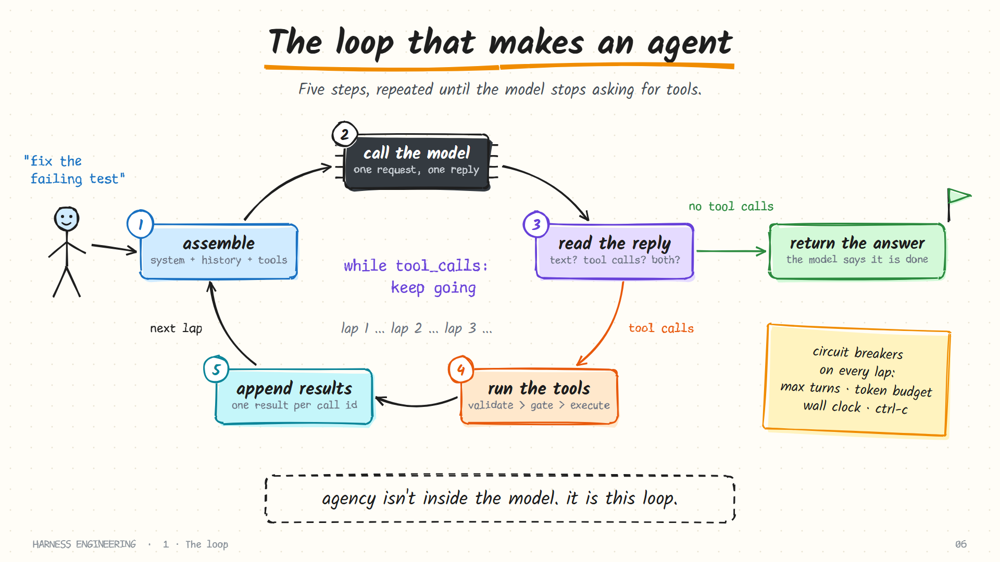

# Harness Engineering

**How a language model becomes an agent, built up from first principles.**

A model can only read text and write text. Everything that makes Claude Code, Codex, Pi or Hermes feel like a colleague who edits files, runs tests and recovers from mistakes lives in the code *around* the model. That code is the **harness**, and designing it well is its own engineering discipline.

This guide takes the harness apart one layer at a time, with 75 hand-drawn diagrams, short runnable code, worked numbers and teardowns of real open-source harnesses.


**Read it as a site:** [akbarsheikh-debug.github.io/harness-engineering](https://akbarsheikh-debug.github.io/harness-engineering/)

## The whole idea in one picture

A model cannot act. It can only ask. The harness is the loop that carries out what it asks for and tells it what happened.



## Start here

Each chapter answers one question. Read them in order the first time; each one builds on the last.

| # | Chapter | The question it answers | You leave able to |
|---|---------|-------------------------|-------------------|
| 0 | [What a harness is](guide/00-what-is-a-harness.md) | What does a model need around it before it can do anything? | Separate model problems from harness problems |
| 1 | [The loop](guide/01-the-loop.md) | How does a decision become an action, and a result the next decision? | Write the agent loop from memory |
| 2 | [Tools](guide/02-tools.md) | What can the agent touch? | Design a tool the model uses correctly on the first try |
| 3 | [Guardrails](guide/03-guardrails.md) | What must it never touch? | Build a permission gate and choose a sandbox |
| 4 | [Context](guide/04-context.md) | How does a long task fit in a finite window? | Budget a context window and compact a transcript |
| 5 | [Memory and skills](guide/05-memory-and-skills.md) | What should outlive a single session? | Lay out instruction files and on-demand skills |
| 6 | [Durability](guide/06-durability.md) | What survives a crash? | Make a session resumable with an append-only log |
| 7 | [Delegation](guide/07-delegation.md) | When should one agent hand work to another? | Write a brief a sub-agent can act on |
| 8 | [Orchestration](guide/08-orchestration.md) | How does work scale past one agent? | Run a fleet headlessly with budgets and checks |
| 9 | [Evaluation](guide/09-evaluation.md) | How do you know the harness is any good? | Build a task set and read a trace |

## Harnesses in the wild

The same nine questions, answered by five real projects, plus the model-access layer that sits beneath them.

| Harness | Its bet in one line |
|---------|---------------------|
| [Claude Code](harnesses/claude-code.md) | Ship a complete runtime: layered memory, permissions, hooks, skills, sub-agents |
| [Codex](harnesses/codex.md) | Keep the core lean; put the knowledge in the repository and the safety in the sandbox |
| [Pi](harnesses/pi.md) | A minimal core that you (or the agent itself) extend |
| [Hermes Agent](harnesses/hermes.md) | An always-on agent with a learning loop that writes its own skills |
| [DeepSeek Harness](harnesses/deepseek-harness.md) | Everything is a plugin, including the loop |
| [OpenRouter](harnesses/openrouter.md) | Not a harness: the routing layer that lets one harness reach many models |

Start with [how to compare them](harnesses/README.md). Hermes Agent and DeepSeek Harness each have a five-page deep dive that goes through the project's own documentation subsystem by subsystem.

## Working with agents

Building a harness is half the craft. The other half is preparing the work so a harness can succeed.

- [Why capable agents still fail](practice/failure-modes.md): eight failure patterns and the harness fix for each
- [The repo as system of record](practice/repo-as-system-of-record.md): instruction files that are a map, not a manual
- [Long-running work](practice/long-running-work.md): initialization, progress files, handoffs and clean state
- [Loops and graphs](practice/loops-and-graphs.md): from one supervised agent to automated maker and checker loops
- [Harness checklist](practice/checklist.md): one page to review any harness, including your own

## Run the code

[`examples/mini_harness.py`](examples/README.md) is a complete harness in one Python file with no dependencies: loop, six tools, a permission gate, compaction, and a resumable session log. It speaks the OpenAI-compatible chat API, so it works with OpenRouter, DeepSeek, OpenAI, or a local model.

```bash
python examples/mini_harness.py --mock "list the files here"
```

`--mock` uses a scripted stand-in for the model, so you can watch the loop turn without an API key.

## Repository layout

```text
guide/         the ten chapters
harnesses/     teardowns of real harnesses
practice/      working methods for agent-driven projects
examples/      a runnable single-file harness
templates/     starter AGENTS.md, progress file and feature list
assets/        75 hand-drawn diagrams (PNG, 1920x1080, slide-ready)
tools/         the diagram sources (tools/sketch/) and the renderer (tools/render.py)
```

## The diagrams

Every diagram is drawn in code with [rough.js](https://roughjs.com) and rendered to a 1920×1080 PNG, so they drop straight into slides. Browse them all in the [diagram gallery](assets/diagrams/README.md). To change one, edit its function in `tools/sketch/` and run:

```bash
python tools/render.py agent-loop
```

## How this guide was written

The explanations, diagrams and code here are original. The ideas are not mine alone: this field was shaped in public by the teams behind the harnesses above and by several excellent courses and essays. Every source that informed a chapter is listed, with links, in [Sources and credits](RESOURCES.md). If you find an error, please open an issue.

## License

[MIT](LICENSE). Use it, teach from it, adapt it.
