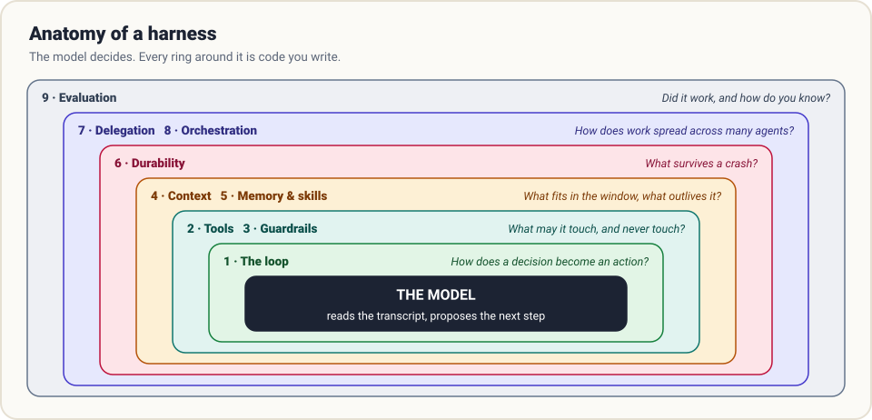
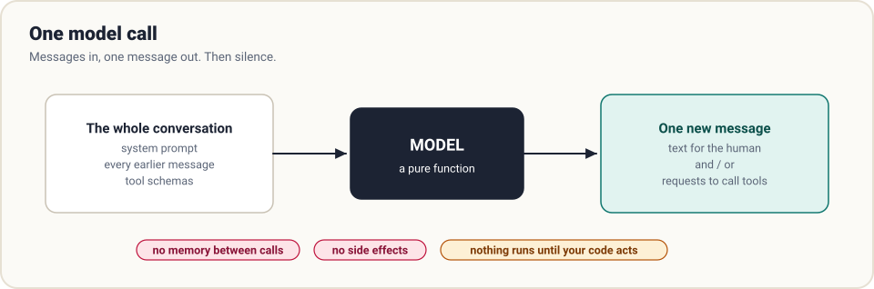
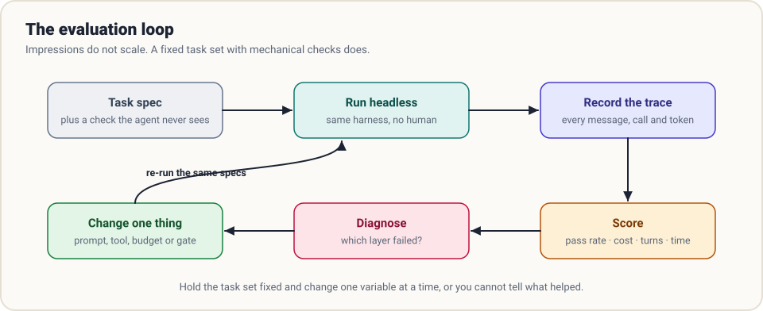

# Diagram gallery

Every diagram in the guide, in one place. They are plain SVG, generated by [`tools/build_diagrams.py`](https://github.com/AkbarSheikh-debug/harness-engineering/blob/main/tools/build_diagrams.py) with no dependencies, so you can change one and regenerate it:

```bash
python tools/build_diagrams.py
```

Use them freely in slides and notes (MIT).

## Foundations





## The loop


## Tools and guardrails


## Context and memory


## Durability


## Many agents


## Evaluation and the landscape




