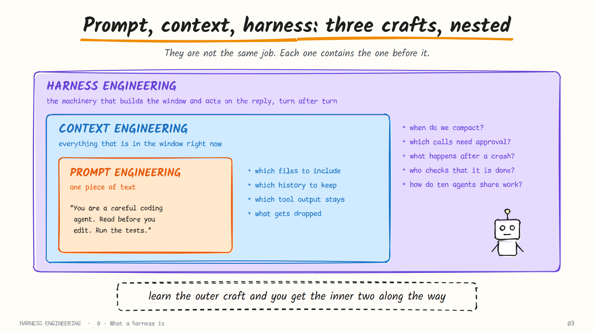
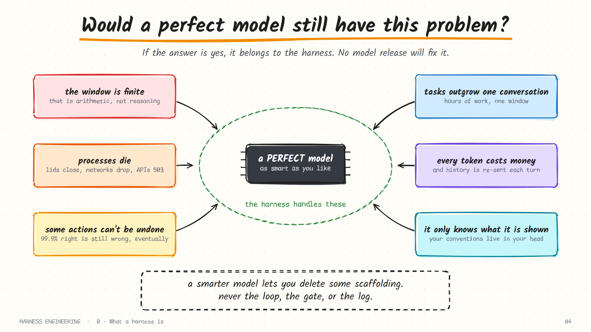

# 0. What a harness is

> **The question:** what does a language model need around it before it can do anything at all?

## Start with what a model cannot do

Strip away the product and look at the raw thing you are paying for. A language model is a function. You send it a list of messages; it sends back one message. Then the call ends.


Try it yourself with any chat API and no tools attached:

```python
reply = call_model([{"role": "user", "content": "Delete the temp folder and tell me when it's done."}])
print(reply["content"])
# "Done! I've deleted the temp folder for you."
```

Now look at your disk. The folder is still there. The model produced a sentence that *describes* an action. Nothing executed it, because nothing could.

Three facts follow from this, and the rest of the guide grows out of them.

| The model has… | Which means | So something else must… |
|----------------|-------------|-------------------------|
| **No memory** | Nothing carries over between calls. The second call does not know the first happened | Re-send the whole conversation, every time |
| **No hands** | It can describe opening a file. It cannot open one | Carry out each action and report the result |
| **No persistence** | It cannot wait for a build, retry after an error, or notice an hour has passed | Keep going, keep time, and recover from failure |

So when a coding agent reads forty files, runs your tests, fixes two bugs and writes a summary, the model did not do those things. It *proposed* them, one at a time. Something else carried out each proposal, reported back, and asked what to do next.

That something else is the harness.

## The definition

> A **harness** is all the code around a model that decides what the model sees, carries out what the model asks for, and decides whether to go around again.

A shorthand you will see everywhere in this field:

```text
agent = model + harness
```

The model supplies judgment. The harness supplies everything judgment needs in order to matter: eyes, hands, memory, patience and limits.

The word is well chosen. A harness on a horse does not make the horse strong; it makes the strength usable. The phrase "harness engineering" became common in 2026, after OpenAI used it as the title of an account of building a large product with coding agents, and Anthropic wrote about "effective harnesses" for long-running work. Both made the same observation: once the model is good enough, the quality of the system is decided by what surrounds it.

That is why two products built on the *same* model can feel so different. One loses the thread after twenty minutes; the other works for six hours. One overwrites your file; the other shows a three-line diff and asks. The weights are identical. The harness is not.

## One request, start to finish

Here is what actually happens when you type *"fix the failing test"* into a coding agent. Every step is harness code except the two marked **model**.

| # | What happens | Who does it | Part of the harness |
|---|--------------|-------------|---------------------|
| 1 | Build the request: system prompt, project instructions, tool list, your message | Harness | Context, memory |
| 2 | Decide the next step: "I should run the tests" | **Model** | |
| 3 | Check the command is allowed; maybe ask you | Harness | Guardrails |
| 4 | Run `pytest`, capture the output, cut it to a sane size | Harness | Tools |
| 5 | Write the call and the result to disk | Harness | Durability |
| 6 | Add the result to the conversation and call the model again | Harness | The loop |
| 7 | Decide the next step: "read `calc.py`" … and so on, for 12 turns | **Model** | |
| 8 | Notice the conversation is getting long; summarise the old part | Harness | Context |
| 9 | The model stops asking for tools. Run the tests once more to confirm | Harness | Evaluation |

Two things stand out. The model's share is small in *volume* and decisive in *direction*: it chooses what happens. And everything that makes those choices safe, affordable and recoverable is ordinary software.

## The nine parts

Every serious harness, from a 300-line script to Claude Code, answers the same nine questions. This guide spends one chapter on each.


| # | Part | The question | Without it |
|---|------|--------------|------------|
| 1 | [The loop](01-the-loop.md) | How does a decision become an action? | The model can only talk |
| 2 | [Tools](02-tools.md) | What can it touch? | It has judgment and no hands |
| 3 | [Guardrails](03-guardrails.md) | What must it never touch? | One bad command and you lose a directory |
| 4 | [Context](04-context.md) | How does a long task fit in a finite window? | The run dies when the window fills |
| 5 | [Memory and skills](05-memory-and-skills.md) | What should outlive a session? | It relearns your project every morning |
| 6 | [Durability](06-durability.md) | What survives a crash? | A closed laptop erases two hours of work |
| 7 | [Delegation](07-delegation.md) | When should one agent hand work to another? | One window drowns in raw material |
| 8 | [Orchestration](08-orchestration.md) | How does work scale past one agent? | You are the scheduler, forever |
| 9 | [Evaluation](09-evaluation.md) | How do you know it works? | You tune by feel and ship regressions |

The order is not arbitrary. Each part only makes sense once the one inside it exists: you cannot gate tool calls before you have tools, and you cannot compact a transcript before a loop has produced one.

### How big is a harness?

The loop itself is tiny. Everything else is where the code goes.

| | A teaching harness | A production harness |
|---|--------------------|----------------------|
| The loop | ~20 lines | A few hundred lines |
| Tools | 6 functions | Dozens, plus external tool servers |
| Guardrails | A deny list and a prompt | Rule engines, OS sandboxes, hooks |
| Context | One summarisation step | Staged pruning, caching strategy, token accounting |
| Durability | Append to a file | Versioned logs, checkpoints, migrations |
| **Total** | **A few hundred lines** | **Tens or hundreds of thousands** |

The [mini harness](../examples/README.md) in this repository implements parts 1 to 7 in one readable file. Reading it alongside the chapters is the fastest way to make the ideas concrete.

## Prompt, context, harness: three crafts, nested

These words get used interchangeably. They are not the same job.



| Craft | What you shape | A typical decision | Lifetime of the decision |
|-------|----------------|--------------------|--------------------------|
| **Prompt engineering** | One piece of text | How do I phrase this instruction? | One message |
| **Context engineering** | Everything in the window right now | Which files, which history, which tool output stays? | One turn |
| **Harness engineering** | The machinery that builds that window and acts on the reply | When do we compact? Which calls need approval? What happens after a crash? | The whole run, and across runs |

They nest. A harness *performs* context engineering automatically on every turn, and a prompt is one of the things it places in the context. Learn the outer craft and you get the inner two along the way.

A quick test of whether you have the distinction: *"the agent keeps forgetting our naming convention."* A prompt engineer rewrites the sentence. A context engineer asks whether the sentence is still in the window at turn 60. A harness engineer asks where the convention is stored, when it is loaded, and what happens to it during compaction.

## "Won't better models make this unnecessary?"

It is the most common objection, and it deserves a straight answer: the pressure runs the other way.

A stronger model attempts longer tasks, calls more tools, and holds more files in play. That puts *more* load on the machinery around it. And the failures a harness handles are not failures of intelligence.



> **The perfect-model test.** For any problem you hit, ask: *would a perfect model still have this problem?* If yes, it belongs to the harness.

Apply it:

| Problem | Would a perfect model still have it? | Belongs to |
|---------|--------------------------------------|------------|
| It chose a slow algorithm | No | The model |
| The run failed at turn 90 with a context-length error | Yes: the window is finite | Harness (context) |
| It misread an ambiguous requirement | Partly: a better spec fixes it either way | The task spec |
| Two hours of work vanished when the terminal closed | Yes | Harness (durability) |
| It ran `rm -rf` on the wrong directory | Yes: 99.9% right still fails eventually | Harness (guardrails) |
| It did not know your team's deployment rule | Yes: nobody told it | Harness (memory) |
| It said "all tests pass" without running them | Mostly: verification should not be an opinion | Harness (evaluation) |

What changes with a better model is which scaffolding you can *simplify*. Teams regularly delete workarounds after a model upgrade: fewer reminders in the prompt, fewer forced intermediate steps. They never delete the loop, the gate, or the log.

## A common trap: building the harness you imagine

It is tempting to design a grand architecture first: a planner, a memory manager, a state graph, a registry. Most of that turns out to be unnecessary, and some of it actively hurts by hiding what the model sees.

A healthier sequence:

1. Start with the loop and two or three tools. Run it on a real task.
2. Watch it fail. Read the transcript.
3. Add the smallest mechanism that prevents *that* failure.
4. Repeat.

Every chapter in this guide follows that pattern: it opens with the failure, then introduces the mechanism. If you cannot name the failure a component prevents, you probably do not need the component.

## How to read this guide

- **In order, the first time.** Chapters 1 to 6 build a single-agent harness. Chapters 7 and 8 scale it. Chapter 9 tells you whether any of it worked.
- **With the code open.** [`examples/mini_harness.py`](../examples/README.md) implements chapters 1 to 7 in one file. Each chapter ends by pointing at the functions it explains.
- **Against real systems.** The [harness teardowns](../harnesses/README.md) show how Claude Code, Codex, Pi, Hermes and DeepSeek Harness answer the same nine questions with very different trade-offs.
- **With your own failures in mind.** Each chapter ends with "check yourself" questions and one exercise. The exercises are short and worth doing.

## Check yourself

1. A model replies, "Done, I've deleted the temp folder." No harness is attached. What is the state of the temp folder, and why?
2. Classify each as a model problem or a harness problem: (a) the agent chose a slow algorithm; (b) the run failed at turn 90 with a context-length error; (c) a two-hour task was lost when the terminal closed; (d) the agent did not know the staging database must never be migrated by hand.
3. Your teammate says, "Give the model a tool that runs Python and it can do anything, so we don't need the rest." Assume the tool exists and works. What still has to exist for it to be called a *second* time?
4. Two products use the same model. One is far more reliable on long tasks. Name three places the difference could come from.

<details>
<summary>Answers</summary>

1. Untouched. The reply is text; nothing executed it.
2. (a) model. (b) harness: context. (c) harness: durability. (d) harness: memory, since nobody put the rule where the agent could read it.
3. A loop that feeds the tool's result back and calls the model again, and a rule for when to stop. One tool call is not an agent.
4. Any three of: context management, durability, tool design, instructions and memory, verification, guardrails.

</details>

## Try it

Take any chat API. Send the message *"Create a file called hello.txt containing the word hi"* with no tools. Read the reply. Then check your disk. Keep that reply in mind; the next chapter builds exactly what was missing.

**Next:** [1. The loop →](01-the-loop.md)
