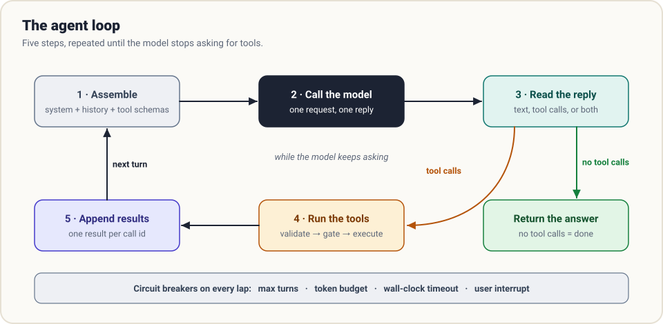
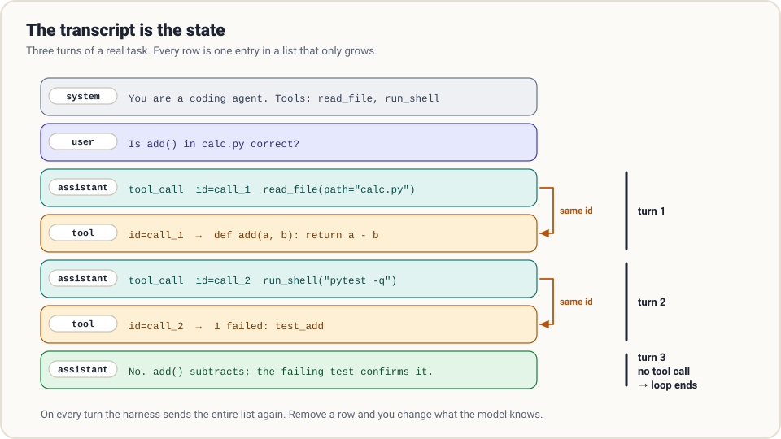
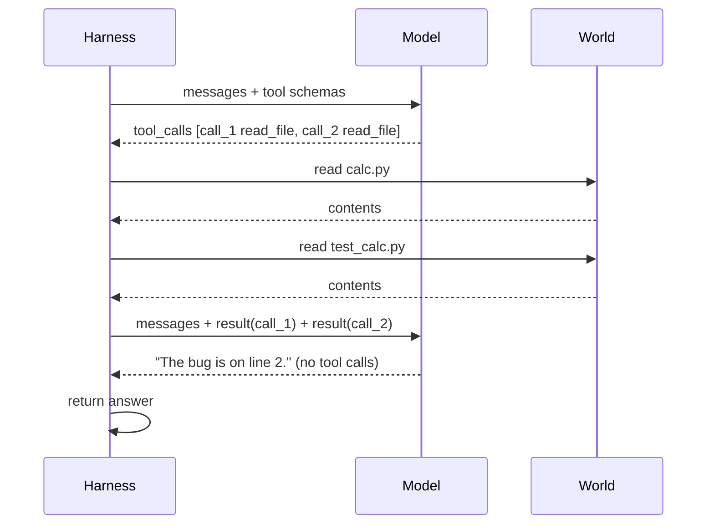

# 1. The loop

> **The question:** how does a decision become an action, and a result the next decision?

## The idea in one minute

A model cannot act, but it can **ask**. Give it a menu of actions (tools) and its reply is one of two kinds: an answer for the human, or a request to run something. If it is a request, your code runs it, shows the model what happened, and calls the model again. Repeat until the reply is an answer.

That repetition is the whole of "agency". It is a `while` loop.



## Deriving it

You do not need to memorise this loop. You can be pushed into it one step at a time.

1. The user asks for something. You call the model.
2. The model replies, "I need to see `calc.py`", as a structured tool call. You cannot return that to the user. It is not an answer.
3. The model cannot read the file. You can. So you read it.
4. Now you hold a fact the model has never seen. The only way to show it is to add it to the conversation and call the model again.
5. You are back at step 1, with a longer conversation.

The exit falls out for free: when a reply contains no tool call, the model is telling you it has nothing left to ask for. That reply is the answer.

## The loop in code

This is the complete control flow of a coding agent. The message shapes follow the OpenAI-compatible chat format, which most providers and routers accept.

```python
def run(task, tools, max_turns=50):
    messages = [
        {"role": "system", "content": SYSTEM_PROMPT},
        {"role": "user", "content": task},
    ]
    for _ in range(max_turns):
        reply = call_model(messages, tools)          # 1-2. assemble + call
        messages.append(reply)                       #      remember what it said

        if not reply.get("tool_calls"):              # 3. no requests?
            return reply["content"]                  #    then this is the answer

        for call in reply["tool_calls"]:             # 4. we run each request
            result = execute(call, tools)
            messages.append({                        # 5. and report back
                "role": "tool",
                "tool_call_id": call["id"],
                "content": result,
            })
    return wrap_up(messages)                         # out of turns: still report
```

Count the lines that matter: about ten. Tools, permissions, compaction, sessions and sub-agents all attach to this skeleton without changing its shape.

## The transcript is the state

Look at what the loop actually maintains: one list, `messages`. There is no plan object, no hidden scratchpad, no "agent memory" somewhere else. If you want to know everything the agent knows at turn 40, print the list.



Four kinds of entry appear in it:

| Role | Who wrote it | Contains |
|------|--------------|----------|
| `system` | You, once | Standing instructions: identity, rules, environment |
| `user` | The human | The task, and later corrections |
| `assistant` | The model | Text, and zero or more tool calls |
| `tool` | Your code | The result of exactly one tool call |

> Some APIs fold tool results into `user` messages instead of a separate `tool` role. The idea is identical: from the model's side, anything that is not its own voice is input from the outside world.

Because the list is the state, three operations have precise meanings:

- **Append** is how the agent remembers.
- **Delete** is how it forgets.
- **Rewrite** changes what it believes about its own past.

Every feature in later chapters is one of these three moves, done carefully. Compaction is a rewrite. A session log is an append to disk. A sub-agent is a second list.

## The one rule that breaks beginners: answer every call

Each tool call carries an `id`. Each result must quote the same `id`. The API enforces two things:

1. **Every tool call gets exactly one result** before the next model call.
2. **One reply may contain several calls.** Models often ask for three file reads at once. You owe three results.

Miss a result and the next request is rejected as malformed. This is the source of the nastiest bugs in real harnesses: a crash lands after the assistant message was saved and before the tool result was. [Chapter 6](06-durability.md) deals with exactly that gap.



## Who decides when it is done?

There are two ways to get multi-step work out of a model.

| | Workflow | Agent |
|---|----------|-------|
| Who writes the steps | You, in code | The model, one step at a time |
| Number of steps | Fixed in advance | Unknown until it finishes |
| Who decides it is finished | Your code | The model |
| Good for | Predictable pipelines | Open-ended tasks |

In a workflow you call the model three times because you wrote three calls. In an agent you wrote a loop and handed the exit condition to the model. That is the trade: you gain the ability to handle tasks you could not script, and you lose the guarantee that it ever stops.

## So never trust the model's stop signal alone

A model can loop politely forever, re-reading the same file. Real harnesses put circuit breakers on every lap:

- **Max turns.** A hard counter. Costs nothing unless it fires.
- **Token or cost budget.** Stop when the run has spent what you allowed.
- **Wall-clock timeout.** For unattended runs.
- **User interrupt.** Ctrl-C should stop the run cleanly, not corrupt it.

And when a breaker fires, **do not just stop**. Make one last model call with no tools and ask for a status: what was done, what is left, what it would do next. The human should read a report, never a stack trace.

```python
def wrap_up(messages):
    messages.append({"role": "user", "content":
        "You are out of turns. Do not call tools. Summarise what is done, "
        "what remains, and the next step you would take."})
    return call_model(messages, tools=None)["content"]
```

A run can end three ways: **finished**, **out of budget**, or **broken**. A good harness produces a readable ending for all three.

## Errors are messages, not exceptions

What should happen when a tool throws? Not a crash. Catch it, turn it into text, and hand it back as the tool result:

```python
def execute(call, tools):
    tool = tools.get(call["function"]["name"])
    if tool is None:
        return f"ERROR: unknown tool {call['function']['name']}"
    try:
        return str(tool.run(**json.loads(call["function"]["arguments"])))
    except Exception as e:
        return f"ERROR: {type(e).__name__}: {e}"
```

The model reads `ERROR: FileNotFoundError: src/calc.py` and tries `ls`. This single habit, *turn failure into a message and let the loop absorb it*, shows up again in permissions, in crash recovery and in context overflow. It is the closest thing this field has to a universal principle.

## What it costs

The whole list is re-sent on every turn. Turn 40 pays again for turns 1 to 39. A long session therefore gets expensive faster than linearly, and agents typically read far more tokens than they write. Hold that thought until [chapter 4](04-context.md); it is the reason context management exists.

## Common mistakes

- **Stopping on text.** Some models narrate ("I'll run the tests now") without attaching a tool call. A loop that treats any text-only reply as final ends early. Mitigations: tell the model in the system prompt to act rather than announce, and consider one nudge ("Continue, or say DONE") before accepting a suspiciously short ending.
- **Dropping fields the provider needs back.** Some APIs attach opaque data to an assistant message (reasoning signatures, for example) and reject the next call if it is missing. Store the assistant message as you received it.
- **Swallowing errors.** An empty tool result teaches the model nothing. Say what failed.
- **No turn cap "because it's a demo".** Demos are where runaway loops get discovered.

## In the reference code

[`examples/mini_harness.py`](../examples/README.md): the function `run_loop` is this chapter. Run it with `--mock --trace` to watch the list grow turn by turn.

## Check yourself

1. An assistant message contains three tool calls. How many messages must you append before calling the model again, and what happens if you append two?
2. `max_turns` is 50 and a task finishes on turn 6. What did the cap cost?
3. Your loop ends when a reply has no tool calls. Describe a reply that ends the run too early.
4. A tool raises `PermissionError`. What should the model see on its next turn?

<details>
<summary>Answers</summary>

1. Three `tool` messages, one per id. With two, the next request is rejected because one call is unanswered.
2. Nothing. The cap only matters when it is reached.
3. A text-only reply that announces an action ("Now I'll run the tests") without a tool call attached.
4. A normal tool result containing the error text, so it can adjust.

</details>

## Try it

Write the loop above against any chat API with a single toy tool (a dice roller is enough). Print `messages` after every turn. Then delete the line that appends the tool result, run it again, and read the error the API gives you. You will recognise that error for the rest of your career.

**Next:** [2. Tools →](02-tools.md)
