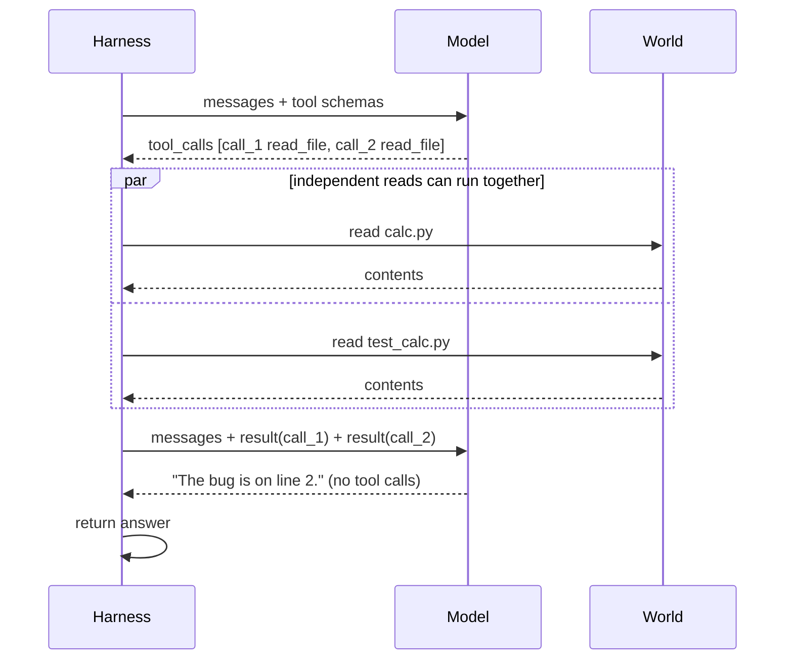

# 1. The loop

> **The question:** how does a decision become an action, and a result the next decision?

## The crack: a model cannot act, but it can ask

Ask a bare model to fix a failing test and it can only talk about it. But change one thing: tell it there is a function called `read_file` it may *request*. Now its reply can be one of two kinds.


On the wire, using the OpenAI-compatible format that most providers and routers accept, the two kinds look like this:

```json
{ "role": "assistant", "content": "The test fails because the token has expired." }
```

```json
{ "role": "assistant", "content": "Let me look at the test first.",
  "tool_calls": [ { "id": "call_1", "type": "function",
      "function": { "name": "read_file", "arguments": "{\"path\": \"test_auth.py\"}" } } ] }
```

The second one is the crack the whole field is pried open through. The model still cannot read the file. It has *asked* for the file to be read. And if it can ask, your code can answer.

> Note that `arguments` is a JSON **string**, not an object. You must parse it, and it may be malformed. That detail matters later.

## Deriving the loop

You do not need to memorise the agent loop. You can be pushed into it one step at a time.

1. The user asks for something. You call the model.
2. The model replies with a tool call. You cannot return that to the user; it is not an answer.
3. The model cannot read the file. You can. So you read it.
4. Now you hold a fact the model has never seen. The only way to show it is to add it to the conversation and call the model again.
5. You are back at step 1, with a longer conversation.

The exit falls out for free: when a reply contains no tool call, the model is telling you it has nothing left to ask for. That reply is the answer.


## The loop in code

This is the complete control flow of a coding agent.

```python
def run(task, tools, max_turns=50):
    messages = [
        {"role": "system", "content": SYSTEM_PROMPT},
        {"role": "user", "content": task},
    ]
    for _ in range(max_turns):
        reply = call_model(messages, tools)          # 1-2. assemble + call
        messages.append(reply)                       #      remember what it said

        if not reply.get("tool_calls"):              # 3. no requests?
            return reply["content"]                  #    then this is the answer

        for call in reply["tool_calls"]:             # 4. we run each request
            result = execute(call, tools)
            messages.append({                        # 5. and report back
                "role": "tool",
                "tool_call_id": call["id"],
                "content": result,
            })
    return wrap_up(messages)                         # out of turns: still report
```

Count the lines that matter: about ten. Tools, permissions, compaction, sessions and sub-agents all attach to this skeleton without changing its shape. When someone says a product is "an agent", this loop is what they mean, whatever else is built around it.

### The vocabulary of one lap

| Term | Meaning |
|------|---------|
| **Turn** | One model call plus the tool round-trip it triggers. (Some systems call this a *step* and use *turn* for everything between two user messages.) |
| **Tool call** | The model's structured request: an id, a tool name, arguments |
| **Tool result** | Your reply to exactly one tool call, quoting its id |
| **Stop reason** | The API's signal for why generation ended: finished, wants tools, or hit the output limit |
| **Run** | Everything from the user's message to the final answer |

A simple question is one turn. "Fix the failing test" is often six to fifteen. A refactor across a codebase can be hundreds.

## The transcript is the state

Look at what the loop maintains: one list, `messages`. There is no plan object, no hidden scratchpad, no "agent memory" somewhere else. If you want to know everything the agent knows at turn 40, print the list.


Four kinds of entry appear in it:

| Role | Who wrote it | Contains |
|------|--------------|----------|
| `system` | You, once | Standing instructions: identity, rules, environment |
| `user` | The human | The task, and later corrections |
| `assistant` | The model | Text, and zero or more tool calls |
| `tool` | Your code | The result of exactly one tool call |

Because the list is the state, three operations have precise meanings:

- **Append** is how the agent remembers.
- **Delete** is how it forgets.
- **Rewrite** changes what it believes about its own past.

Every feature in later chapters is one of these three moves, done carefully. Compaction is a rewrite. A session log is an append to disk. A sub-agent is a second list.

### Same idea, three dialects

Vendors spell the transcript differently. The structure is identical; only the envelope changes. This is the reason for a provider layer that translates at one door ([OpenRouter page](../harnesses/openrouter.md)).

| | OpenAI-compatible | Anthropic Messages | Google Gemini |
|---|-------------------|--------------------|---------------|
| Model's request | `tool_calls[]` on the assistant message | A `tool_use` content block | A `functionCall` part |
| Your reply | A message with role `tool` | A `tool_result` block inside a `user` message | A `functionResponse` part in a `user` turn |
| Pairing | `tool_call_id` | `tool_use_id` | By function name and order |
| "Wants tools" signal | `finish_reason: "tool_calls"` | `stop_reason: "tool_use"` | Presence of a function call |

Notice the Anthropic and Gemini columns: tool results travel as *user* content. From the model's side, anything that is not its own voice is input from the outside world, whether a person typed it or a program produced it. Hold on to that; it is the root of prompt injection in [chapter 3](03-guardrails.md).

## The one rule that breaks beginners: answer every call

Each tool call carries an `id`. Each result must quote the same `id`. The API enforces two things:

1. **Every tool call gets exactly one result** before the next model call.
2. **One reply may contain several calls.** Models often ask for three file reads at once. You owe three results.

Miss a result and the next request is rejected as malformed, with an error along the lines of *"tool call ids did not have response messages"*. This is the source of the nastiest bugs in real harnesses: a crash lands after the assistant message was saved and before the tool result was. [Chapter 6](06-durability.md) deals with exactly that gap.



**Parallel calls.** When a reply contains several calls, you may run them concurrently if they are independent, which is true of reads and searches. Writes and shell commands should run in the order the model listed them, one at a time. The results can be appended in any order, since the ids do the pairing, but listing them in call order keeps transcripts readable.

**Malformed arguments.** If `arguments` is not valid JSON, or names a parameter that does not exist, do not crash and do not guess. The call still needs a result. Return one that says what was wrong.

## Errors are messages, not exceptions

What should happen when a tool throws? Not a crash. Catch it, turn it into text, and hand it back as the tool result:

```python
def execute(call, tools):
    name = call["function"]["name"]
    tool = tools.get(name)
    if tool is None:
        return f"ERROR: unknown tool {name!r}. Available: {', '.join(tools)}"
    try:
        args = json.loads(call["function"]["arguments"] or "{}")
    except json.JSONDecodeError as e:
        return f"ERROR: arguments were not valid JSON ({e}). Send a JSON object."
    try:
        return str(tool.run(**args))
    except Exception as e:
        return f"ERROR: {type(e).__name__}: {e}"
```

The model reads `ERROR: FileNotFoundError: src/calc.py is not a file here` and tries `list_dir`. This single habit, *turn failure into a message and let the loop absorb it*, shows up again in permissions, in crash recovery and in context overflow. It is the closest thing this field has to a universal principle.

## Who decides when it is done?

There are two ways to get multi-step work out of a model.


| | Workflow | Agent |
|---|----------|-------|
| Who writes the steps | You, in code | The model, one step at a time |
| Number of steps | Fixed in advance | Unknown until it finishes |
| Who decides it is finished | Your code | The model |
| Predictability and cost | High and bounded | Lower, and open-ended |
| Good for | Pipelines you can describe in advance | Tasks whose shape you cannot predict |

In a workflow you call the model three times because you wrote three calls. In an agent you wrote a loop and handed the exit condition to the model. That is the trade: you gain the ability to handle tasks you could not script, and you lose the guarantee that it ever stops.

Use a workflow when you can. Many problems that are dressed up as agents are three fixed steps, and are cheaper and more reliable that way. Reach for the loop when the path depends on what is discovered along the way.

## So never trust the model's stop signal alone

A model can loop politely forever, re-reading the same file. Real harnesses put circuit breakers on every lap.

| Breaker | Catches | A reasonable default |
|---------|---------|----------------------|
| **Max turns** | Any runaway loop | 30 to 100 for interactive use |
| **Token or cost budget** | Expensive wandering | Set per task type |
| **Wall-clock timeout** | Hung tools, slow drift | Minutes for interactive, hours for batch |
| **Repetition detector** | The same call with the same arguments, three times running | Inject a nudge, then stop |
| **User interrupt** | A human who has seen enough | Always available |

And when a breaker fires, **do not just stop**.


Make one last model call with no tools and ask for a status:

```python
def wrap_up(messages):
    messages.append({"role": "user", "content":
        "You are out of turns. Do not call tools. Summarise what is done, "
        "what remains, and the next step you would take."})
    return call_model(messages, tools=None)["content"]
```

The human should read a report, never a stack trace. A run can end three ways: **finished**, **out of budget**, or **broken**. A good harness produces a readable ending for all three, and tells a calling script which one it was through an exit code.

### Interrupts need care

Stopping in the middle is harder than it looks, because of the answer-every-call rule. If the user presses Ctrl-C while a reply with three tool calls is being executed, the transcript has an assistant message with three calls and perhaps one result. Before you can continue the conversation, the other two must be answered:

```python
for call in pending_calls:
    messages.append({"role": "tool", "tool_call_id": call["id"],
                     "content": "CANCELLED: the user interrupted before this ran."})
```

Mature harnesses also distinguish two kinds of mid-run input: a **steering** message, delivered as soon as the current turn finishes, and a **follow-up**, held until the agent has nothing left to do.

## The stop rule can also fire too early

The loop ends when a reply has no tool call. Some models *narrate*:

```json
{ "role": "assistant", "content": "I'll run the tests now to confirm the fix." }
```

No tool call is attached, so the loop treats this as the final answer. The user sees an announcement of work that never happened.

Mitigations, in order of preference:

1. **Say it in the system prompt:** *"Act through tools. Do not describe an action instead of taking it."*
2. **A cheap check:** if the final text looks like a statement of intent ("I'll…", "Let me…", "Next I will…") and the task is not complete, send one nudge: *"Continue. If you are finished, say what you did."*
3. **An explicit completion tool.** Some harnesses require the model to call a `done` tool, so finishing is a deliberate act and not an absence.

## What it costs

The whole list is re-sent on every turn. Turn 40 pays again for turns 1 to 39.


A worked example makes the shape concrete. Suppose the system prompt and tool schemas are 3,000 tokens, and each turn adds 2,000 tokens of new material (mostly tool output).

| Turns | Tokens in the last request | Total input tokens paid | Output tokens (≈300 per turn) |
|-------|----------------------------|-------------------------|-------------------------------|
| 5 | 13,000 | 45,000 | 1,500 |
| 20 | 43,000 | 480,000 | 6,000 |
| 40 | 83,000 | 1,760,000 | 12,000 |
| 80 | 163,000 | 6,720,000 | 24,000 |

Doubling the length of the run roughly quadruples the input bill. And notice the ratio in the last row: about 280 input tokens for every output token. Agents read vastly more than they write. Provider-side prompt caching softens the price of re-reading, but it does not remove the problem, and it does nothing about the window limit. That is the reason [chapter 4](04-context.md) exists.

## Common mistakes

- **Dropping fields the provider needs back.** Some APIs attach opaque data to an assistant message (reasoning signatures, encrypted thinking blocks) and reject the next call if it is missing. Store the assistant message exactly as you received it.
- **Swallowing errors.** An empty tool result teaches the model nothing. Say what failed.
- **No turn cap "because it's a demo".** Demos are where runaway loops get discovered.
- **Parsing tool calls out of prose.** If your model supports native tool calling, use it. Regex over free text is how agents silently skip actions.
- **Mutating `messages` while iterating.** Build the results, then append. Out-of-order transcripts produce confusing API errors.
- **Treating `finish_reason: "length"` as done.** The model was cut off mid-thought. Either raise the output limit and retry, or tell the model its reply was truncated.

## How real harnesses do it

- **Claude Code** runs a single-threaded loop with streaming and interruption, and exposes the same loop as an SDK.
- **Pi** documents it in three sentences: record the response, execute each tool call, record the results; if results or queued messages require another request, start another turn; otherwise the run ends. It also defines *steering* and *follow-up* messages precisely.
- **Hermes** keeps its loop in one module and each turn phase (preparation, API call, error, overflow, truncation, recovery) in its own, and tracks an iteration budget shared between parent and child agents.
- **DeepSeek Harness** gives every stage of the loop a named event, so features attach as listeners instead of edits.

## In the reference code

[`examples/mini_harness.py`](../examples/README.md): the function `run_loop` is this chapter, and `execute` is the error handling. Run it with `--mock --trace` to watch the list grow turn by turn.

## Check yourself

1. An assistant message contains three tool calls. How many messages must you append before calling the model again, and what happens if you append two?
2. `max_turns` is 50 and a task finishes on turn 6. What did the cap cost?
3. Your loop ends when a reply has no tool calls. Describe a reply that ends the run too early, and two ways to guard against it.
4. A tool raises `PermissionError`. What should the model see on its next turn?
5. A run takes 40 turns. Roughly how does the input-token bill compare with a 20-turn run of the same kind?

<details>
<summary>Answers</summary>

1. Three `tool` messages, one per id. With two, the next request is rejected because one call is unanswered.
2. Nothing. The cap only matters when it is reached.
3. A text-only reply that announces an action without attaching a tool call. Guard with a system-prompt rule, a one-time nudge, or an explicit completion tool.
4. A normal tool result containing the error text, so it can adjust.
5. About four times as much, because each turn re-sends everything before it.

</details>

## Try it

Write the loop above against any chat API with a single toy tool (a dice roller is enough). Print `messages` after every turn. Then delete the line that appends the tool result, run it again, and read the error the API gives you. You will recognise that error for the rest of your career.

**Next:** [2. Tools →](02-tools.md)
