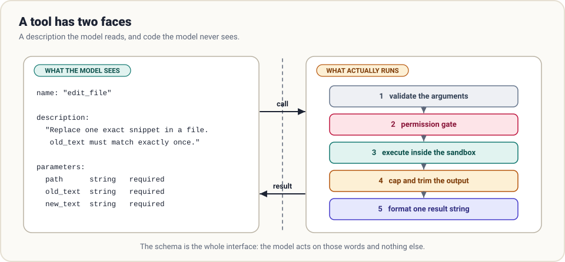

# 2. Tools

> **The question:** what can the agent touch?

## The idea in one minute

A tool is an ordinary function with a description attached. The model never sees the function. It sees the description, decides whether to call it, and fills in the arguments. Your code does the rest.

So a tool has two faces, and almost every tool problem comes from forgetting one of them.



## What the model actually receives

On every turn the harness sends the full list of tool schemas alongside the messages. One schema looks like this:

```json
{
  "type": "function",
  "function": {
    "name": "edit_file",
    "description": "Replace one exact snippet of text in a file. old_text must appear exactly once; include enough surrounding lines to make it unique. Fails without changing the file otherwise.",
    "parameters": {
      "type": "object",
      "properties": {
        "path":     {"type": "string", "description": "File path relative to the workspace root"},
        "old_text": {"type": "string", "description": "Exact text to find, including whitespace"},
        "new_text": {"type": "string", "description": "Text to put in its place"}
      },
      "required": ["path", "old_text", "new_text"]
    }
  }
}
```

That text is the entire interface. The model has not read your source code and never will. If the description is vague, the model guesses. If a parameter is called `data`, it will put whatever seems plausible in it.

> Write a tool description the way you would brief a capable new colleague who cannot ask follow-up questions: what it does, when to use it, what each field means, and what happens when it fails.

## A small set of sharp tools

A coding agent needs surprisingly few tools. Six cover almost everything:

| Tool | Verb | Why it earns a slot |
|------|------|---------------------|
| `read_file` | Look | Paged reading, so one huge file cannot flood the context |
| `list_dir` | Orient | Cheap way to see what exists |
| `search` | Find | Grep across the tree; returns locations, not whole files |
| `write_file` | Create | New files and full rewrites |
| `edit_file` | Change | A targeted replacement; sends only the diff |
| `run_shell` | Everything else | Tests, builds, git, package managers |

Why so few? Three reasons.

**Schemas are not free.** The whole tool list rides along on every single request. Forty tools can cost thousands of tokens per turn before the agent has done anything.

**Choice has a cost.** With `read_file`, `read_lines`, `read_head`, `cat_file` and `open_document` on the menu, the model spends effort choosing, and sometimes chooses badly. Overlapping tools are a design smell.

**The shell is a universal adapter.** Anything with a command line (git, pytest, curl, docker) is already a tool. You do not need a `git_commit` tool; you need `run_shell` and good guardrails.

Add a dedicated tool when the shell version is error-prone, when the output needs shaping before the model sees it, or when the action needs its own permission rule.

## Five design rules

### 1. Make inputs tight

A loose parameter makes the model invent a format and hope your code guesses the same one.

| Loose | Tight |
|-------|-------|
| `when: string` | `date: string`, described as `YYYY-MM-DD` |
| `mode: string` | `mode: enum ["read", "write", "append"]` |
| `options: object` | Named fields, each with a description |

Mark what is required. Use enums wherever the set of legal values is closed. Then **validate anyway**: schemas guide the model, they do not bind it.

### 2. Bound every output

A tool result is appended to the transcript and re-sent on every later turn. A tool that returns 40,000 lines of log taxes the rest of the run.

- Cap by lines and by bytes.
- When you truncate, **say so and say how to get more**: `[showing lines 1-200 of 4,812; call again with offset=200]`.
- Prefer returning *locations* over *contents*. A search tool should return `path:line: match`, not the files.

### 3. Write errors as instructions

The error message is the model's only clue about what to do next.

| Unhelpful | Helpful |
|-----------|---------|
| `Error` | `ERROR: src/app.py not found. Files in src/: main.py, api.py` |
| `Invalid input` | `ERROR: old_text matched 3 times. Add surrounding lines so it matches once.` |
| *(empty string)* | `Command exited 0 with no output.` |

Never return an empty result. Silence looks like a bug and invites a retry.

### 4. Prefer edits to rewrites

Asking a model to regenerate a 600-line file to change two lines is slow, expensive, and an invitation to drop a function by accident. The standard fix is an exact-match replace:

- The model supplies the old snippet and the new snippet.
- The tool applies it only if the old snippet appears **exactly once**.
- Zero matches or several matches is a loud failure, with no change made.

The uniqueness rule turns a silent wrong edit into an error the model can correct.

### 5. Make re-running safe where you can

Runs get interrupted and retried. A tool that is harmless to call twice (reading, searching, an edit that fails when the old text is gone) is much easier to recover than one that is not (sending an email, charging a card). For the second kind, see [guardrails](03-guardrails.md) and [durability](06-durability.md).

## The shell deserves its own section

`run_shell` is what makes six tools enough. It is also where nearly all the risk concentrates. Before any policy question, it needs two mechanical guards:

```python
def run_shell(command, timeout=120):
    try:
        p = subprocess.run(command, shell=True, cwd=WORKSPACE, capture_output=True,
                           text=True, timeout=timeout)
    except subprocess.TimeoutExpired:
        return f"ERROR: timed out after {timeout}s. If this is a server, run it in the background."
    out = (p.stdout + p.stderr).strip() or "(no output)"
    return f"exit code {p.returncode}\n{clip(out, max_chars=8000)}"
```

- **A timeout**, because `npm run dev` never returns and an agent waiting on it is a dead agent.
- **An output cap**, because one verbose build can fill the window. Keep the *tail* of long output; that is where the error usually is.

Always report the exit code. "It printed nothing" and "it failed silently" look identical without it.

## Extending the toolbox: MCP

Hard-coding tools works until you want the agent to talk to GitHub, a database, or a browser. The **Model Context Protocol (MCP)** standardises that: a tool server exposes schemas and executes calls over a simple protocol, and any MCP-aware harness can connect to it.

For harness design, MCP changes distribution, not the fundamentals. An MCP tool is still a name, a description and a schema in the model's context. The same rules about count, clarity and output size apply, and connecting ten servers with thirty tools each will bloat every request. Mature harnesses load tool definitions lazily or let the model search for a tool before loading its schema.

## Common mistakes

- **Describing the implementation, not the use.** "Wraps `os.walk`" tells the model nothing. "Lists files under a directory, one path per line" does.
- **One tool, five jobs.** A `file` tool with an `action` parameter hides five tools behind one schema and makes every call harder to gate.
- **Returning raw JSON blobs.** Shape results for a reader. Drop fields nobody needs.
- **Trusting arguments.** Models produce paths like `../../etc/passwd` by accident and, under prompt injection, on purpose. Resolve and check every path.

## How real harnesses do it

- **Claude Code** ships a compact built-in set (read, edit, write, search, shell, and a few others) and grows through MCP servers and skills.
- **Codex** leans heavily on the shell inside an OS-level sandbox, plus a patch-application tool for edits.
- **Pi** keeps a handful of built-in tools and expects you to add more through extensions.
- **Hermes** treats the tool list as a cost: its contributor guide notes that every tool is sent on every call, so the bar for a new core tool is high.

## In the reference code

[`examples/mini_harness.py`](../examples/README.md): the `TOOLS` table and the six `tool_*` functions. Note `clip()`, which every tool result passes through.

## Check yourself

1. Why does adding a twentieth tool cost something even on turns that never use it?
2. `edit_file` finds `old_text` three times in the file. What should happen, and what should the result say?
3. A build command prints 50,000 lines and fails on the last one. Which part of the output should the model see?
4. You are tempted to add a `git_status` tool. What question decides whether it earns a slot?

<details>
<summary>Answers</summary>

1. Its schema is sent with every request, and it widens the choice the model has to make.
2. Fail without modifying the file, and say how many matches there were and how to make the snippet unique.
3. The tail, with a note that the head was dropped, plus the exit code.
4. Whether it does something `run_shell("git status")` cannot: safer, better-shaped output, or a separate permission rule.

</details>

## Try it

Write a seventh tool for something you do every day (running one test by name, querying a local database). Write the description first. Hand only the schema to a colleague and ask what they think it does. Fix the description until their answer matches the code.

**Next:** [3. Guardrails →](03-guardrails.md)
