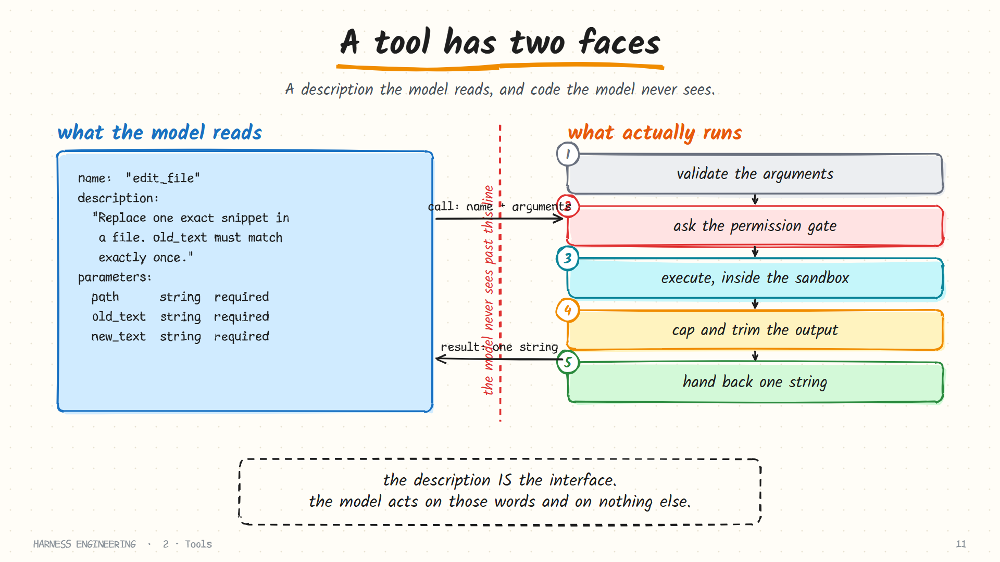
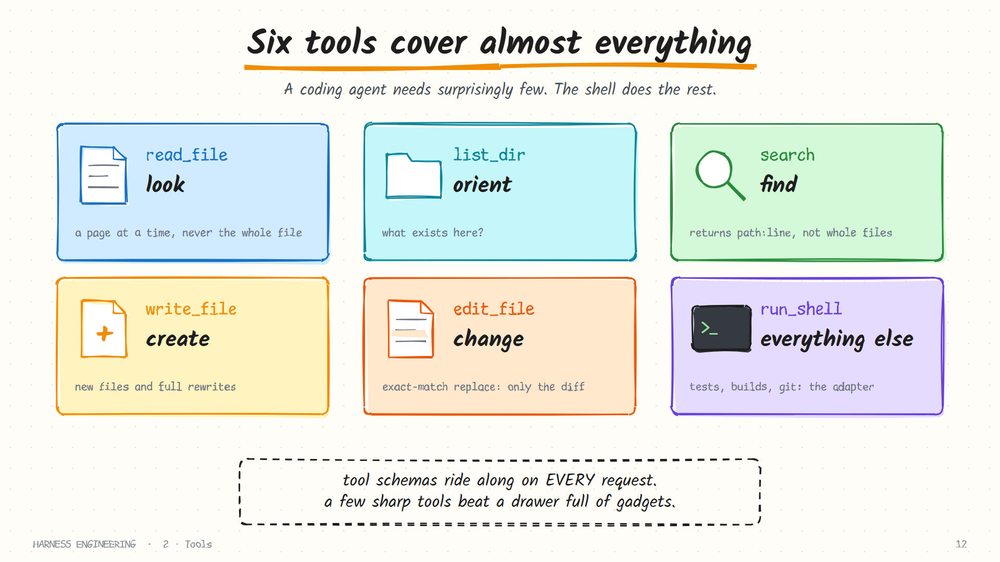
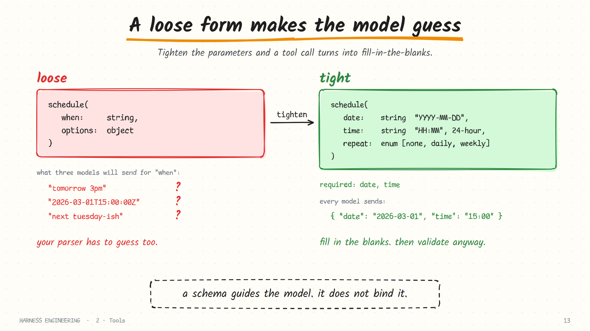
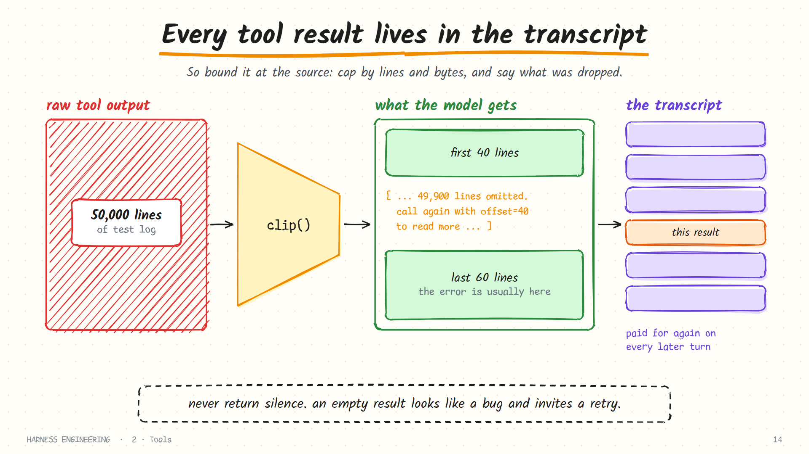
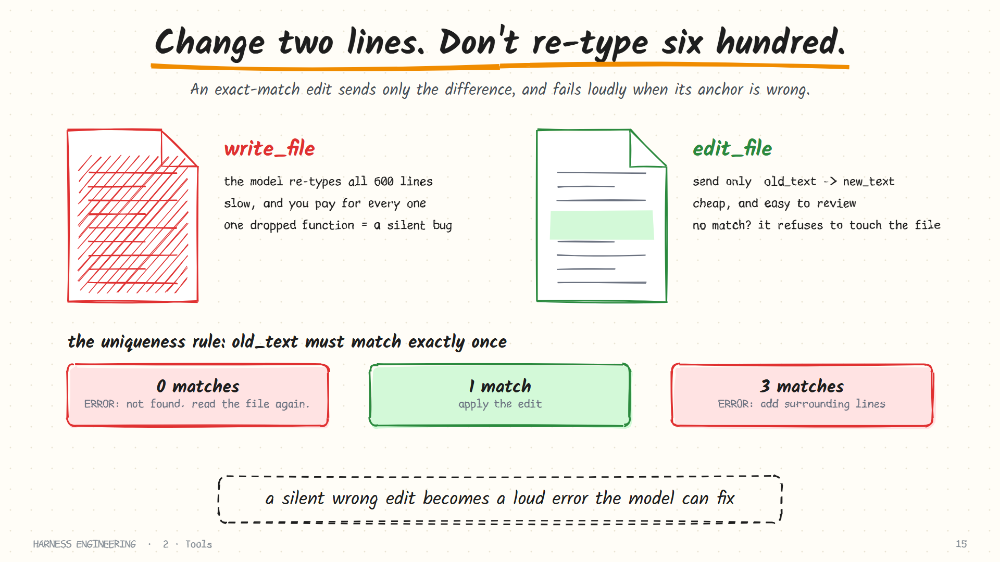
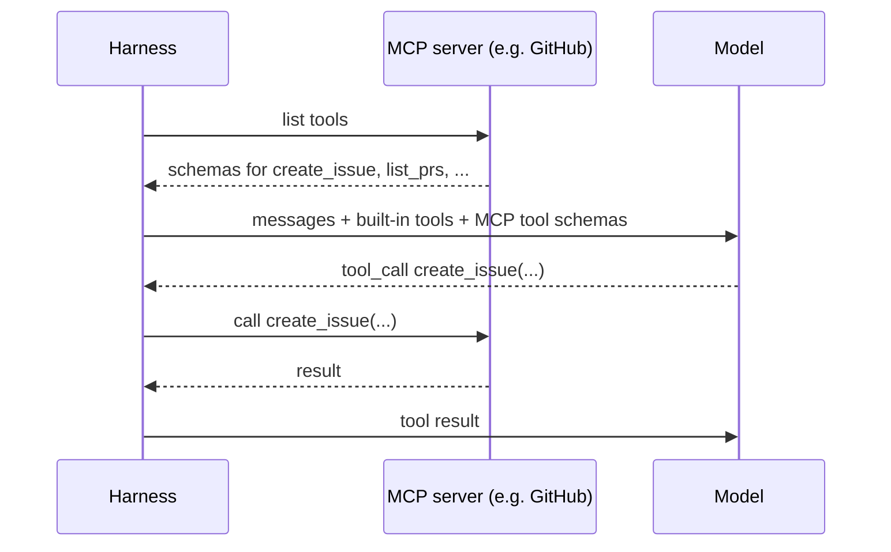

# 2. Tools

> **The question:** what can the agent touch?

## The idea in one minute

A tool is an ordinary function with a description attached. The model never sees the function. It sees the description, decides whether to call it, and fills in the arguments. Your code does the rest.

So a tool has two faces, and almost every tool problem comes from forgetting one of them.



## What the model actually receives

On every turn the harness sends the full list of tool schemas alongside the messages. One schema looks like this:

```json
{
  "type": "function",
  "function": {
    "name": "edit_file",
    "description": "Replace one exact snippet of text in a file. old_text must appear exactly once; include enough surrounding lines to make it unique. Fails without changing the file otherwise.",
    "parameters": {
      "type": "object",
      "properties": {
        "path":     {"type": "string", "description": "File path relative to the workspace root"},
        "old_text": {"type": "string", "description": "Exact text to find, including whitespace"},
        "new_text": {"type": "string", "description": "Text to put in its place"}
      },
      "required": ["path", "old_text", "new_text"]
    }
  }
}
```

That text is the entire interface. The model has not read your source code and never will. If the description is vague, the model guesses. If a parameter is called `data`, it will put whatever seems plausible in it.

### Anatomy of a good description

A description should answer four questions, in this order.

| Question | In the example above |
|----------|----------------------|
| **What does it do?** | "Replace one exact snippet of text in a file." |
| **What must be true to use it?** | "old_text must appear exactly once" |
| **How do I satisfy that?** | "include enough surrounding lines to make it unique" |
| **What happens when it fails?** | "Fails without changing the file otherwise." |

Compare a description written from the implementer's side with one written for the caller:

| Before | After |
|--------|-------|
| `search`: "Runs ripgrep over the workspace." | `search`: "Find lines matching a regular expression across the project. Returns `path:line: text` for each match, up to 100. Use it to locate code before reading a file. To search one folder, pass `path`." |

The second version tells the model what comes back, when to reach for the tool, and how to narrow it. Those three facts change behaviour far more than the model's intelligence does.

> Write a tool description the way you would brief a capable new colleague who cannot ask follow-up questions.

## A small set of sharp tools

A coding agent needs surprisingly few tools. Six cover almost everything.



| Tool | Verb | Returns | Safe to repeat? |
|------|------|---------|-----------------|
| `read_file` | Look | Numbered lines, one page at a time | Yes |
| `list_dir` | Orient | Names, folders marked with `/` | Yes |
| `search` | Find | `path:line: text` hits, capped | Yes |
| `write_file` | Create | A one-line confirmation | Mostly: it overwrites |
| `edit_file` | Change | A one-line confirmation, or a precise error | Yes: a repeat fails harmlessly |
| `run_shell` | Everything else | Exit code and output, capped | Depends on the command |

Why so few? Three reasons.

**Schemas are not free.** The whole tool list rides along on every single request. Forty tools can cost several thousand tokens per turn before the agent has done anything, and that cost is paid on every turn of every run.

**Choice has a cost.** With `read_file`, `read_lines`, `read_head`, `cat_file` and `open_document` on the menu, the model spends effort choosing, and sometimes chooses badly. Overlapping tools are a design smell.

**The shell is a universal adapter.** Anything with a command line (git, pytest, curl, docker) is already a tool. You do not need a `git_commit` tool; you need `run_shell` and good guardrails.

Add a dedicated tool only when one of these is true:

- the shell version is error-prone (file edits through `sed` are the classic case);
- the output needs shaping before the model sees it;
- the action needs its own permission rule;
- the action must be safe to retry and the shell version is not.

## Five design rules

### 1. Make inputs tight

A loose parameter makes the model invent a format and hope your code guesses the same one.



| Loose | Tight | Why |
|-------|-------|-----|
| `when: string` | `date: string` described as `YYYY-MM-DD` | One format, stated |
| `mode: string` | `mode: enum ["read", "write", "append"]` | The legal set is closed |
| `options: object` | Named fields, each with a description | Nothing to invent |
| `lines: string` ("10-20") | `offset: integer`, `limit: integer` | No parsing, no ambiguity |
| `path: string` | `path: string` described as "relative to the workspace root" | Removes the absolute-or-relative guess |

Mark what is required. Give defaults for the rest. Then **validate anyway**: schemas guide the model, they do not bind it. A model will occasionally send a number as a string or omit a required field, and your tool should answer with a correction, not a stack trace.

### 2. Bound every output

A tool result is appended to the transcript and re-sent on every later turn. A tool that returns 40,000 lines of log taxes the rest of the run.



Different tools want different cuts:

| Tool | Keep | Because |
|------|------|---------|
| `read_file` | A page from `offset`, with line numbers | The model asks for the next page if it needs it |
| `run_shell` | The head and, above all, the **tail** | Errors and summaries come last |
| `search` | The first N matches | More matches means the pattern was too broad |
| `list_dir` | The first few hundred entries | Beyond that, the agent should search instead |

Three habits make truncation safe:

- **Cap by lines *and* by bytes.** One minified file is a single 2 MB line.
- **Say what was dropped and how to get more:** `[lines 1-200 of 4,812; call again with offset=200]`.
- **Prefer locations to contents.** A search tool should return `path:line: match`, not the files.

Here is the helper every result should pass through:

```python
def clip(text, limit=8000):
    if len(text) <= limit:
        return text
    half = limit // 2
    return f"{text[:half]}\n[... {len(text) - limit} characters omitted ...]\n{text[-half:]}"
```

### 3. Write errors as instructions

The error message is the model's only clue about what to do next.

| Unhelpful | Helpful |
|-----------|---------|
| `Error` | `ERROR: src/app.py is not a file here. Files in src/: main.py, api.py` |
| `Invalid input` | `ERROR: old_text matched 3 times. Add surrounding lines so it matches once.` |
| `Permission denied` | `BLOCKED: writes to .git/ are never allowed. Use run_shell("git ...") instead.` |
| `Timeout` | `ERROR: timed out after 120s. If this starts a server, it cannot be run with this tool.` |
| *(empty string)* | `exit code 0\n(no output)` |

Never return an empty result. Silence looks like a bug and invites a retry. And put the *cause* and the *next step* in the same message: the model should not need a second call to find out what to do.

### 4. Prefer edits to rewrites

Asking a model to regenerate a 600-line file to change two lines is slow, expensive, and an invitation to drop a function by accident.



The standard fix is an exact-match replace: the model supplies the old snippet and the new one, and the tool applies the change only if the old snippet appears **exactly once**. Zero matches or several matches is a loud failure with nothing changed.

```python
def edit_file(path, old_text, new_text):
    text = read(path)
    count = text.count(old_text)
    if count == 0:
        raise ValueError(f"old_text was not found in {path}. Read the file again; it may have changed.")
    if count > 1:
        raise ValueError(f"old_text matched {count} times. Include more surrounding lines.")
    write(path, text.replace(old_text, new_text, 1))
    return f"edited {path}"
```

Harnesses have tried several designs for the edit tool. Each fails in a characteristic way:

| Design | The model sends | Typical failure |
|--------|-----------------|-----------------|
| Whole-file rewrite | The entire new file | Silent deletions; huge cost on big files |
| Line-range replace | Start line, end line, new text | Line numbers go stale after the first edit |
| Unified diff / patch | A diff with context | Malformed hunks; off-by-one context |
| **Exact-match replace** | Old snippet, new snippet | Whitespace mismatches, which fail loudly |

Exact-match replace wins in practice because its failures are *loud and specific*, which is the property that matters most in a loop that can self-correct.

### 5. Make re-running safe where you can

Runs get interrupted and retried. Classify each tool by what a repeat does:

| Class | Examples | After a crash |
|-------|----------|---------------|
| **Pure read** | `read_file`, `search` | Repeat freely |
| **Idempotent write** | `write_file` with the same content; an edit that now fails | Repeat is harmless |
| **Non-idempotent, local** | Appending to a file; `git commit` | Check state before repeating |
| **Non-idempotent, external** | Sending email, charging a card, pushing | Never repeat blindly; require a human |

That last class is why [guardrails](03-guardrails.md) and [durability](06-durability.md) both pay special attention to effects that leave the machine.

## The shell deserves its own section

`run_shell` is what makes six tools enough. It is also where nearly all the risk concentrates. Before any policy question, it needs mechanical guards:

```python
def run_shell(command, timeout=120):
    try:
        p = subprocess.run(command, shell=True, cwd=WORKSPACE, capture_output=True,
                           text=True, timeout=timeout, stdin=subprocess.DEVNULL)
    except subprocess.TimeoutExpired:
        return f"ERROR: timed out after {timeout}s. Long-running servers cannot be run with this tool."
    out = (p.stdout + p.stderr).strip() or "(no output)"
    return f"exit code {p.returncode}\n{clip(out)}"
```

Each line there exists because of a failure:

| Guard | The failure it prevents |
|-------|-------------------------|
| A **timeout** | `npm run dev` never returns; the agent waits forever |
| An **output cap** | One verbose build fills the context window |
| **stdin closed** | A command prompts ("Overwrite? [y/N]") and hangs waiting for input |
| The **exit code**, always | "Printed nothing" and "failed silently" look identical without it |
| A **fixed working directory** | `cd` in one call silently changing the meaning of the next |
| **stdout and stderr together** | The error is in the stream you did not capture |

Problems you will meet once the basics work:

- **Long-running processes.** Servers and watchers need a separate mechanism: start in the background, return a handle, and offer tools to read output and stop it.
- **Interactive programs.** Editors, pagers and REPLs expect a terminal. Set `GIT_PAGER=cat`, pass `--yes` or `--no-input` flags, and tell the model in the tool description that no terminal is attached.
- **State between calls.** Each call is usually a fresh process, so `export` and `cd` do not persist. Either document that, or keep a persistent shell session and accept the extra complexity.
- **Platform differences.** The same harness on Windows and Linux needs to say which shell it is; put it in the system prompt.

## Results are prose for a reader

A tool result is not an API response for a program. It is text a language model will read. Shape it that way:

```text
# read_file
    41  def add(a, b):
    42      return a - b
    43
[lines 41-43 of 120]

# search
src/calc.py:41: def add(a, b):
tests/test_calc.py:7:     assert add(2, 2) == 4

# run_shell
exit code 1
FAILED tests/test_calc.py::test_add - assert 0 == 4
1 failed, 13 passed in 0.42s
```

Line numbers on file reads let the model refer to locations precisely. Paths relative to the workspace keep results short. Dropping fields nobody needs (timestamps, internal ids, null values) saves tokens on every later turn.

## Extending the toolbox: MCP

Hard-coding tools works until you want the agent to talk to GitHub, a database, or a browser. The **Model Context Protocol (MCP)** standardises that: a tool server lists its tools and executes calls over a simple protocol, and any MCP-aware harness can connect to it.



For harness design, MCP changes distribution, not the fundamentals. An MCP tool is still a name, a description and a schema in the model's context. The same rules about count, clarity and output size apply. Two consequences are worth planning for:

- **Schema bloat.** Ten servers with thirty tools each put three hundred schemas in every request. Mature harnesses load tool definitions lazily, or give the model a "search for a tool" step and load a schema only when it is chosen.
- **Trust.** A tool server is third-party code that returns text into your transcript. Its *descriptions* and its *results* are both untrusted input ([guardrails](03-guardrails.md)).

## Common mistakes

- **Describing the implementation, not the use.** "Wraps `os.walk`" tells the model nothing. "Lists files under a directory, one path per line" does.
- **One tool, five jobs.** A `file` tool with an `action` parameter hides five tools behind one schema and makes every call harder to gate.
- **Returning raw JSON blobs.** Shape results for a reader. Drop fields nobody needs.
- **Trusting arguments.** Models produce paths like `../../etc/passwd` by accident and, under prompt injection, on purpose. Resolve and check every path.
- **Changing a tool mid-session.** Adding, removing or reordering tools changes the start of the prompt and throws away the provider's cache ([chapter 4](04-context.md)).
- **Never testing the schema on its own.** Hand only the schema to a colleague, or to a model, and ask what the tool does. If the answer is wrong, the description is.

## A tool review checklist

Before a tool goes in, it should pass all of these:

- [ ] The name is a verb phrase and unlike every other tool's name
- [ ] The description says what it does, when to use it, and how it fails
- [ ] Every parameter is named, typed, described, and constrained where possible
- [ ] Arguments are validated, with corrective error text
- [ ] The result is size-capped, and truncation says how to get more
- [ ] It never returns an empty string
- [ ] You know which retry class it is in
- [ ] You know which permission class it is in

## How real harnesses do it

- **Claude Code** ships a compact built-in set (read, edit with exact-match replace, write, search by content and by filename, shell, and a few others) and grows through MCP servers and skills.
- **Codex** leans heavily on the shell inside an OS-level sandbox, plus a patch-application tool for edits.
- **Pi** keeps a handful of built-in tools and expects you to register more from extensions with `registerTool`.
- **Hermes** treats the tool list as a cost: its contributor guide notes that every tool is sent on every call, so the bar for a new core tool is high, and proposes a "footprint ladder" for where new capability should go.
- **DeepSeek Harness** runs every call through a fixed pipeline of pre-execute, execute and post-execute stages, so validation, timeouts and result rewriting are separate, replaceable steps.

## In the reference code

[`examples/mini_harness.py`](../examples/README.md): `make_tools` holds the schemas, the `tool_*` functions hold the implementations, and `clip()` bounds every result.

## Check yourself

1. Why does adding a twentieth tool cost something even on turns that never use it?
2. `edit_file` finds `old_text` three times in the file. What should happen, and what should the result say?
3. A build command prints 50,000 lines and fails on the last one. Which part of the output should the model see?
4. You are tempted to add a `git_status` tool. What question decides whether it earns a slot?
5. A command asks "Proceed? [y/N]" and your agent hangs. Which guard was missing?

<details>
<summary>Answers</summary>

1. Its schema is sent with every request, and it widens the choice the model has to make.
2. Fail without modifying the file, and say how many matches there were and how to make the snippet unique.
3. The tail, with a note that the middle was dropped, plus the exit code.
4. Whether it does something `run_shell("git status")` cannot: safer, better-shaped output, or a separate permission rule.
5. stdin was left open. Close it, so prompts fail fast instead of waiting.

</details>

## Try it

Write a seventh tool for something you do every day (running one test by name, querying a local database). Write the description first. Hand only the schema to a colleague and ask what they think it does. Fix the description until their answer matches the code.

**Next:** [3. Guardrails →](03-guardrails.md)
