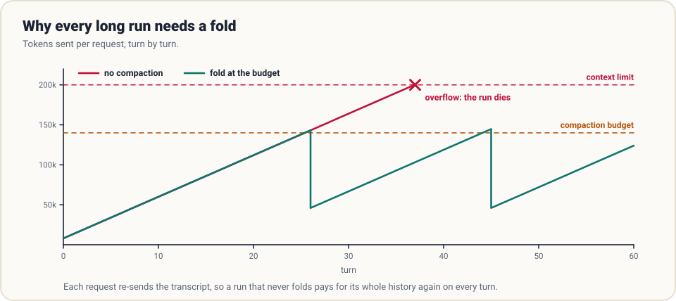
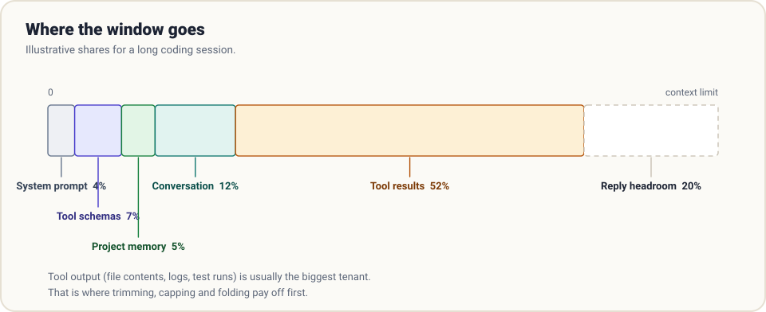
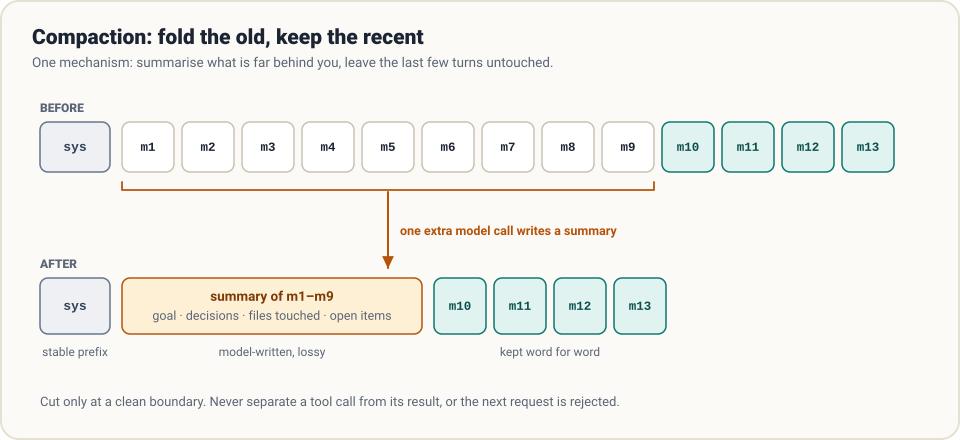

# 4. Context

> **The question:** how does a long task fit in a finite window?

## The idea in one minute

The loop from [chapter 1](01-the-loop.md) has a flaw you can now see coming. The transcript only grows, the whole thing is re-sent every turn, and the window has a hard limit. Run long enough and one of three things happens: the request is rejected, the bill becomes absurd, or the model quietly gets worse because the important parts are buried.

Context engineering is the set of decisions about **what occupies the window right now**. A harness makes those decisions automatically, every turn.



## Where the tokens go

Before optimising anything, measure. Most providers return token counts with every reply; log them per turn. A typical long coding session looks roughly like this:



Two observations hold almost everywhere:

- **Tool results dominate.** File contents, command output and search hits dwarf everything the human and the model actually said.
- **Agents read far more than they write.** Input tokens outnumber output tokens by an order of magnitude or more, because of the re-sending.

So the first place to look for savings is never the system prompt. It is tool output.

## More context is not better context

It is tempting to treat the window as storage: if it fits, send it. Two things argue against that.

**Attention is finite.** A model given 150,000 tokens does not weigh them all equally. Details from the middle of a long transcript are recalled less reliably than those at the start or end. The practical name for this is *context rot*: quality degrading as the window fills with stale material.

**Old material misleads.** A file the agent read at turn 5 and edited at turn 20 exists in the transcript in both versions. An error message from a bug that was fixed an hour ago is still sitting there, looking current.

> The goal is not the fullest window. It is the smallest window that contains what the next step needs.

## Four moves

Almost every context technique is one of four moves. This framing is widely used in the community, and it is a useful checklist:

| Move | What it means | Examples |
|------|---------------|----------|
| **Write** | Put information somewhere outside the window | Notes file, progress log, task list on disk |
| **Select** | Pull in only what this step needs | Read a line range, search before reading, load a skill on demand |
| **Compress** | Keep the meaning, drop the bulk | Truncate tool output, clear old results, summarise old turns |
| **Isolate** | Give a sub-task its own window | Sub-agents ([chapter 7](07-delegation.md)) |

The rest of this chapter is mostly about *select* and *compress*.

## Prevention first: cap at the source

The cheapest token is the one that never enters the transcript.

- `read_file` returns a page, not the file, and says how to get the next page.
- `search` returns `path:line` hits with a snippet, not whole files.
- `run_shell` keeps the tail of long output.
- Every tool result passes through a single `clip()` with a size limit.

Do this in the tools ([chapter 2](02-tools.md)) and compaction has much less to do.

## Then lossless pruning

Before summarising anything, remove what is safely redundant:

- **Supersede stale reads.** If a file was read three times, only the latest is true. Replace earlier results with a one-line stub: `[earlier read of app.py removed; see the later read]`.
- **Clear old tool results.** A 6,000-token test log from thirty turns ago rarely matters. Keep the call and a short marker so the model knows it happened.

This is nearly free and loses almost nothing. Mature harnesses run several such passes before they ever ask a model to summarise.

## Compaction: fold the old, keep the recent

When the transcript still exceeds your budget, fold it.



```python
def compact(messages, keep_recent=6):
    head, old, recent = messages[:1], messages[1:-keep_recent], messages[-keep_recent:]
    while recent and recent[0]["role"] == "tool":      # never start on an orphan result
        old.append(recent.pop(0))
    summary = call_model(old + [{"role": "user", "content": SUMMARY_PROMPT}], tools=None)
    note = {"role": "user", "content": "[Summary of earlier work]\n" + summary["content"]}
    return head + [note] + recent
```

Three details decide whether this works.

**1. Trigger on a budget, not on the limit.** Fold at perhaps 60 to 75% of the window. You need headroom for the summarisation call itself and for the model's next reply.

**2. Cut on a clean boundary.** A tool call and its result must stay together ([chapter 1](01-the-loop.md)'s rule). If the cut lands between them, the next request is malformed. The `while` loop above moves the boundary until it is legal.

**3. Ask for the right summary.** A summary is a handoff note to a colleague with amnesia. Ask for:

```text
Summarise the work so far for someone taking over. Include:
- the user's goal and any constraints they stated, in their words
- decisions made, and why
- files created or changed, and the current state of each
- commands that were run and what they showed
- what is still to do, and the very next step
Do not include pleasantries. Be specific about file names and identifiers.
```

Vague summaries ("worked on the API") cause the classic post-compaction failure: the agent re-does finished work or forgets a constraint the user stated once, an hour ago.

### What compaction costs

It is lossy by design. Details vanish. Good harnesses soften that by writing important state to disk *before* it can be folded away (the **write** move), so the agent can re-read a notes file instead of trusting a summary of a summary.

## The system prompt is assembled, not written

A system prompt in a real harness is built at startup from parts:

```text
identity and working style        (stable)
environment: OS, cwd, date, git   (per session)
project instructions (AGENTS.md)  (per repo)
available skills: name + one line (per install)
tool usage rules                  (stable)
```

Two disciplines keep it healthy:

- **Every line earns its place.** Each sentence should exist because of a failure you actually observed. A prompt that grows by anecdote becomes a wall of rules the model weighs against each other.
- **Keep the prefix stable.** Providers cache the unchanged beginning of a request and charge far less to re-read it. If you insert a timestamp at the top, reorder tools, or edit an old message, the cache is invalidated and every turn pays full price. Put volatile content late; never rewrite history casually.

That second point is why compaction is a *deliberate, occasional* event rather than something done every turn: each fold changes the prefix and resets the cache.

## Common mistakes

- **Compacting at 99%.** There is no room left to make the summarisation call.
- **Summarising everything.** Without the last few turns verbatim, the model loses its immediate working state and stumbles.
- **Counting characters as tokens.** Use the provider's reported usage, or a rough estimate with a safety margin. Do not cut it fine.
- **Volatile data up top.** A clock in the first line of the system prompt quietly doubles your bill.
- **Letting instructions get folded away.** The user's original requirements must survive every compaction, verbatim if possible.

## How real harnesses do it

- **Claude Code** has been analysed as running a multi-stage pipeline: cheap, lossless pruning first and model-written summaries last, with an explicit `/compact` command and automatic compaction.
- **Codex** supports automatic and manual compaction with a customisable compaction prompt, and sends environment context as deltas rather than repeating it.
- **Pi** makes compaction a pluggable strategy: an extension can replace how summaries are made or use a different model for them.
- **Hermes** treats per-conversation prompt caching as an invariant: its guide says mutating past context is forbidden mid-conversation, with compression as the single exception.

## In the reference code

[`examples/mini_harness.py`](../examples/README.md): `estimate_tokens()`, `compact()`, and the `before_turn` check inside `run_loop`. Set `--budget 2000` to force a fold after a few turns and watch it happen.

## Check yourself

1. Why does turn 40 cost more than turn 2 even if both do the same amount of new work?
2. You fold when the transcript reaches 95% of the window. What goes wrong?
3. Your cut point lands right after an assistant message with two tool calls. What must you do?
4. A teammate adds the current time to the first line of the system prompt. What changes on the invoice, and why?

<details>
<summary>Answers</summary>

1. Turn 40 re-sends everything from turns 1 to 39.
2. No headroom for the summarisation call or the next reply; the fold itself may overflow.
3. Move the boundary so both results stay with their calls: either fold all three messages or keep all three.
4. The cached prefix is invalidated on every request, so input tokens are billed at the full rate.

</details>

## Try it

Log input and output tokens per turn for three tasks of different sizes. Plot input tokens against turn number. Then add an output cap to your most verbose tool and plot again.

**Next:** [5. Memory and skills →](05-memory-and-skills.md)
