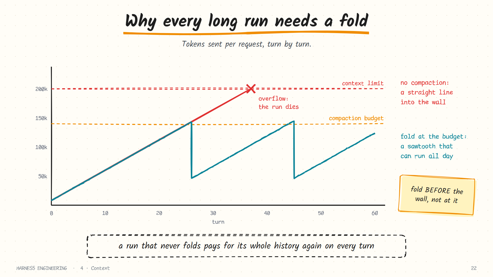
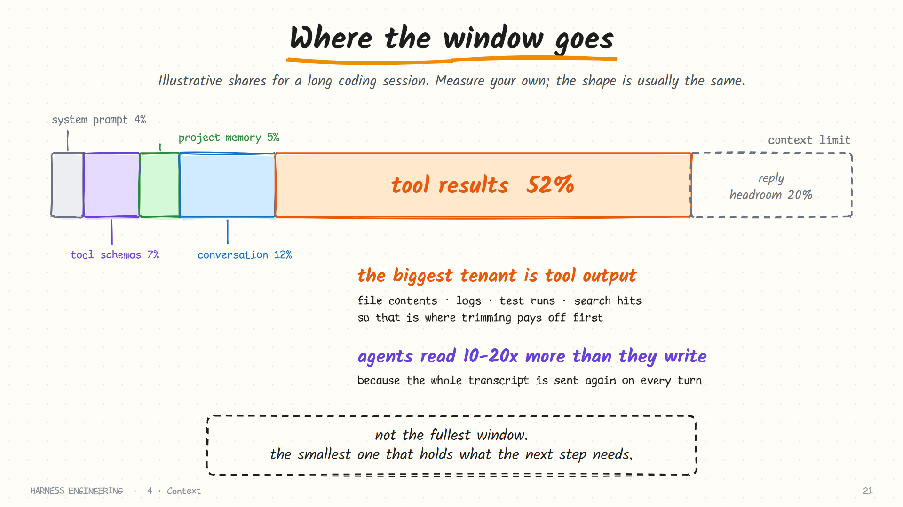
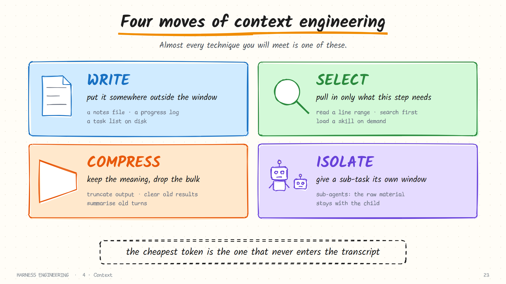
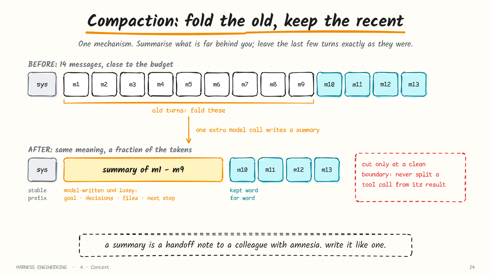
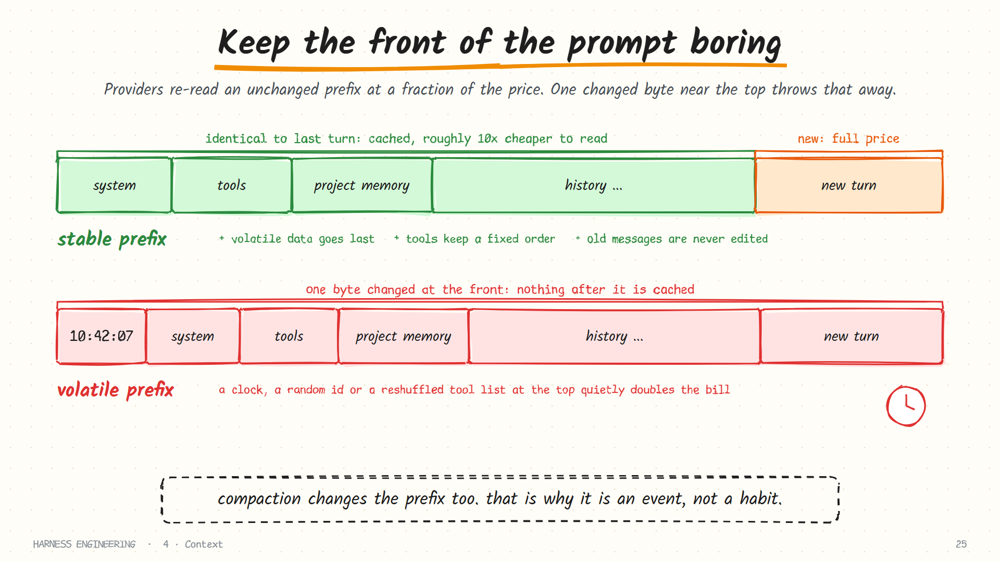

# 4. Context

> **The question:** how does a long task fit in a finite window?

## The idea in one minute

The loop from [chapter 1](01-the-loop.md) has a flaw you can now see coming. The transcript only grows, the whole thing is re-sent every turn, and the window has a hard limit. Run long enough and one of three things happens: the request is rejected, the bill becomes absurd, or the model quietly gets worse because the important parts are buried.

Context engineering is the set of decisions about **what occupies the window right now**. A harness makes those decisions automatically, every turn.



## Measure first

Before optimising anything, look. Most providers return token counts with every reply:

```json
"usage": { "prompt_tokens": 48210, "completion_tokens": 312,
           "prompt_tokens_details": { "cached_tokens": 44800 } }
```

Log them per turn, with the size of each tool result. Twenty lines of instrumentation produce a table like this, and the table tells you where to look:

| Turn | Tool | Result tokens | Request tokens | Cached | Output |
|------|------|---------------|----------------|--------|--------|
| 1 | `list_dir` | 180 | 3,400 | 0 | 90 |
| 2 | `read_file` | 4,100 | 7,700 | 3,300 | 140 |
| 3 | `run_shell` (tests) | **22,600** | 30,500 | 7,600 | 210 |
| 4 | `read_file` | 3,900 | 34,600 | 30,400 | 380 |
| 5 | `edit_file` | 40 | 35,000 | 34,500 | 120 |

One command at turn 3 is responsible for two-thirds of the window. That is typical.



Two observations hold almost everywhere:

- **Tool results dominate.** File contents, command output and search hits dwarf everything the human and the model actually said.
- **Agents read far more than they write.** Input tokens outnumber output tokens by an order of magnitude or more, because of the re-sending.

So the first place to look for savings is never the system prompt. It is tool output.

## More context is not better context

It is tempting to treat the window as storage: if it fits, send it. Two things argue against that.

**Attention is finite.** A model given 150,000 tokens does not weigh them all equally. Details in the middle of a long transcript are recalled less reliably than those at the start or the end. The practical name for this is **context rot**: quality degrading as the window fills with stale material, well before the hard limit.

**Old material misleads.** A file the agent read at turn 5 and edited at turn 20 exists in the transcript in both versions. An error message from a bug that was fixed an hour ago is still sitting there, looking current.

> The goal is not the fullest window. It is the smallest window that contains what the next step needs.

## Set a budget

Decide the numbers in advance, per model. For a 200,000-token window, a reasonable starting point:

| Slice | Tokens | Why |
|-------|--------|-----|
| Reserved for the reply | 16,000 | The model needs room to answer; some APIs count this against the window |
| Reserved for the summarisation call | 10,000 | Compaction itself is a model call |
| **Compaction trigger** | **≈ 140,000** | Fold here, with headroom to spare |
| Kept verbatim after a fold | 20,000 | The recent working state |

One production harness states its trigger as a formula worth copying:

```text
compact when   context_tokens  >  context_window − reserve_tokens
```

Keep these as per-model configuration. A budget tuned for a 200k model will overflow a 32k one on the second file read.

## Four moves

Almost every context technique is one of four moves.



| Move | What it means | Examples |
|------|---------------|----------|
| **Write** | Put information somewhere outside the window | A notes file, a progress log, a task list on disk |
| **Select** | Pull in only what this step needs | Read a line range, search before reading, load a skill on demand |
| **Compress** | Keep the meaning, drop the bulk | Truncate tool output, clear old results, summarise old turns |
| **Isolate** | Give a sub-task its own window | Sub-agents ([chapter 7](07-delegation.md)) |

The rest of this chapter is mostly *select* and *compress*; *write* returns in [chapter 5](05-memory-and-skills.md) and *isolate* in chapter 7.

### Select: let the agent look things up

There are two ways to get the right information into the window. **Preloading** puts it there before the model asks: paste the whole repository map, attach every relevant document. **Just-in-time retrieval** gives the agent tools to find what it needs and lets it fetch only that.

For code, just-in-time usually wins. A file tree, a search tool and paged reads let the agent pull in three relevant functions instead of thirty irrelevant files, and what it retrieves is current by construction. Preloading is right for small things that every task needs: the project instructions, the build command.

## A ladder of reduction, cheapest first

Do not jump straight to summarising. Reduce in stages, from free and lossless to expensive and lossy.

| Stage | What it does | Loss | Cost |
|-------|--------------|------|------|
| **1. Cap at the source** | Tools return pages, tails and locations ([chapter 2](02-tools.md)) | None the model would miss | Free |
| **2. Drop superseded reads** | Replace earlier reads of a file with a one-line stub when a later read exists | None | Free |
| **3. Clear old tool results** | Replace bulky results from many turns ago with `[output cleared; re-run if needed]` | Small, and recoverable | Free |
| **4. Summarise** | One model call folds old turns into a note | Real | One model call, and a cache reset |
| **5. Hard truncate** | Drop the oldest messages outright | Severe | Free. Last resort only |

Stages 2 and 3 are sometimes called *micro-compaction*. They are nearly free and often buy dozens more turns before a real fold is needed:

```python
def clear_old_results(messages, keep_last=8, min_chars=2000):
    cutoff = len(messages) - keep_last
    for m in messages[:cutoff]:
        if m["role"] == "tool" and len(m["content"]) > min_chars:
            m["content"] = "[output cleared to save context; run the tool again if you need it]"
```

The assistant's *call* stays in place, so the model still knows it ran that command; only the bulk goes.

## Compaction: fold the old, keep the recent

When the transcript still exceeds your budget, fold it.



```python
def compact(messages, keep_recent_tokens=20_000):
    head = messages[:1]                                  # the system prompt
    cut = find_cut(messages, keep_recent_tokens)         # walk back from the end
    old, recent = messages[1:cut], messages[cut:]
    while recent and recent[0]["role"] == "tool":        # never start on an orphan result
        old.append(recent.pop(0))
    summary = call_model(old + [{"role": "user", "content": SUMMARY_PROMPT}], tools=None)
    note = {"role": "user", "content": "[Summary of earlier work]\n" + summary["content"]}
    return head + [note] + recent
```

Five details decide whether this works.

**1. Trigger on a budget, not on the limit.** Fold at 60 to 75% of the window. You need headroom for the summarisation call itself and for the next reply.

**2. Choose the cut by tokens, not by message count.** "Keep the last six messages" keeps almost nothing if they are short and overflows if one is a 30,000-token log. Walk backwards from the end, adding up estimates, until you have kept your token allowance.

**3. Cut on a clean boundary.** A tool call and its result must stay together ([chapter 1](01-the-loop.md)'s rule). If the cut lands between them, the next request is malformed. The `while` loop above moves the boundary until it is legal.

**4. Ask for the right summary.** A summary is a handoff note to a colleague with amnesia. Give it a structure:

```text
Summarise the work so far for someone taking over. Use these headings:

GOAL          the user's request and constraints, in their own words
DECISIONS     what was decided, and why
FILES         each file created or changed, and its current state
COMMANDS      what was run and what it showed
STATE         what works now; what is broken
NEXT          what remains, and the very next step

Be specific about file names, function names and identifiers. No pleasantries.
```

**5. Summarise iteratively.** On the second fold, pass the *previous summary* in as context and ask for an updated one. Summarising a summary from scratch loses a little more each time; updating one loses much less.

### After the fold

A good harness does not stop at replacing messages. It restores the working state the fold just flattened:

- Re-attach the list of files touched so far, so the agent does not rediscover them.
- Re-read the one or two files it was actively editing.
- Re-state the open task list, if you keep one.

And it keeps the *original* messages in the session log ([chapter 6](06-durability.md)). Compaction changes what the model sees. It should never destroy the record.

### What compaction costs

It is lossy by design. The classic post-compaction failures are an agent that re-does finished work, or forgets a constraint the user stated once, an hour ago. Two defences: protect the user's original instructions from summarisation entirely, and write important state to disk *before* it can be folded away, so the agent can re-read a notes file instead of trusting a summary of a summary.

### Overflow as a recoverable error

Even with a budget, a single enormous tool result can overflow the window in one step. Treat the provider's "context length exceeded" error as a signal, not a crash: compact, then retry the same turn once. If it overflows again, stop with a clear status.

## Prompt caching: keep the front boring

Providers can cache the unchanged beginning of a request and charge far less to read it again, typically around a tenth of the normal input price, with a small premium for writing the cache on some APIs. Because an agent re-sends its whole transcript every turn, this is the single largest cost lever you have.

The catch is how it works: caching is by **prefix**. The request is compared from the first byte, and the cache applies up to the first difference.



That turns ordering into an engineering decision. Arrange the prompt from most stable to most volatile:

```text
1. STABLE     identity, tool guidance, tool schemas          never changes in a session
2. CONTEXT    project instructions, repository facts          changes per project
3. VOLATILE   memory snapshot, date, working directory        changes per session
   ─────────────────────────────────────────────────
4. HISTORY    the transcript                                  append-only
```

Rules that follow directly:

- **Nothing volatile near the top.** A timestamp in the first line of the system prompt defeats the cache on every single request.
- **Do not reorder or swap tools mid-session.** The schemas are part of the prefix.
- **Do not edit old messages.** Appending is free; rewriting invalidates everything after the edit.
- **Freeze memory at session start.** If the agent updates its memory file mid-conversation, do not re-inject the new version into the system prompt; let it apply next session.
- **Compaction resets the cache.** That is fine, and it is the reason a fold should be a deliberate, occasional event and not a per-turn habit.

To feel the stakes: a 100,000-token transcript re-read over 30 turns is 3 million input tokens. With an intact cache most of that is billed at the discounted rate. With a clock in the first line, all of it is billed in full.

## The system prompt is assembled, not written

A system prompt in a real harness is built at startup from parts:

```text
identity and working style        (stable)
tool usage rules                  (stable)
project instructions (AGENTS.md)  (per repo)
available skills: name + one line (per install)
environment: OS, cwd, git branch  (per session)
```

Two disciplines keep it healthy:

- **Every line earns its place.** Each sentence should exist because of a failure you actually observed. A prompt that grows by anecdote becomes a wall of rules the model weighs against each other.
- **Short beats thorough.** If a rule only matters for one kind of task, it belongs in a skill or a document that is loaded on demand ([chapter 5](05-memory-and-skills.md)).

## Common mistakes

- **Compacting at 99%.** There is no room left to make the summarisation call.
- **Summarising everything.** Without the last few turns verbatim, the model loses its immediate working state and stumbles.
- **Counting characters as tokens and cutting it fine.** Use the provider's reported usage where you can; otherwise estimate with a safety margin.
- **Volatile data up top.** A clock in the first line quietly multiplies your bill.
- **Letting instructions get folded away.** The user's original requirements must survive every compaction, verbatim if possible.
- **Deleting the originals.** Keep the full history in the log; change only the model's view.
- **One budget for every model.** Window sizes differ by a factor of ten or more.

## How real harnesses do it

- **Claude Code** offers automatic and manual compaction; an independent source-level analysis describes it as a staged pipeline, with cheap lossless pruning before any model-written summary.
- **Codex** supports automatic and manual compaction with a customisable compaction prompt, and sends environment context as deltas rather than repeating it.
- **Pi** documents its algorithm exactly: trigger when context exceeds the window minus a reserve (16,384 tokens by default), keep roughly the most recent 20,000 tokens, summarise the rest with the previous summary as input, and append a compaction entry while the original entries stay in the session tree. It also attempts one compact-and-retry on a provider overflow error.
- **Hermes** assembles its system prompt in three ordered tiers (stable, context, volatile) specifically so sessions share the longest possible cached prefix, and makes the context engine a replaceable plugin.
- **DeepSeek Harness** records compaction as three log events (start, summary, end) that act as a lock, so a crash mid-compaction leaves a detectable orphan instead of a corrupted history.

## In the reference code

[`examples/mini_harness.py`](../examples/README.md): `estimate_tokens()`, `compact()`, and the budget check at the top of `run_loop`. Run with `--mock --mode auto --budget 50 --trace` to force a fold and watch the message count drop.

## Check yourself

1. Why does turn 40 cost more than turn 2 even if both do the same amount of new work?
2. You fold when the transcript reaches 95% of the window. What goes wrong?
3. Your cut point lands right after an assistant message with two tool calls. What must you do?
4. A teammate adds the current time to the first line of the system prompt. What changes on the invoice, and why?
5. Name two things you can do to shrink the transcript *before* asking a model to summarise.
6. After a fold, the agent re-implements a function it already wrote. Give two changes that would prevent this.

<details>
<summary>Answers</summary>

1. Turn 40 re-sends everything from turns 1 to 39.
2. No headroom for the summarisation call or the next reply; the fold itself may overflow.
3. Move the boundary so both results stay with their calls: either fold all three messages or keep all three.
4. The cached prefix is invalidated on every request, so all input tokens are billed at the full rate.
5. Replace superseded file reads with stubs; clear bulky old tool results.
6. A structured summary that lists files and their state; re-attaching the list of touched files after the fold; writing progress to a file the agent re-reads.

</details>

## Try it

Log input tokens, cached tokens and output tokens per turn for three tasks of different sizes. Plot input tokens against turn number. Then add an output cap to your most verbose tool and plot again. Finally, put a timestamp at the top of your system prompt and watch the cached-token column go to zero.

**Next:** [5. Memory and skills →](05-memory-and-skills.md)
