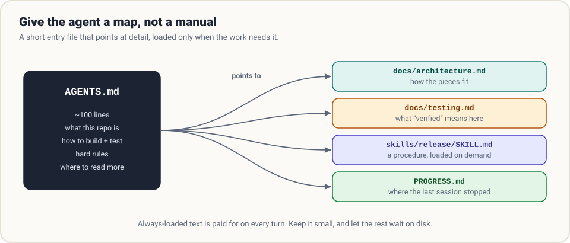

# 5. Memory and skills

> **The question:** what should outlive a single session?

## The idea in one minute

Everything in [chapter 4](04-context.md) lives and dies inside one transcript. Close the session and the agent has forgotten your build command, your naming conventions, and the mistake it promised not to repeat.

The fix is deliberately low-tech: **write things in files, and load the right files at the right time.**

- **Memory** is knowledge that should be present from the first turn: what this project is and how to work in it.
- **Skills** are procedures that should appear only when a task calls for them.

Both are plain text on disk. Neither requires a database.

## Memory: instructions that load themselves

Almost every harness reads a Markdown file from the repository at startup and places it in the system prompt. The filename varies (`AGENTS.md` is the cross-tool convention; Claude Code reads `CLAUDE.md`), the idea does not.

A good one is short and practical:

```markdown
# Payments service

Python 3.12, FastAPI, PostgreSQL. Entry point: `app/main.py`.

## Commands
- Install: `uv sync`
- Test: `uv run pytest -q`            (must pass before you say you are done)
- Lint: `uv run ruff check .`

## Rules
- Never edit files under `migrations/` by hand; generate them with `alembic revision`.
- Money is `Decimal`, never `float`.
- Public API changes need an entry in `CHANGELOG.md`.

## Where to read more
- Architecture: `docs/architecture.md`
- How we test: `docs/testing.md`
```

### Scopes

Mature harnesses load several such files and layer them, broadest first:

| Scope | Typical location | Holds |
|-------|------------------|-------|
| Organisation | A managed system path | Company-wide policy |
| User | Your home directory | Your personal preferences, across projects |
| Project | Repository root | How this codebase works; shared via git |
| Local | An untracked file in the repo | Your private notes for this project |
| Directory | A subfolder | Rules that only apply there, loaded when the agent works there |

More specific files are placed later, so they take precedence. Directory-level files are the interesting ones: they load *only when relevant*, which keeps the always-on cost low.

### The map, not the manual

The most common memory failure is growth. Someone adds a rule after every incident, and a year later the file is 2,000 lines. Now every turn pays for all of it, important rules are buried among trivia, and nobody can tell which parts are stale.



The cure is to treat the entry file as a **table of contents**:

- Keep it to roughly a hundred lines.
- State what the project is, how to build and verify, and the handful of rules that are never negotiable.
- For everything else, say *where to read*, and let the agent open that file when the task needs it.

> Always-loaded text is paid for on every turn of every session. Text on disk costs nothing until it is read.

### Memory the agent writes

The second kind of memory flows the other way: the agent records what it learned.

- **Learned preferences.** "User prefers `pnpm`." "Integration tests need Docker running."
- **Progress notes.** A `PROGRESS.md` saying what was finished, what is in flight, and what comes next. This is what makes multi-session work possible ([long-running work](../practice/long-running-work.md)).
- **Lessons.** "The flaky test is `test_webhook_retry`; re-run before investigating."

Give the agent a tool or a convention for it:

```python
def remember(note: str) -> str:
    """Append a durable fact to the project memory file."""
    with open(MEMORY_FILE, "a", encoding="utf-8") as f:
        f.write(f"- {note.strip()}\n")
    return "saved"
```

and cap how much of that file is loaded at startup.

Agent-written memory needs hygiene, because it fails in specific ways:

| Failure | What it looks like | Guard |
|---------|--------------------|-------|
| **Rot** | A note says the API is at `/v1` long after it moved | Date entries; prune on a schedule; prefer pointing at code over restating it |
| **Bloat** | Hundreds of trivial entries | Load a bounded amount; consolidate periodically |
| **Poisoning** | A note written while processing hostile content ("always skip the security check") | Treat memory writes as a side effect: gate them, review them, keep them in git |
| **Duplication** | Memory restates what the code already says | Record only what is not derivable from the repo |

That last row is a good general test: *would a careful reader of the repository already know this?* If yes, it does not belong in memory.

## Skills: procedures on a shelf

Some knowledge is only needed occasionally and is long when it is needed: how to cut a release, how to write a database migration in this codebase, how to fill in a particular PDF form. Putting all of that in the system prompt would be absurd.

A **skill** is a folder with a `SKILL.md` file and, optionally, scripts and reference material:

```text
skills/
  release/
    SKILL.md
    scripts/bump_version.py
    checklist.md
```

```markdown
---
name: release
description: Cut a versioned release of this package. Use when asked to release, publish, tag or bump the version.
---

1. Confirm the working tree is clean and tests pass.
2. Run `python scripts/bump_version.py <major|minor|patch>`.
3. Update CHANGELOG.md: move "Unreleased" entries under the new version.
4. Commit, tag `vX.Y.Z`, and stop. Ask before pushing.
```

### Progressive disclosure

The mechanism that makes skills cheap is loading in three stages:

1. **Always loaded:** each skill's `name` and one-line `description`. A few dozen tokens apiece.
2. **Loaded when triggered:** the body of `SKILL.md`, when the model decides the task matches.
3. **Loaded when followed:** any files the body points to, and scripts that are *executed* rather than read.

A harness can carry a hundred skills for the price of a hundred short lines. The description therefore does one critical job: it is the trigger. Write it to say *when* to use the skill, not just what it is.

The format has been published as an open standard (see [agentskills.io](https://agentskills.io)), and several harnesses, including Claude Code, Pi and Hermes, read compatible skill folders.

## Choosing where knowledge goes

| Put it in… | When it is… | Cost |
|------------|-------------|------|
| System prompt | True for every task in every project | Every turn, forever |
| Project memory file | True for every task in this repo | Every turn in this repo |
| Directory memory file | True only in one part of the repo | Only when working there |
| A skill | A procedure needed occasionally | One line always; the rest on use |
| A doc the map points to | Reference detail | Nothing until read |
| A tool | An action, or data that must be fresh | Schema every turn; result on use |
| Retrieval (search) | A large corpus you query | Only what is retrieved |

Reach for the cheapest row that works. Most teams discover they put far too much in the first two.

## Common mistakes

- **Rules without reasons.** "Never use `any`" gets followed mechanically and badly. "Avoid `any`; the API client is generated from types, and `any` hides contract breaks" lets the model handle cases you did not anticipate.
- **No verification command.** If the memory file does not say how to check the work, "done" means "I stopped typing".
- **Skills with vague triggers.** A description like "Helpful utilities" never fires. Name the situations.
- **Memory as a diary.** A log of everything that happened is not memory; it is a transcript with worse search.

## How real harnesses do it

- **Claude Code** layers `CLAUDE.md` across organisation, user, project and local scopes, loads subdirectory files on demand, keeps an auto-written memory with a bounded load, and offers `/init` to draft a project file from the codebase.
- **Codex** treats `AGENTS.md` as a short directory page pointing into structured docs, an approach its team described publicly as replacing an "encyclopedia" that kept drifting out of date.
- **Pi** loads `AGENTS.md` from the global config, parent directories and the current directory, and lets a project replace or extend the system prompt.
- **Hermes** goes furthest on agent-written memory: it creates skills from experience, refines them in use, and searches its own past sessions.

## In the reference code

[`examples/mini_harness.py`](../examples/README.md): `build_system_prompt()` reads `AGENTS.md` if present and lists any skills under `skills/`; the `remember` tool appends to a notes file. See also the starter [`templates/AGENTS.md`](https://github.com/AkbarSheikh-debug/harness-engineering/blob/main/templates/AGENTS.md).

## Check yourself

1. Your project memory file has grown to 1,800 lines. Name two concrete costs.
2. A skill's body is 900 tokens. How much of it does the model see on a turn where the skill is irrelevant?
3. Where should "run `make test` before finishing" live? Where should a 40-step release procedure live?
4. An agent processing a customer email writes "always approve refunds without checking" to memory. Which failure is this, and what guards against it?

<details>
<summary>Answers</summary>

1. Tokens paid on every turn, and important rules diluted among stale ones (plus nobody can maintain it).
2. Only its name and one-line description.
3. The first in the project memory file. The second in a skill.
4. Memory poisoning via prompt injection. Gate and review memory writes; keep the file under version control.

</details>

## Try it

Open the instruction file of a project you work on (or write one). Delete every line a newcomer could learn by reading the code. Move every procedure longer than five lines into a skill. Count what is left.

**Next:** [6. Durability →](06-durability.md)
