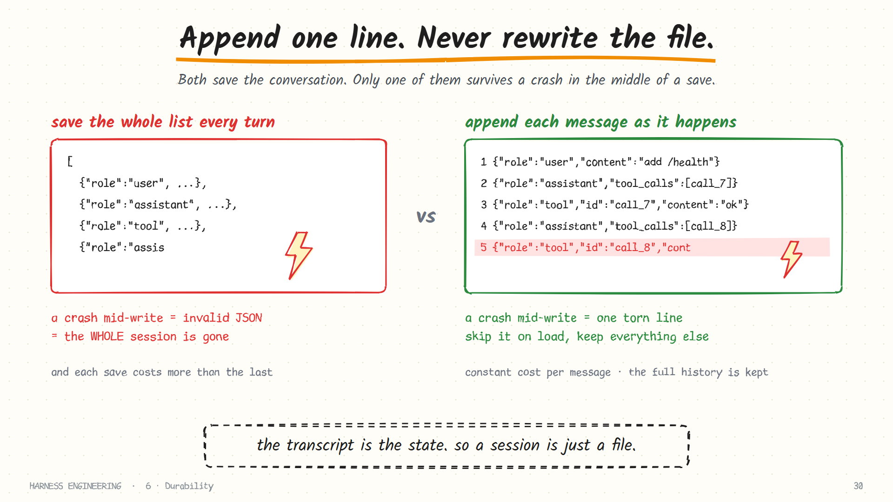
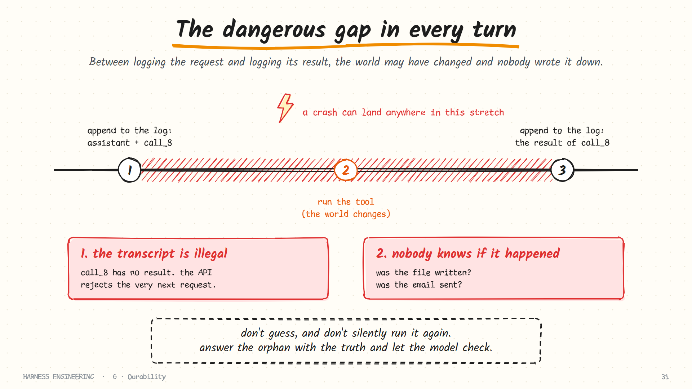
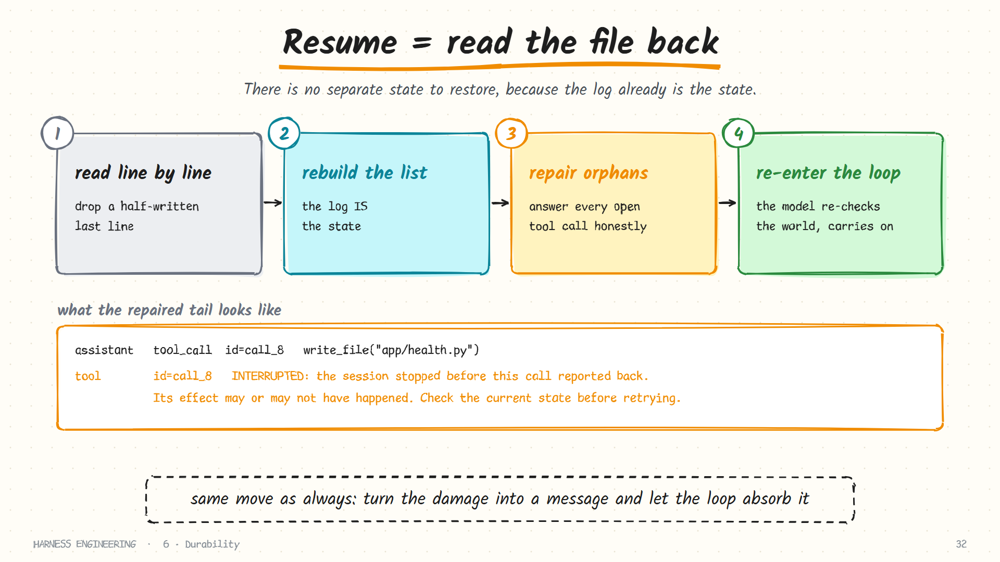
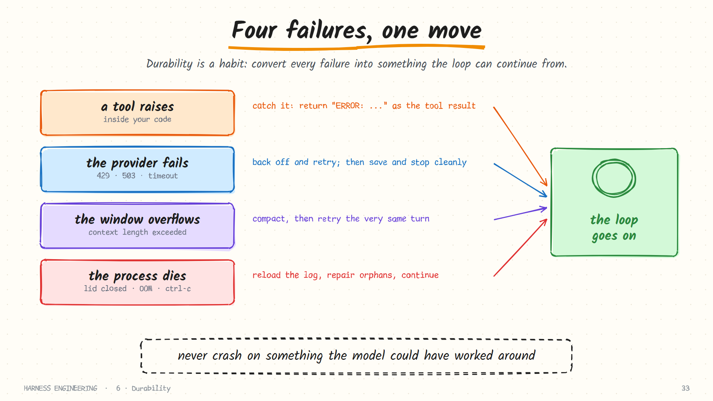
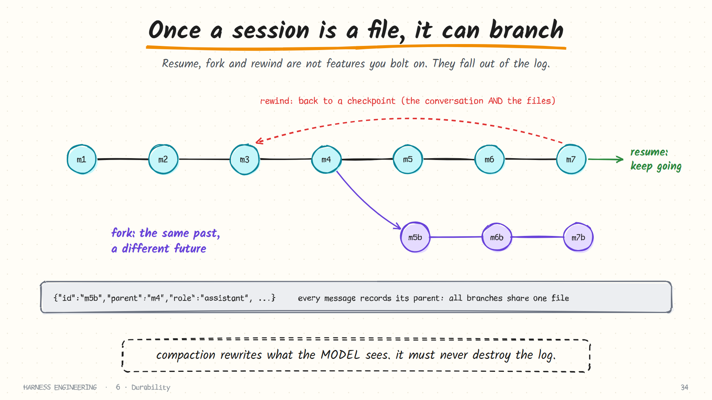

# 6. Durability

> **The question:** what survives a crash?

## The idea in one minute

Up to now the transcript has lived in a Python list. Lists die with the process. The laptop lid closes, the SSH session drops, the API returns a 500 at the wrong moment, and ninety minutes of work is gone.

Treat interruption as a normal event, not an accident. The design that makes that possible is borrowed from databases: **an append-only log, written before you rely on it.**

## What has to survive

Three different things are in play, and they need different treatment.

| State | Where it lives | If lost | How to keep it |
|-------|----------------|---------|----------------|
| **The transcript** | A list in memory | The agent forgets everything | Append each message to a log |
| **The workspace** | Files on disk | Usually survives a crash, but may be half-edited | Checkpoints you can roll back to |
| **In-flight effects** | The outside world | Nobody knows whether they happened | Log intent first; verify on resume |

Most of this chapter is about the first and the third. The second gets its own section.

## A session is a file

The transcript is already an ordered list of messages. Write each one to disk as a line of JSON the moment it exists.



```python
def append(path, message):
    record = {"ts": now_iso(), "msg": message}
    with open(path, "a", encoding="utf-8") as f:
        f.write(json.dumps(record, ensure_ascii=False) + "\n")
        f.flush()
        os.fsync(f.fileno())          # make sure it has really left the process
```

Why this shape, and not "save the whole list as JSON every turn"?

| | Rewrite the whole file | Append one line |
|---|------------------------|-----------------|
| Crash mid-write | The file may be truncated: everything lost | At worst the last line is torn |
| Cost per message | Grows with the session | Constant |
| History | Overwritten | Preserved; you can audit and replay |
| Detecting damage | Hard | Trivial: the last line fails to parse |
| Concurrent readers | See a half-written file | Always see whole lines |

Append-only means the worst possible damage is one half-written line at the tail, and that is easy to detect and discard.

### What goes in a record

A useful line carries more than the message:

```json
{"ts": "2026-01-14T10:15:02Z", "id": "m_0042", "parent": "m_0041", "turn": 14,
 "msg": {"role": "tool", "tool_call_id": "call_8", "content": "exit code 0\n14 passed"},
 "meta": {"tool": "run_shell", "ms": 8421, "tokens_in": 48210, "tokens_out": 312}}
```

| Field | Why you will want it |
|-------|----------------------|
| `ts` | "Why did that take so long?" |
| `id` and `parent` | Branching and rewinding (below) |
| `turn` | Slicing the log by lap |
| `meta.tool`, `meta.ms` | Finding slow tools |
| `meta.tokens_*` | Cost accounting ([chapter 9](09-evaluation.md)) |

Put a small **header** on the first line with a format version. Session formats change, and a version number is what lets a future release migrate old files instead of failing on them.

### About `fsync`

`fsync` forces the operating system to put the bytes on disk before your code continues. It costs a few milliseconds per message, which is negligible next to a model call that takes seconds. Skipping it means a power cut can lose the last several messages even though your code "wrote" them. For an agent, always sync.

## The ordering rule: log the intent before the effect

This is the single most important line in the chapter.

> Write the assistant message (with its tool calls) to the log **before** executing any of them. Write each result **after** it returns.

That is the *write-ahead* principle from databases: record what you are about to do before you do it. It guarantees that after a crash, the log never shows an effect with no record of the request that caused it.

## The gap: when a tool call has no result

Here is the sharp edge that ordering leaves behind.



If the process dies between the first append and the last, the log ends with a tool call that has no result. Two problems follow:

1. **The transcript is illegal.** The API rejects a request where a tool call is unanswered ([chapter 1](01-the-loop.md)).
2. **Nobody knows whether the effect happened.** Was the file written? Was the email sent?

## Resume is just reading the file



```python
def load(path):
    messages = []
    with open(path, encoding="utf-8") as f:
        for line in f:
            try:
                messages.append(json.loads(line)["msg"])
            except json.JSONDecodeError:
                break                  # torn tail: stop here, keep what is whole
    return repair(messages)
```

There is no separate "state" to restore, because [the transcript is the state](01-the-loop.md). Load it, hand it to the loop, and the agent continues.

The honest repair for an orphaned call is to answer it with the truth:

```python
def repair(messages):
    answered = {m["tool_call_id"] for m in messages if m["role"] == "tool"}
    fixed = []
    for m in messages:
        fixed.append(m)
        for call in m.get("tool_calls") or []:
            if call["id"] not in answered:
                fixed.append({"role": "tool", "tool_call_id": call["id"], "content":
                    "INTERRUPTED: the session stopped before this call reported back. "
                    "Its effect may or may not have happened. Check the current state "
                    "before retrying."})
    return fixed
```

Now the transcript is legal, and the model has been told exactly what you know. It will typically inspect the file or re-run a harmless check before deciding. This is the same move as in chapters 1 and 3: **turn the damage into a message and let the loop absorb it.**

### Why not just re-run the call?

Because some calls are not safe to repeat. Use the classification from [chapter 2](02-tools.md):

| The interrupted call was… | On resume |
|---------------------------|-----------|
| A pure read (`read_file`, `search`) | Safe to re-run automatically, though telling the model is simpler and just as good |
| An idempotent write (an exact-match edit) | A repeat either succeeds or fails harmlessly; let the model decide |
| A local, non-idempotent action (`git commit`, appending) | Tell the model; it should check state first |
| An external effect (email, payment, deploy) | Never re-run. Tell the model, and involve a human |

Where you control the far side of an external call, attach an **idempotency key**: a unique id sent with the request, so the receiving system recognises a repeat and ignores it.

## Three failures, one move

Durability is the general habit of converting failures into something the loop can continue from.



| Failure | Where it happens | Conversion |
|---------|------------------|------------|
| A tool raises | Inside your code | Catch it; return `ERROR: …` as the tool result |
| The provider fails | The model call | Retry with backoff; after N tries, save and stop with a clear status |
| The window overflows | The model call | Compact ([chapter 4](04-context.md)), then retry the same turn once |
| The process dies | Anywhere | Reload the log, repair orphans, continue |

### Retrying the provider properly

Network APIs fail routinely. Retries belong in the provider layer, where they are invisible to the loop.

| Response | Meaning | What to do |
|----------|---------|------------|
| `429` | Rate limited | Wait (honour `Retry-After` if present), then retry |
| `500`, `502`, `503`, `529` | The server is struggling | Retry with exponential backoff |
| Timeout, connection reset | The network blinked | Retry |
| `400` | Your request is malformed | **Do not retry.** It will fail identically. Surface it |
| `401`, `403` | Bad or missing credentials | Do not retry. Stop with a clear message |
| `413` / "context length exceeded" | Too many tokens | Compact, then retry once |

```python
for attempt in range(5):
    try:
        return post(url, body)
    except Retryable as e:
        if attempt == 4:
            raise ProviderDown("gave up after 5 attempts") from e
        time.sleep(min(60, 2 ** attempt) + random.random())   # backoff with jitter
```

The random jitter matters when many agents share one account: without it, they all retry at the same instant and collide again. For unattended runs, add a **fallback model**: if the primary is down after N attempts, continue on a second one rather than abandoning a three-hour job.

### Shutting down cleanly

Ctrl-C is the commonest "crash". Handle it deliberately:

1. Stop reading the model's stream.
2. If tool calls were pending, append a `CANCELLED` result for each, so the transcript stays legal.
3. Flush the log.
4. Print how to resume: the session path or id.

A run that prints `resume with: --resume .harness/sessions/20260114-101502.jsonl` on the way out has turned an interruption into a pause.

## The transcript is half the state

The other half is the **workspace**. Resuming a transcript against files that changed underneath it produces a confused agent, and "undo" needs the files as well as the conversation.

| Approach | How | Trade-off |
|----------|-----|-----------|
| **Checkpoint commits** | Commit or stash the workspace before each edit, or each turn | Simple and robust; clutters history unless on a throwaway branch |
| **Shadow snapshots** | Keep snapshots in a separate git directory outside the user's repo | Clean history; more plumbing |
| **Checkpoint ids in the log** | Each turn's record names its snapshot | "Rewind to turn 12" restores conversation and files together |

A minimal version needs no new machinery:

```bash
git stash create "checkpoint turn 12"     # prints a commit id without touching the working tree
```

Store that id in the turn's log record. Rewinding becomes `git checkout <id> -- .` plus truncating your view of the transcript to that turn.

## Beyond a straight line: forks and trees

Once sessions are files, more becomes possible.



- **Resume** an old session by id.
- **Fork** it: continue from an earlier point down a different path, keeping the original.
- **Rewind**: step back to a checkpoint and restore the files to match.

The enabling idea is one extra field. Give every record an `id` and a `parentId`, and the log becomes a tree stored in a single append-only file. The "current" conversation is simply the path from the root to the active leaf; a branch is a new record whose parent is not the last line. Nothing is ever overwritten.

## Compaction and the log

A subtle point: compaction ([chapter 4](04-context.md)) rewrites what the *model* sees. It must not destroy the *log*.

Append a compaction record instead ("from here on, everything before message X is represented by this summary"), and derive the live transcript by reading forward. You keep the full history for audit and debugging, and the model gets the folded view.

Compaction is also itself a multi-step operation that can be interrupted. One harness brackets it with *start* and *end* records that act as a lock: a crash in the middle leaves a start with no end, which is a detectable, recoverable state rather than a half-applied fold that looks complete.

## Logs are also your black box

The same file that makes resume possible makes everything in [chapter 9](09-evaluation.md) possible. With timestamps, token usage and tool durations on each line, you can answer "why did that take so long?" and "what did it cost?" from a text file.

One team states the standard as a rule: **anything the model can see must be reconstructable from the log.** If a request ever contained something the log cannot reproduce (an injected reminder, a dynamically added hint), you have lost the ability to debug it.

Two practical cautions:

- **One writer per session file.** Two processes appending to the same log interleave their lines and corrupt the tree. Take a lock.
- **Redact secrets before writing.** Tool output goes into the log verbatim. A printed environment variable is now a credential at rest on disk.

## Test it the way it will break

Durability code is only real once you have tried to break it:

| Test | Expected |
|------|----------|
| `kill -9` during a tool call, then resume | An `INTERRUPTED` result is added; the run continues |
| Truncate the last line of a session file by hand | Load succeeds, minus that line |
| Disconnect the network mid-run | Retries, then a clean stop with the session saved |
| Fill the window with one huge tool result | Compaction and a retry, not a crash |
| Resume a session twice at once | The second is refused |

## Common mistakes

- **Saving at the end.** A run that only persists on clean exit persists nothing when it matters.
- **Executing before logging.** An effect with no record of the request is the worst state to recover from.
- **Silent retry of an interrupted call.** Fine for reads, a disaster for side effects.
- **Retrying a 400.** It will fail the same way forever.
- **Mutating old lines.** The moment you edit history, the log stops being evidence.
- **No format version.** The first schema change strands every existing session.
- **Storing secrets.**

## How real harnesses do it

- **Claude Code** stores sessions as append-oriented JSONL, supports resuming, forking and rewinding to checkpoints, and writes sub-agent transcripts to separate files.
- **Codex** records sessions to disk for resuming, and isolates tasks in git worktrees so a failed run leaves the main checkout untouched.
- **Pi** stores each session as a JSONL **tree**: every entry has an `id` and a `parentId`, the file carries a version header and is migrated on load, continuing from an earlier entry creates a branch in the same file, and compaction appends a summary entry while the originals remain.
- **Hermes** keeps session state in a local database with full-text search, so past conversations are both resumable and searchable.
- **DeepSeek Harness** builds everything on an append-only, versioned session event log, derives the model's view from it, logs each tool call *before* execution, and states "model-visible means logged" as an invariant.

## In the reference code

[`examples/mini_harness.py`](../examples/README.md): `Session.append`, `Session.load` and `repair()`. A `reset` record represents a compaction without deleting earlier lines. Start a task, press Ctrl-C during a tool call, then run again with `--resume <file>`.

## Check yourself

1. Why is a torn last line acceptable, when a truncated whole-file save is not?
2. A resumed log ends with an assistant message containing `call_8` and nothing after it. What must happen before the next model call?
3. Which of these is safe to re-run blindly after a crash: `read_file`, `run_shell("pytest")`, `run_shell("git push")`, `send_email`?
4. Your harness compacts by overwriting the session file with the summary. What have you lost?
5. The provider returns HTTP 400 on turn 12. Should you retry? What about 503?
6. What single field turns a linear log into a tree?

<details>
<summary>Answers</summary>

1. A torn tail loses at most one message and is detectable; a truncated rewrite can lose everything.
2. A tool result for `call_8` must be appended, stating the call was interrupted and its effect is unknown.
3. `read_file` and `pytest`. A push or an email may already have happened.
4. The full history: audit trail, debuggability, and the ability to fork from before the fold.
5. Not a 400: the request itself is wrong and will fail identically. Yes for a 503, with backoff.
6. A parent id on every record.

</details>

## Try it

Make your harness log to JSONL. Start a multi-step task, kill it mid-tool-call with `kill -9`, and resume. Then open the file in a text editor and read it top to bottom. That file is the most useful debugging tool you will build.

**Next:** [7. Delegation →](07-delegation.md)
