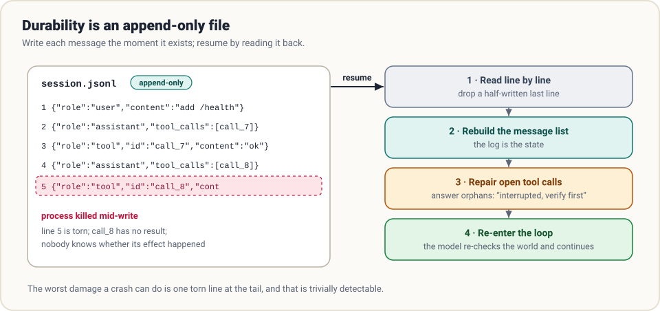
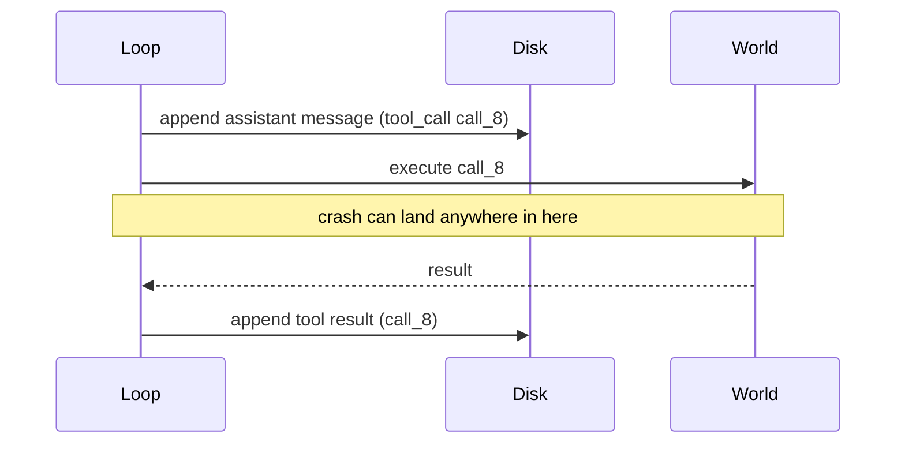

# 6. Durability

> **The question:** what survives a crash?

## The idea in one minute

Up to now the transcript has lived in a Python list. Lists die with the process. The laptop lid closes, the SSH session drops, the API returns a 500 at the wrong moment, and ninety minutes of work is gone.

Treat interruption as a normal event, not an accident. The design that makes that possible is borrowed from databases: **an append-only log, written before you rely on it.**



## A session is a file

The transcript is already an ordered list of messages. Write each one to disk as a line of JSON the moment it exists:

```python
def append(path, message):
    with open(path, "a", encoding="utf-8") as f:
        f.write(json.dumps(message, ensure_ascii=False) + "\n")
        f.flush()
        os.fsync(f.fileno())          # make sure it has really left the process
```

Why this shape, and not "save the whole list as JSON every turn"?

| | Rewrite the whole file | Append one line |
|---|------------------------|-----------------|
| Crash mid-write | The file may be truncated: everything lost | At worst the last line is torn |
| Cost per message | Grows with the session | Constant |
| History | Overwritten | Preserved; you can audit and replay |
| Detecting damage | Hard | Trivial: the last line fails to parse |

Append-only means the worst possible damage is one half-written line at the tail, and that is easy to detect and discard.

## Resume is just reading the file

```python
def load(path):
    messages = []
    with open(path, encoding="utf-8") as f:
        for line in f:
            try:
                messages.append(json.loads(line))
            except json.JSONDecodeError:
                break                  # torn tail: stop here, keep what is whole
    return repair(messages)
```

There is no separate "state" to restore, because [the transcript is the state](01-the-loop.md). Load it, hand it to the loop, and the agent continues. It does not know it was ever interrupted unless you tell it.

## The gap: when a tool call has no result

Here is the sharp edge. Consider the order of events in one turn:



If the process dies between the first append and the last, the log ends with a tool call that has no result. Two problems follow:

1. **The transcript is illegal.** The API rejects a request where a tool call is unanswered.
2. **Nobody knows whether the effect happened.** Was the file written? Was the email sent?

The honest repair is to answer the orphan with the truth:

```python
def repair(messages):
    answered = {m["tool_call_id"] for m in messages if m["role"] == "tool"}
    fixed = []
    for m in messages:
        fixed.append(m)
        for call in m.get("tool_calls") or []:
            if call["id"] not in answered:
                fixed.append({"role": "tool", "tool_call_id": call["id"], "content":
                    "INTERRUPTED: the session stopped before this call reported back. "
                    "Its effect may or may not have happened. Check the current state "
                    "before retrying."})
    return fixed
```

Now the transcript is legal, and the model has been told what you actually know. It will typically inspect the file or re-run a harmless check before deciding. This is the same move as in chapters 1 and 3: **turn the damage into a message and let the loop absorb it.**

### Why not just re-run the call?

Because some calls are not safe to repeat. Reading a file twice is fine. Appending to a file twice, or charging a card twice, is not. This is why [chapter 2](02-tools.md) favours tools that are harmless to re-run, and why truly irreversible actions sit behind a human in [chapter 3](03-guardrails.md). Where you control the far side, use an idempotency key so a repeat is recognised and ignored.

## Three failures, one move

Durability is the general habit of converting failures into something the loop can continue from.

| Failure | Where it happens | Conversion |
|---------|------------------|------------|
| A tool raises | Inside your code | Catch it; return `ERROR: …` as the tool result |
| The provider fails (429, 5xx, timeout) | The model call | Retry with exponential backoff and jitter; after N tries, save and stop with a clear status |
| The window overflows | The model call | Compact ([chapter 4](04-context.md)), then retry the same turn |
| The process dies | Anywhere | Reload the log, repair orphans, continue |

Retries belong in the provider layer, where they are invisible to the loop:

```python
for attempt in range(5):
    try:
        return post(url, body)
    except Retryable:
        time.sleep(min(60, 2 ** attempt) + random.random())
raise ProviderDown("gave up after 5 attempts")
```

## The transcript is half the state

The other half is the **workspace**: the files on disk. Resuming a transcript against a workspace that changed underneath it produces a confused agent, and "undo" needs the files as well as the conversation.

Common approaches:

- **Checkpoint commits.** Commit (or stash) the workspace before each edit or at each turn. Undo is a `git` operation. Cheap and robust.
- **Shadow snapshots.** Keep file snapshots outside the user's git history so checkpoints do not pollute it.
- **Record the checkpoint in the log.** Each turn's log entry names its checkpoint, so "rewind to turn 12" restores conversation and files together.

## Beyond a straight line: forks and trees

Once sessions are files, more becomes possible:

- **Resume** an old session by id.
- **Fork** it: copy the log up to some turn and continue differently, keeping the original.
- **Tree-shaped sessions.** Store every message with a parent id, so branches live in one file and you can return to any earlier point.

These are not exotic. They fall out naturally once the log is the source of truth.

## Compaction and the log

A subtle point: compaction ([chapter 4](04-context.md)) rewrites what the *model* sees. It should not destroy the *log*. Append a compaction record instead ("from here, messages 1 to 40 are represented by this summary") and derive the live transcript by reading forward. You keep the full history for audit and debugging, and the model gets the folded view.

## Logs are also your black box

The same file that makes resume possible makes everything in [chapter 9](09-evaluation.md) possible. If each line also carries a timestamp, token usage, and tool duration, you can answer "why did that take so long?" and "what did it cost?" from a text file.

One team states the standard as a rule: *anything the model can see must be reconstructable from the log.* If a request ever contained something the log cannot reproduce, you have lost the ability to debug it.

## Common mistakes

- **Saving at the end.** A run that only persists on clean exit persists nothing when it matters.
- **Saving results but not calls** (or the reverse). Log every message, in order, as it is created.
- **Silent retry of an interrupted call.** Fine for reads, a disaster for side effects. Tell the model and let it verify.
- **Mutating old lines.** The moment you edit history, the log stops being evidence.
- **Storing secrets.** Tool output goes into the log verbatim. Redact tokens and keys before writing.

## How real harnesses do it

- **Claude Code** stores sessions as append-oriented JSONL, supports `/resume`, forking and rewinding to checkpoints, and writes sub-agent transcripts to separate files.
- **Codex** records sessions as rollout files that can be resumed, and isolates tasks in worktrees so a failed run leaves the main checkout untouched.
- **Pi** stores sessions as trees in a single file; `/tree` returns to any earlier node and branches from it.
- **DeepSeek Harness** builds everything on an append-only session event log and derives the model's view from it, with "model-visible means logged" as a stated invariant.
- **Hermes** keeps session state in SQLite with full-text search, so past conversations are both resumable and searchable.

## In the reference code

[`examples/mini_harness.py`](../examples/README.md): `Session.append`, `Session.load` and `repair()`. Start a task, kill the process with Ctrl-C during a tool call, then run again with `--resume <file>`.

## Check yourself

1. Why is a torn last line acceptable, when a truncated whole-file save is not?
2. A resumed log ends with an assistant message containing `call_8` and nothing after it. What must happen before the next model call?
3. Which of these is safe to re-run blindly after a crash: `read_file`, `run_shell("pytest")`, `run_shell("git push")`, `send_email`?
4. Your harness compacts by overwriting the session file with the summary. What have you lost?

<details>
<summary>Answers</summary>

1. A torn tail loses at most one message and is detectable; a truncated rewrite can lose everything.
2. A tool result for `call_8` must be appended, stating the call was interrupted and its effect is unknown.
3. `read_file` and `pytest`. A push or an email may already have happened.
4. The full history: audit trail, debuggability, and the ability to fork from before the fold.

</details>

## Try it

Make your harness log to JSONL. Start a multi-step task, kill it mid-tool-call, and resume. Then open the file in a text editor and read it top to bottom. That file is the most useful debugging tool you will build.

**Next:** [7. Delegation →](07-delegation.md)
