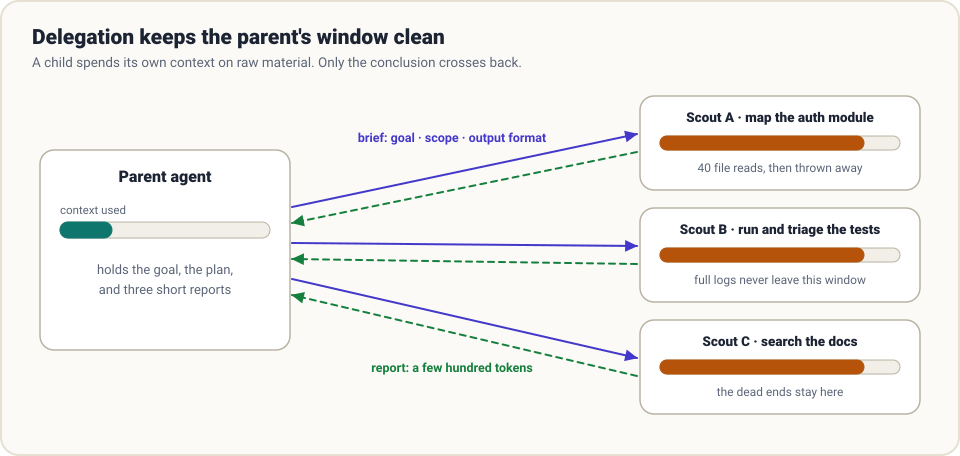

# 7. Delegation

> **The question:** when should one agent hand work to another?

## The idea in one minute

Some sub-tasks are expensive to *do* and cheap to *report*. Finding where authentication is handled might take forty file reads; the answer is three sentences. If the main agent does the reading itself, all forty files sit in its transcript for the rest of the run.

A **sub-agent** is the same loop, started with a fresh, empty transcript and a written brief. It burns its own context on the raw material, returns a short report, and is thrown away.



Delegation is, first of all, a **context management** technique. Parallelism is a bonus.

## Why delegate

| Reason | What you get |
|--------|--------------|
| **Isolation** | The parent's window holds conclusions, not raw material |
| **Parallelism** | Independent questions answered at the same time |
| **Specialisation** | A different system prompt, tool set, or model for a narrow job |
| **A second opinion** | A reviewer that has not seen the author's reasoning and cannot be anchored by it |

## A sub-agent is twenty lines

Nothing new is needed. Delegation is a tool whose implementation is "run the loop again":

```python
def spawn_agent(brief: str, tools=READ_ONLY_TOOLS, max_turns=25) -> str:
    """Run a sub-agent on a self-contained task and return its final report."""
    messages = [
        {"role": "system", "content": SUBAGENT_PROMPT},
        {"role": "user", "content": brief},
    ]
    return run_loop(messages, tools, max_turns=max_turns)   # the same loop
```

Register that function as a tool and the model can call it like any other. The child's whole transcript stays inside the call; the parent sees one string.

## The brief is the entire interface

A sub-agent knows nothing the parent knows. Not the user's goal, not which files were already ruled out, not that "the API" means the internal one. Only the brief crosses the boundary.

The classic failure is a one-liner:

```text
Look into the auth bug.
```

The child must guess the bug, the scope, and what "look into" should produce. Compare:

```text
GOAL
Find why requests with an expired token return HTTP 500 instead of 401.

CONTEXT
FastAPI service in ./app. Auth lives somewhere under app/security/.
I already confirmed token decoding itself works (tests/test_jwt.py passes).

SCOPE
Read-only. Do not modify files. Stay inside ./app and ./tests.

DONE WHEN
You can name the file and line where the wrong status code originates.

REPORT
- Root cause in one or two sentences
- File path and line number
- The smallest change you would make
- Anything you checked and ruled out
```

A good brief has five parts:

1. **Goal.** The outcome, and why it matters.
2. **Context.** What the parent already knows, including what has been ruled out.
3. **Scope.** What it may touch, and what it must not.
4. **Done.** A condition it can check for itself.
5. **Report format.** Exactly what to send back.

Writing this takes the parent a few hundred tokens. Skipping it costs a wasted run.

## The report is the other half

The report is the only thing that survives. Ask for it deliberately:

- **Conclusions, not narration.** "The bug is in `deps.py:41`" beats a diary of every file opened.
- **Evidence the parent can check.** Paths, line numbers, commands run, exact error text.
- **What was *not* done.** If the child ran out of turns or could not verify something, it must say so. A confident-sounding partial answer is worse than an honest "I could not find it."

And the parent should treat a report as a claim from a colleague, not as ground truth. For anything that matters, verify: open the file, run the test.

## Rules that keep delegation sane

- **No grandchildren by default.** Give sub-agents no `spawn_agent` tool. Unbounded recursion multiplies cost and makes failures untraceable.
- **Least privilege.** A research sub-agent gets read-only tools. Fewer tools also means a shorter prompt.
- **A budget per child.** Its own turn limit and, ideally, token cap.
- **Children cannot ask the user.** They either finish or report that they are blocked. Design briefs so that is enough.
- **One writer.** If several agents edit the same files in the same checkout, they will overwrite each other. Parallelise reads freely; give writers separate worktrees or do writes in the parent.
- **Results come home as data.** A child's report can contain hostile text it picked up from a web page. The parent should not treat it as instructions ([guardrails](03-guardrails.md)).

## What it costs

Delegation trades tokens for a clean window.

- Each child pays its own system prompt and tool schemas again.
- Multi-agent runs commonly use several times the tokens of a single agent doing the same task.
- Coordination has overhead: writing briefs, reading reports, reconciling disagreements.

So delegate when the raw material is **large and the result is small**, or when questions are **truly independent**. Do not delegate a tightly coupled task where every step depends on the last; you will spend more explaining it than doing it.

| Delegate | Keep in the parent |
|----------|--------------------|
| "Where is X handled?" across a big codebase | A change that touches three files you are already reading |
| Running a long test suite and triaging failures | A decision that needs the whole conversation's nuance |
| Researching three unrelated libraries | Anything requiring a question to the user |
| An independent review of a finished diff | Sequential steps where each depends on the previous output |

## Sidechains: keep the child's transcript

"Thrown away" means it does not enter the parent's context, not that it should be deleted. Write each child's transcript to its own log file. When a report turns out wrong, that file is the only way to find out why.

## Common mistakes

- **The telephone game.** Parent summarises for child, child summarises for parent, parent summarises for user. Detail erodes at each hop. Pass exact strings (paths, error text) through unchanged.
- **Delegating the understanding.** "Based on your findings, fix it" pushes the thinking onto a worker with less context. The parent should read the report and decide.
- **Duplicate work.** Two children both explore the same directory because neither brief drew a boundary.
- **Fan-out with no budget.** Twenty children on a large model is a real invoice.

## How real harnesses do it

- **Claude Code** has built-in sub-agents with their own context windows, tool sets and optional custom system prompts; their transcripts are kept as separate sidechain files and do not inflate the parent.
- **Codex** exposes spawn and wait as tools, and lets you define named agents with their own model and instructions in configuration.
- **Pi** deliberately ships without sub-agents in the core. Its position is that you can add them as an extension, or ask Pi to build the variant you want.
- **Hermes** spawns isolated sub-agents for parallel work, and adds a twist: the agent can write a script that calls tools directly, collapsing a multi-step pipeline into a single turn.
- **DeepSeek Harness** models sub-agents as a swappable capability, so the "child" can be a fresh agent or a delegated turn in a different product altogether.

## In the reference code

[`examples/mini_harness.py`](../examples/README.md): `tool_spawn_agent` reuses `run_loop` with a read-only tool set and its own turn cap.

## Check yourself

1. A sub-agent reads 60 files to answer a question. How many of those files end up in the parent's context?
2. Name the five parts of a good brief.
3. Why should sub-agents usually *not* be given the delegation tool themselves?
4. Two sub-agents are asked to refactor overlapping files in the same checkout at the same time. What goes wrong, and what are two ways to prevent it?

<details>
<summary>Answers</summary>

1. None. Only the report does.
2. Goal, context, scope, done-condition, report format.
3. Recursion multiplies cost and makes runs hard to trace and bound.
4. They overwrite each other's edits. Give each its own worktree, or have only one writer.

</details>

## Try it

Pick a question about a large codebase. Have your harness answer it once directly and once through a read-only sub-agent. Compare the parent's token count at the end of each run.

**Next:** [8. Orchestration →](08-orchestration.md)
