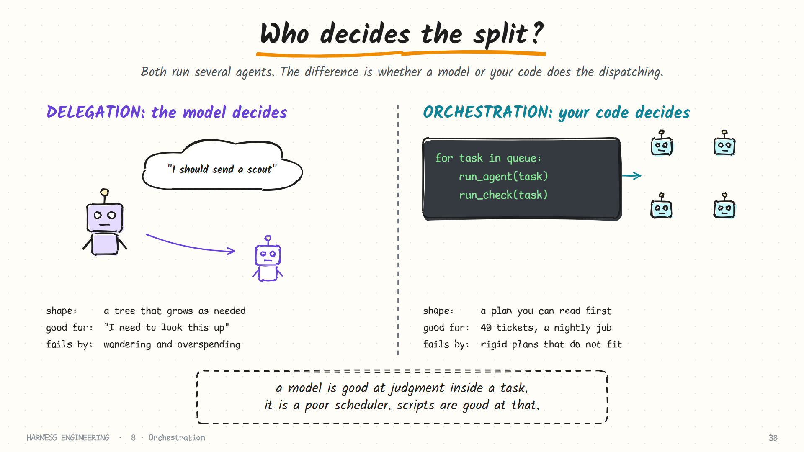
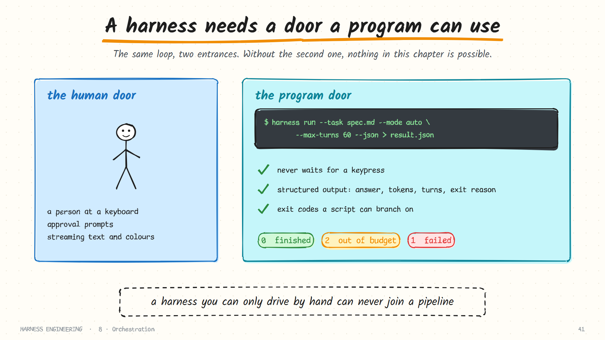
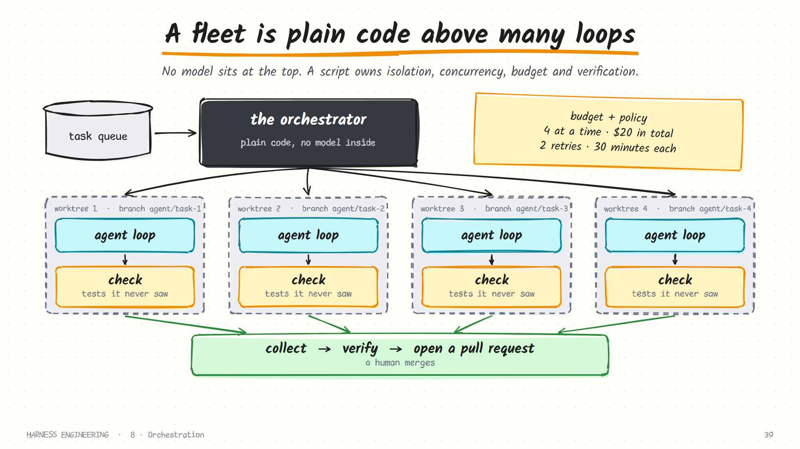

# 8. Orchestration

> **The question:** how does work scale past one agent?

## The idea in one minute

In [delegation](07-delegation.md), a *model* decided to hand off a sub-task. Orchestration is different: **ordinary code** decides which agents run, on what, in what order, with what budget. No model sits at the top.



That distinction matters. A model is good at judgment inside a task. It is a poor scheduler: it cannot hold fifty parallel jobs in mind, it cannot guarantee a cost cap, and it does not retry reliably. Scripts can.

| | Delegation | Orchestration |
|---|------------|---------------|
| Who decides the split | The model, mid-task | Your code, up front |
| Shape | A tree that grows as needed | A plan you can read before it runs |
| Budget | Hard to bound in advance | Enforced by the script |
| Good for | "I need to look something up" | 40 tickets, a nightly job, a pipeline |
| Fails by | Wandering and overspending | Rigid plans that do not fit the task |

## Prerequisite: a headless door

An orchestrator is a program, so the harness needs an interface a program can use.



```bash
harness run --task "$(cat spec.md)" --mode auto --max-turns 60 --json > result.json
echo $?    # 0 = finished, 2 = out of budget, 1 = error
```

Three properties make this work:

| Property | Why a script needs it |
|----------|-----------------------|
| **Non-interactive** | It must never wait for a keypress. Anything needing approval is decided by policy, or fails closed |
| **Structured output** | The answer, token usage, turn count and exit reason, as JSON a program can parse |
| **Meaningful exit codes** | Finished, out of budget and broken are three different outcomes; the caller must be able to branch on them |

A typical result object:

```json
{ "status": "finished", "answer": "Added GET /health and a test. 15 tests pass.",
  "turns": 11, "tokens_in": 184210, "tokens_out": 3120, "cost_usd": 0.41,
  "session": ".harness/sessions/20260114-101502.jsonl" }
```

Beyond one-shot runs, mature harnesses offer two richer doors: a **streaming event mode** that emits every message and tool call as a line of JSON, and an **RPC or SDK mode** where another program can send messages, approve calls and interrupt. A harness that can only be driven by a person at a keyboard can never be automated.

## A fleet in thirty lines



```python
from concurrent.futures import ThreadPoolExecutor

def run_one(spec):
    workdir = make_worktree(spec.id)                # isolated checkout
    try:
        result = harness_run(spec.task, cwd=workdir, max_turns=60, mode="auto")
        passed = run_check(spec.check_cmd, cwd=workdir)   # the agent never sees this
        return {"id": spec.id, "passed": passed, **result}
    except Exception as e:
        return {"id": spec.id, "passed": False, "error": str(e)}

def run_fleet(specs, workers=4, budget_usd=20.0):
    spent, results = 0.0, []
    with ThreadPoolExecutor(max_workers=workers) as pool:
        for r in pool.map(run_one, specs):
            results.append(r)
            append_jsonl("results.jsonl", r)        # survive a crash of the fleet itself
            spent += r.get("cost_usd", 0)
            if spent > budget_usd:
                pool.shutdown(cancel_futures=True)
                break
    return results
```

There is no intelligence here, and that is the point. The orchestrator owns four boring responsibilities.

| Responsibility | What it means | What goes wrong without it |
|----------------|---------------|----------------------------|
| **Isolation** | Each task gets its own working directory | Agents overwrite each other's files |
| **Concurrency** | A fixed number at a time | Rate limits, then a wave of 429 errors |
| **Budget** | A total spend cap that actually stops the run | A surprise invoice |
| **Verification** | A check that is independent of the agent's opinion | A pass rate that measures confidence, not correctness |

### Make the fleet itself durable

The orchestrator is a long-running process too, and everything in [chapter 6](06-durability.md) applies to it. Write each finished task to a results file as it completes, and make the script skip tasks already recorded. Then a fleet that dies at task 31 of 50 restarts at task 32, not task 1.

## Isolation: one workspace per task

Parallel agents in one directory will overwrite each other. The standard answer for code is **git worktrees**: several checkouts of the same repository, each on its own branch, sharing one object store.

```bash
git worktree add ../wt-task-17 -b agent/task-17     # a fresh checkout on a new branch
# ... the agent works in ../wt-task-17 ...
git worktree remove ../wt-task-17                   # gone without a trace if it failed
```

Each agent works in its own tree; successful branches are merged or opened as pull requests; failed ones are deleted. A worktree separates *work*, not *privilege*, so for unattended runs put each one inside a container as well ([guardrails](03-guardrails.md)).

Isolation has a subtler requirement: each task also needs its own **runtime**. If four agents start the app on port 8000 or share one test database, they will interfere just as surely as if they shared files. Give each its own port, database and temp directory.

### Merging the results

Parallel work has to come back together, and this is where naive fleets stall.

- **Keep tasks small and non-overlapping.** Two tasks that both rewrite the same module will conflict no matter how clever the merge.
- **Merge one at a time and re-run the checks after each.** A branch that passed in isolation can fail once its neighbour has landed.
- **Send conflicts back to an agent**, with the conflict as the task. Resolving a rebase is work agents do well, given a check to confirm the result.

## Verification: never grade your own homework

The most important line in the fleet code is `run_check`. An agent's final message says "all tests pass". That is a claim. The orchestrator runs the tests itself.

| Check | Catches | Cost |
|-------|---------|------|
| Required files exist | The agent stopped early | Trivial |
| Build and lint | Broken syntax, obvious errors | Seconds |
| Unit tests | Regressions | Seconds to minutes |
| A hidden acceptance test | Solutions that fit the visible tests and miss the point | Minutes |
| A reviewer agent with a rubric | What tests cannot express: clarity, scope creep | A model call |
| A human | Everything irreversible | Attention |

Run them cheapest first, and stop at the first failure.

## When a task fails

The reflex is to retry. Resist it past the first attempt.

| Failure | Sensible response |
|---------|-------------------|
| Provider outage, timeout | Retry the same task; nothing was wrong with it |
| Out of turns, with real progress | Resume the session with more budget |
| The check failed | One retry, **with the check's output added to the task** |
| It failed the same way twice | Stop. The spec is unclear or the task is too big. A person should look |
| Ran out of budget wandering | Narrow the task; do not raise the budget |

A task that failed three times usually needs a better spec, not a fourth attempt. Retrying an under-specified task just purchases the same wrong answer again.

## Maker and checker

The simplest multi-agent pattern that reliably improves quality is two roles in a loop.


- The **maker** does the work.
- The **checker** evaluates the result against explicit criteria. Prefer a mechanical check (tests). Where that is impossible, use a second agent with a fresh context and a written rubric.
- On failure, the checker's **specific** feedback is appended to a state file and the maker tries again.
- A **hard cap** on iterations ends it, along with a budget cap and a no-progress check.

Why a separate checker instead of asking the maker to review itself? An agent that has just spent an hour on something is anchored by its own reasoning and tends to approve. A reviewer that sees only the artifact and the criteria is far harsher, and more useful.

A checker prompt that works:

```text
You are reviewing a change. You have not seen how it was made.
Criteria: (1) the tests in tests/api pass; (2) no file outside app/ changed;
(3) every new function has a docstring; (4) no TODO comments were added.
For each criterion answer PASS or FAIL with the evidence (a file and line, or command output).
If anything fails, say exactly what to change. Do not praise.
```

## Pipelines and graphs

Chain those ideas and you get a pipeline: plan, then implement, then test, then review. Let stages branch and loop and you have a graph.


The rule that keeps graphs maintainable: **nodes are agent runs; edges are code.** Each node has a narrow job, its own prompt, its own tools and a fresh context. Each transition is an `if` on something mechanical: an exit code, a test result, a field in a JSON file. State that must survive between nodes lives in files, not in anyone's context.

Give every node a written contract:

| Field | Example |
|-------|---------|
| Input | `plan.md` and the issue text |
| Output | A branch with commits; `result.json` with a status and a summary |
| Tools | Read, edit, shell. No network |
| Done when | `make check` exits 0 |
| On failure | Write what blocked you to `result.json`; exit non-zero |

Resist drawing the graph first. Most work is served by one good agent, then by a maker and checker. Add nodes only when you can name the failure each one prevents. See [loops and graphs](../practice/loops-and-graphs.md) for when to graduate.

## Triggers: who starts the run?

Once runs are headless, they do not need a person to start them.

| Trigger | Example | Extra care |
|---------|---------|------------|
| **Scheduled** | A nightly dependency audit; a weekly report | Make it idempotent: two runs must not do the work twice |
| **Event-driven** | A new issue, a failing CI job, a webhook | The event payload is untrusted input |
| **Queue-driven** | Workers pulling tasks from a backlog | Claim a task atomically so two workers do not take it |

Unattended runs raise the stakes on everything earlier in this guide. There is no human to notice a runaway loop, so turn caps and cost caps are mandatory. There is no human to approve an action, so the sandbox carries the full weight. And nobody is watching the terminal, so the log is the only record of what happened.

## Keep the human at the right doors

Orchestration does not remove people; it moves them. The pattern that works is to let reversible work flow and require a person exactly where it becomes irreversible:

- Agents open pull requests; people merge them.
- Agents draft the release notes; people publish.
- Agents propose the migration; people run it in production.

A useful mental check for any pipeline: *list every action in it that cannot be undone, and confirm a person stands in front of each one.*

## What to watch while it runs

A fleet needs a dashboard, even if it is a text file. The numbers that matter:

| Metric | Tells you |
|--------|-----------|
| Tasks finished / failed / in progress | Throughput, and whether it is stuck |
| Pass rate on the independent check | The only quality number that counts |
| Cost so far, and cost per task | Whether the budget will hold |
| Turns per task (median and worst) | Wandering shows up here first |
| Retries and their reasons | Whether failures are the provider's or the spec's |

## Common mistakes

- **A model as the scheduler.** It will lose track, and you cannot enforce a budget on it.
- **Shared mutable workspace.** Parallel writers in one checkout corrupt each other's work.
- **Shared runtime.** One port, one database, four agents.
- **No global budget.** Per-task limits do not stop fifty tasks from each spending their limit.
- **Trusting "done".** Without an independent check, pass rate measures confidence, not correctness.
- **Retrying forever.** A task that failed three times usually needs a better spec, not a fourth attempt.
- **Too many agents.** Coordination overhead grows quickly. Ten agents are rarely ten times as productive as one.
- **A fleet that cannot resume.** If it dies at task 31, it should not start again at task 1.

## How real harnesses do it

- **Claude Code** runs headlessly with a print mode and structured output, exposes its loop as an SDK, and supports background and scheduled agents.
- **Codex** has a non-interactive execution mode and a cloud product that runs tasks in parallel in remote sandboxes. It was also the vehicle for one of the best-known reports in this area: OpenAI's "harness engineering" account of agents working in isolated worktrees, each with its own instance of the application and its own logs, metrics and traces.
- **Pi** offers a print mode, a JSON mode that writes agent events as lines of JSON, an RPC mode that accepts commands on stdin, and a TypeScript SDK; all four use the same agent and session mechanisms.
- **Hermes** includes a cron scheduler and a messaging gateway, so runs can be triggered on a timer or from a chat app and report back there.
- **DeepSeek Harness** ships launch profiles for a one-shot headless runner, an SDK server and an automation server, plus experimental agent teams with shared task state.

## In the reference code

[`examples/mini_harness.py`](../examples/README.md) provides the headless door: `--json` prints a result object, and the exit code is `0` for finished, `2` for out of turns and `1` for an error. That is everything a fleet script needs.

## Check yourself

1. What is the essential difference between delegation and orchestration?
2. Name three things a headless mode must provide for a script to use it.
3. Your fleet reports 24 of 25 tasks "completed". What do you need before believing that number?
4. Why give the checker a fresh context instead of asking the maker to review its own work?
5. Four agents each start the application on port 8000 in separate worktrees. What goes wrong, and what does it tell you about isolation?
6. A task fails its check twice in the same way. What should the orchestrator do?

<details>
<summary>Answers</summary>

1. Who decides the split: the model mid-task, or code up front.
2. No interactive prompts, structured output, and exit codes that distinguish finished, out of budget and failed.
3. An independent check per task that the agents did not write or grade.
4. The maker is anchored by its own reasoning and tends to approve its work.
5. They collide on the port. Isolating files is not enough; each task needs its own runtime as well.
6. Stop retrying and escalate to a person: the spec or the task size is the problem.

</details>

## Try it

Write three small task specs, each with a check command the agent is not shown. Run them through a fleet script with two workers and a total budget. Compare what the agents *said* against what the checks *found*. Then kill the script halfway and make sure a restart does not redo finished tasks.

**Next:** [9. Evaluation →](09-evaluation.md)
