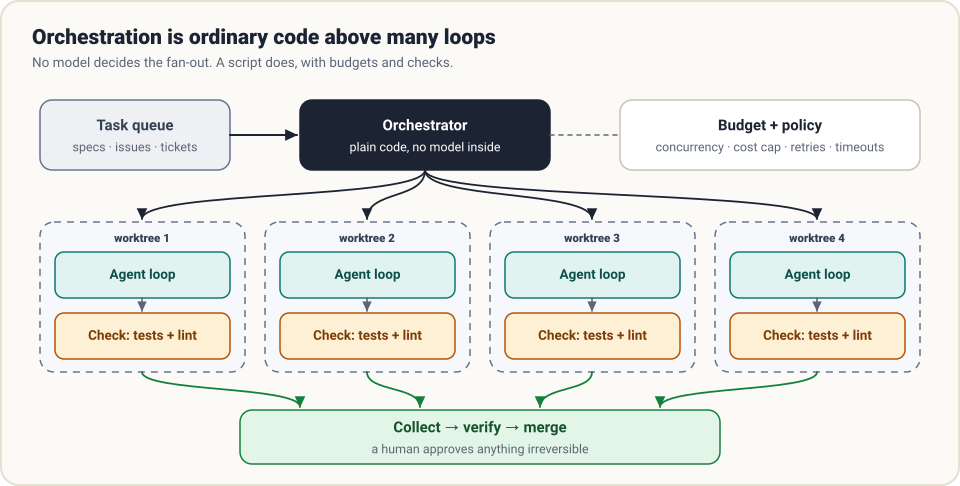
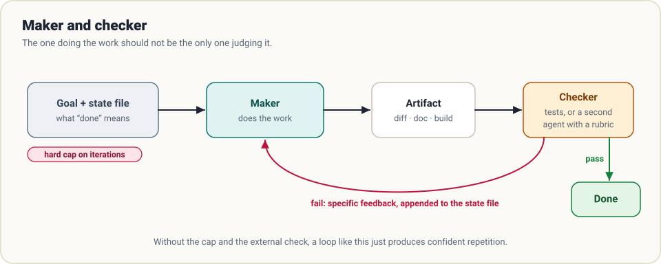
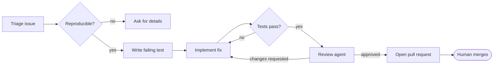

# 8. Orchestration

> **The question:** how does work scale past one agent?

## The idea in one minute

In [delegation](07-delegation.md), a *model* decided to hand off a sub-task. Orchestration is different: **ordinary code** decides which agents run, on what, in what order, with what budget. No model sits at the top.

That distinction matters. A model is good at judgment inside a task. It is a poor scheduler: it cannot hold fifty parallel jobs in mind, it cannot guarantee a cost cap, and it does not retry reliably. Scripts can.



| | Delegation | Orchestration |
|---|------------|---------------|
| Who decides the split | The model, mid-task | Your code, up front |
| Shape | A tree that grows as needed | A plan you can read before it runs |
| Good for | "I need to look something up" | 40 tickets, a nightly job, a pipeline |
| Fails by | Wandering and overspending | Rigid plans that do not fit the task |

## Prerequisite: a headless door

An orchestrator is a program, so the harness needs an interface a program can use. That means a mode with no prompts and no terminal UI:

```bash
harness run --task "$(cat spec.md)" --mode auto --max-turns 60 --json > result.json
echo $?    # 0 = finished, 2 = out of budget, 1 = error
```

Three properties make this work:

- **Non-interactive.** It never waits for a keypress. Anything needing approval is decided by policy or fails cleanly.
- **Structured output.** JSON with the final answer, token usage, turn count and exit reason.
- **Meaningful exit codes.** Finished, out of budget, and broken are three different outcomes; the caller must be able to tell them apart.

A harness that can only be driven by a person at a keyboard can never be automated. Every serious one ships this door.

## A fleet in thirty lines

```python
from concurrent.futures import ThreadPoolExecutor

def run_one(spec):
    workdir = make_worktree(spec.id)                # isolated checkout
    try:
        result = harness_run(spec.task, cwd=workdir, max_turns=60, mode="auto")
        passed = run_check(spec.check_cmd, cwd=workdir)   # the agent never sees this
        return {"id": spec.id, "passed": passed, **result}
    except Exception as e:
        return {"id": spec.id, "passed": False, "error": str(e)}

def run_fleet(specs, workers=4, budget_usd=20.0):
    spent, results = 0.0, []
    with ThreadPoolExecutor(max_workers=workers) as pool:
        for r in pool.map(run_one, specs):
            results.append(r)
            spent += r.get("cost_usd", 0)
            if spent > budget_usd:
                pool.shutdown(cancel_futures=True)
                break
    return results
```

There is no intelligence here, and that is the point. The orchestrator owns four boring responsibilities:

1. **Isolation.** Each task gets its own working directory.
2. **Concurrency.** A fixed number at a time, respecting provider rate limits.
3. **Budget.** A total spend cap that actually stops the run.
4. **Verification.** A check that is independent of the agent's own opinion.

## Isolation: one workspace per task

Parallel agents in one directory will overwrite each other. The standard answer for code is **git worktrees**: several checkouts of the same repository, each on its own branch, sharing one object store.

```bash
git worktree add ../wt-task-17 -b agent/task-17
```

Each agent works in its own tree; successful branches are merged or opened as pull requests; failed ones are deleted without a trace. For stronger separation, put each worktree in its own container ([guardrails](03-guardrails.md)).

## Verification: never grade your own homework

The most important line in the fleet code is `run_check`. An agent's final message says "all tests pass". That is a claim. The orchestrator runs the tests itself.

Checks, from cheap to thorough:

| Check | Catches |
|-------|---------|
| Required files exist | The agent stopped early |
| Build and lint | Broken syntax, obvious errors |
| Unit tests | Regressions |
| A hidden acceptance test | Solutions that fit the visible tests and miss the point |
| A reviewer agent with a rubric | Things tests cannot express: clarity, scope creep |
| A human | Everything irreversible |

## Maker and checker

The simplest multi-agent pattern that reliably improves quality is two roles in a loop.



- The **maker** does the work.
- The **checker** evaluates the result against explicit criteria. Prefer a mechanical check (tests). Where that is impossible, use a second agent with a fresh context and a written rubric.
- On failure, the checker's **specific** feedback is appended to a state file and the maker tries again.
- A **hard cap** on iterations ends it.

Why a separate checker instead of asking the maker to review itself? An agent that has just spent an hour on something is anchored by its own reasoning and tends to approve. A reviewer that sees only the artifact and the criteria is far harsher, and more useful.

## Pipelines and graphs

Chain those ideas and you get a pipeline: plan, then implement, then test, then review. Let stages branch and loop and you have a graph:



The rule that keeps graphs maintainable: **nodes are agent runs; edges are code.** Each node has a clear input, a clear output and a check. Transitions are decided by exit codes and test results, not by a model's mood. State that must survive between nodes lives in files, not in anyone's context.

Resist drawing the graph first. Most work is served by one good agent, then by a maker and checker. Add nodes only when you can name the failure each one prevents. See [loops and graphs](../practice/loops-and-graphs.md) for when to graduate.

## Triggers: who starts the run?

Once runs are headless, they do not need a person to start them:

- **Scheduled.** A nightly dependency audit; a weekly report.
- **Event-driven.** A new issue, a failing CI job, a webhook.
- **Queue-driven.** Workers pulling tasks from a backlog.

Unattended runs raise the stakes on everything earlier in this guide. There is no human to notice a runaway loop, so turn caps and cost caps are mandatory. There is no human to approve an action, so the sandbox carries the full weight. And nobody is watching the terminal, so the log is the only record of what happened.

## Keep the human at the right doors

Orchestration does not remove people; it moves them. The pattern that works is to let reversible work flow and require a person exactly where it becomes irreversible:

- Agents open pull requests; people merge them.
- Agents draft the release notes; people publish.
- Agents propose the migration; people run it in production.

## Common mistakes

- **A model as the scheduler.** It will lose track, and you cannot enforce a budget on it.
- **Shared mutable workspace.** Parallel writers in one checkout corrupt each other's work.
- **No global budget.** Per-task limits do not stop fifty tasks from each spending their limit.
- **Trusting "done".** Without an independent check, pass rate measures confidence, not correctness.
- **Retrying forever.** A task that failed three times usually needs a better spec, not a fourth attempt.
- **Too many agents.** Coordination overhead grows quickly. Ten agents are rarely ten times as productive as one.

## How real harnesses do it

- **Claude Code** runs headlessly with a print mode and structured output, exposes its loop as an SDK, and supports background and scheduled agents.
- **Codex** was the vehicle for one of the best-known reports in this area: OpenAI's "harness engineering" account of building a large product with agents working in isolated worktrees, each with its own observability stack.
- **Pi** offers print and JSON modes, an RPC protocol and a TypeScript SDK, so another program can drive it step by step.
- **Hermes** includes a cron scheduler and a messaging gateway, so runs can be triggered on a timer or from a chat app and report back there.
- **DeepSeek Harness** ships headless and SDK profiles and experimental agent teams with shared task state.

## Check yourself

1. What is the essential difference between delegation and orchestration?
2. Name three things a headless mode must provide for a script to use it.
3. Your fleet reports 24 of 25 tasks "completed". What do you need before believing that number?
4. Why give the checker a fresh context instead of asking the maker to review its own work?

<details>
<summary>Answers</summary>

1. Who decides the split: the model mid-task, or code up front.
2. No interactive prompts, structured output, and exit codes that distinguish finished, out of budget and failed.
3. An independent check per task that the agents did not write or grade.
4. The maker is anchored by its own reasoning and tends to approve its work.

</details>

## Try it

Write three small task specs, each with a check command the agent is not shown. Run them through a fleet script with two workers and a total budget. Compare what the agents *said* against what the checks *found*.

**Next:** [9. Evaluation →](09-evaluation.md)
