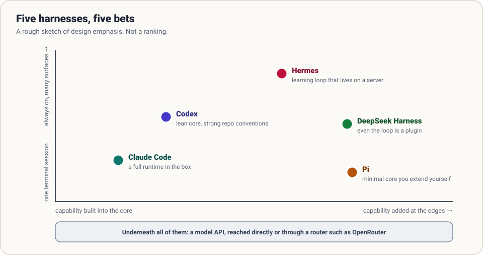

# Harnesses in the wild

The [guide](../guide/00-what-is-a-harness.md) builds a harness from nothing. This section runs the film backwards: it takes five real, widely used harnesses and asks the same nine questions of each.

The point is not to pick a winner. It is to see that every team faced the same problems and made *different* trade-offs, and to learn which trade-off suits your situation.

> **Snapshot: October 2026.** These projects ship weekly. Treat version-specific details as a starting point and follow the links to primary sources. Where a claim comes from a third-party analysis rather than official documentation, the page says so.

## Five bets

| Harness | Maintainer | Language | Licence | The bet |
|---------|-----------|----------|---------|---------|
| [Claude Code](claude-code.md) | Anthropic | TypeScript | Proprietary | A complete runtime works out of the box: memory, permissions, hooks, skills, sub-agents |
| [Codex](codex.md) | OpenAI | Rust | Apache-2.0 | A lean core, with knowledge in the repository and safety in an OS sandbox |
| [Pi](pi.md) | Earendil Works | TypeScript | MIT | A minimal core; everything else is an extension you write or install |
| [Hermes Agent](hermes.md) | Nous Research | Python | MIT | An always-on personal agent that learns: it writes and improves its own skills |
| [DeepSeek Harness](deepseek-harness.md) | DeepSeek | TypeScript | MIT | Everything is a plugin, including the agent loop |

And one page that is not a harness at all:

- [OpenRouter](openrouter.md): the model-access layer. It is here because every harness needs a provider, and choosing one is a harness design decision.

## The same nine questions

| Part | Claude Code | Codex | Pi | Hermes | DeepSeek Harness |
|------|-------------|-------|----|--------|------------------|
| **Loop** | Built in; also exposed as an SDK | Built in (Rust) | A small agent-core package | One core shared by CLI, gateway, TUI and desktop | The default loop is a replaceable plugin |
| **Tools** | Compact built-in set, plus MCP | Shell and patch tools, plus MCP | A few built-ins; add more via extensions | 40+ tools grouped into toolsets, plus MCP | Scoped registry behind "capability seams" |
| **Guardrails** | Permission modes, allow/deny rules, hooks | Approval policy plus OS sandbox | None built in; containerise it | Command approval; container and remote backends | Sandbox and approval as plugins on a pre-execute event |
| **Context** | Automatic and manual compaction | Automatic and manual compaction | Automatic, with a pluggable strategy | Compression, under a strict cache-preserving rule | Model view derived from an event log |
| **Memory & skills** | Layered `CLAUDE.md`, auto memory, skills | `AGENTS.md` as a short directory page | `AGENTS.md` hierarchy, skills, prompt templates | Agent-curated memory, self-written skills, session search | Supplied by plugins |
| **Durability** | JSONL sessions, resume, rewind | Resumable session files, worktrees | Sessions stored as a tree | SQLite state with full-text search | Append-only, versioned event log |
| **Delegation** | Built-in sub-agents | Spawn and wait tools | Not in the core, by choice | Isolated sub-agents; tool-calling scripts | Sub-agent seam; experimental teams |
| **Orchestration** | Headless mode, SDK, scheduled agents | Non-interactive exec; cloud tasks | Print/JSON modes, RPC, SDK | Cron scheduler and messaging gateway | Headless, SDK and ACP profiles |
| **Evaluation** | Hooks for in-loop checks | Verification commands in the repo | Telemetry and eval packages | Batch trajectories | "Model-visible means logged" invariant |

## How to read a teardown

Each page follows the same outline:

1. **The bet.** What the designers optimised for, in a sentence or two.
2. **The nine parts.** How it answers each question from the guide.
3. **What to steal.** Ideas worth copying into your own harness, whatever you build on.
4. **What it costs.** The trade-off that comes with the bet.
5. **Sources.** Where to verify every claim.

## Three axes that explain most of the differences

**Batteries or bricks?** Claude Code gives you a finished runtime. Pi and DeepSeek Harness give you a kit. A finished runtime is faster to adopt and harder to bend; a kit is the reverse.

**Where does safety live?** In *policy* (Claude Code's permission rules and hooks), in *containment* (Codex's sandbox), or *outside the harness entirely* (Pi's "run it in a container"). All three are legitimate; mixing the first two is the most robust.

**Where does knowledge live?** In the *harness's memory* (Claude Code, Hermes) or in the *repository* (Codex's documented conventions). Knowledge in the repo is portable across tools and visible to humans; harness memory is automatic and personal.

## A reading order

- Building your own? Read [Pi](pi.md) first: it is the closest to the minimal harness in this guide, at production quality.
- Want the fullest feature set to map onto the nine parts? Read [Claude Code](claude-code.md).
- Running agents at scale on a codebase? Read [Codex](codex.md) and then [the repo as system of record](../practice/repo-as-system-of-record.md).
- Want an agent that runs for weeks and improves? Read [Hermes](hermes.md).
- Designing a platform other people will extend? Read [DeepSeek Harness](deepseek-harness.md).
