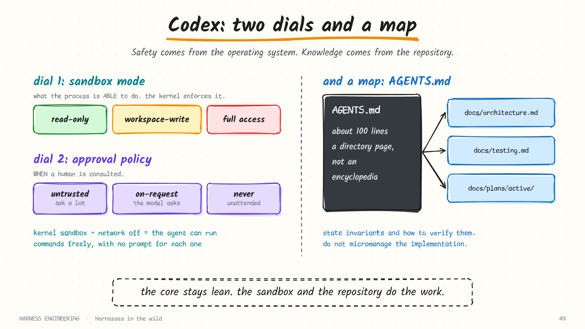

# Codex

> **The bet:** keep the core lean. Put the project's knowledge in the repository, where it is versioned and checkable, and put safety in an operating-system sandbox, where it does not depend on the model's good behaviour.

**Maintainer:** OpenAI · **Repository:** [openai/codex](https://github.com/openai/codex) · **Language:** Rust · **Licence:** Apache-2.0 · **Docs:** [developers.openai.com/codex](https://developers.openai.com/codex)

> Snapshot: October 2026. Check the repository and docs for current behaviour.

## In one paragraph

Codex CLI is an open-source coding agent that runs locally, with IDE, desktop and cloud counterparts. As software, it is a restrained design: a fast native binary, a short list of tools, a real sandbox. Its larger contribution to this field is a set of *working practices*. The phrase "harness engineering" was popularised by OpenAI's account of building a large product almost entirely with Codex, and most of what that account describes happens in the repository rather than in the agent.



## A closer look: two independent dials

This is where Codex is most distinctive. It separates two questions that most tools blur together.

| Dial | The question | Enforced by |
|------|--------------|-------------|
| **Sandbox mode** | What is the process *able* to do? | The operating system |
| **Approval policy** | *When* is a human consulted? | The harness |

**Sandbox modes:**

| Mode | Filesystem | Network |
|------|-----------|---------|
| `read-only` | Read anywhere it is permitted; write nowhere | Off |
| `workspace-write` | Write inside the workspace (and temp directories) | Off by default |
| `danger-full-access` | Unrestricted | On |

The enforcement is the important part. On macOS it uses Seatbelt; on Linux, Landlock and seccomp. These are kernel mechanisms, so they apply to *every process the agent starts*, not only to the harness's own tools. A Python script launched by a Makefile launched by the shell is inside the box too. That is the difference between policy and containment described in [chapter 3](../guide/03-guardrails.md).

**Approval policies** range from asking before anything that is not known to be safe, through letting the model request approval when it needs to step outside the sandbox, to never asking at all.

Because the two dials are independent, you can pick useful combinations:

| Combination | Behaviour | Good for |
|-------------|-----------|----------|
| `read-only` + ask | Looks, proposes, changes nothing | Exploring; planning |
| `workspace-write` + on-request | Works freely in the project; asks to leave it | Everyday development |
| `workspace-write` + never | Fully unattended, still boxed in | CI jobs |
| `danger-full-access` + never | No limits | Only inside an external sandbox |

The payoff is fewer prompts without less safety. With writes confined to the workspace and the network off, there is little a command can break, so there is little reason to ask.

## The nine parts

### 1. Loop

A conventional agent loop implemented in Rust, with an interactive terminal UI and a non-interactive `exec` mode for scripts and CI.

### 2. Tools

Few, and centred on the shell. Edits go through a patch-application tool: the model writes a structured diff and the harness applies it, which keeps edits small and makes failures explicit. MCP servers extend the set.

### 3. Guardrails

The two dials above. An execution policy lets you declare which command prefixes are always allowed, always prompt, or are forbidden.

### 4. Context

Automatic compaction plus a manual command, with a customisable compaction prompt. Community source analysis notes an efficiency detail worth copying: environment context (working directory, branch and so on) is re-sent only when it *changes*, as a delta, rather than repeated every turn. Unchanged context costs nothing and does not disturb the cached prefix.

The community often summarises Codex's context approach as four verbs, **write, select, compress, isolate**, which this guide also uses in [chapter 4](../guide/04-context.md).

### 5. Memory and skills

`AGENTS.md`, an open convention now read by many tools. Codex discovers these files in layers: a global one in its home directory, then from the repository root down to the working directory, so a file nearer the code can refine the ones above it. It also supports skills in the shared `SKILL.md` format.

Codex's team described a specific lesson about the instruction file:

- They began with one large file and found it impossible to keep current. Nothing could check it for coverage or freshness, so it drifted.
- They replaced it with a short file, on the order of a hundred lines, that works as a **directory page**: what the repo is, how to verify work, the non-negotiable rules, and pointers into structured documentation under `docs/`.
- Their guidance on content: state **invariants** and how to verify them; do not micromanage implementation.

A file in that spirit:

```markdown
# Orders service

Rust workspace. `crates/api` is the HTTP layer; `crates/core` is the domain logic.

## Verify (run before you say you are done)
- `just check`      # fmt + clippy + unit tests, ~30s
- `just test-all`   # adds integration tests against a local Postgres

## Invariants
- `core` never imports from `api`.          Checked by `just check-deps`.
- All money is `rust_decimal::Decimal`.     Checked by a clippy lint.
- Every handler has an integration test.    Checked by `just test-coverage-api`.

## Read more
- docs/architecture.md   when changing how crates talk to each other
- docs/testing.md        when adding or fixing tests
- docs/plans/active/     for work in progress
```

See [the repo as system of record](../practice/repo-as-system-of-record.md) for this pattern in full.

### 6. Durability

Sessions are recorded to disk and can be resumed. More important in practice is that tasks run in **git worktrees**: each gets an isolated checkout, so an abandoned or failed run leaves the main tree untouched.

### 7. Delegation

Sub-agents are exposed as tools the model calls to spawn a child and wait for its result. A child inherits the repository instructions and runs in its own context. Named agents, with their own model and instructions, can be defined in configuration files.

### 8. Orchestration

The non-interactive mode makes Codex scriptable, and the cloud product runs tasks in parallel in remote sandboxes. OpenAI's account describes many agents working concurrently, each in its own worktree with its own instance of the application and its own logs, metrics and traces.

### 9. Evaluation

The repository carries the definition of "correct". Verification commands are listed in `AGENTS.md`; tests, CI and observability configuration are first-class parts of the codebase; and an agent is expected to run them and read the results rather than assert success.

## The lesson behind the product

OpenAI's write-up makes a claim that reframes the engineer's job. When agents write the code, the scarce human skills become:

| Skill | In practice |
|-------|-------------|
| **Designing the environment** | Sandboxes, worktrees, a runnable app per task, observability the agent can query |
| **Expressing intent** | Specifications, invariants and acceptance criteria precise enough to act on |
| **Building feedback loops** | Checks that tell the agent, quickly and mechanically, whether it is right |

A few of the practices it describes are worth repeating because they generalise:

- **Make the application legible to the agent.** If it can start the app, drive the UI and read logs and metrics for *its own* instance, it can verify behaviour instead of guessing.
- **Encode taste as lints.** Architectural rules ("the UI layer may not import the database layer") become mechanical checks with error messages the agent can act on.
- **Turn review feedback into rules.** When a reviewer corrects the same thing twice, it is promoted into a lint or a line in the docs, so the correction applies to every future run.
- **Garbage-collect continuously.** Agents periodically scan for stale docs and drift from the stated principles, and open small cleanup pull requests.

None of those is prompt-writing. All of them are harness engineering in the broad sense this guide uses.

## What to steal

1. **Separate "able to" from "allowed to".** Two dials are clearer than one, and containment lets you ask less often.
2. **Make `AGENTS.md` a map.** About a hundred lines, pointing at detail. Make it something a script can lint for dead links and staleness.
3. **Specify invariants, not steps.** Say what must stay true and how to check it; leave the route to the model.
4. **Isolate with the environment.** A worktree per task and an OS sandbox enforce boundaries that instructions can only request.
5. **Send deltas.** Do not re-paste unchanged context every turn.
6. **Put the verification path in the repo.** If "done" is a command, every agent and every human runs the same one.

## What it costs

- **You bring the discipline.** A lean core means the repository conventions *are* the harness. Without good docs and tests, there is less to fall back on.
- **Sandboxing is platform-specific.** The strongest guarantees depend on OS features that differ across macOS, Linux and Windows.
- **Less built-in memory.** State lives in files you organise, not in a managed memory system.

## Compared with Claude Code

The two are instructive opposites. Claude Code *adds*: memory layers, hooks, skills and sub-agents in the core. Codex *subtracts*: a small core, with responsibility pushed to the sandbox and the repository. Neither is wrong. Teams with strong engineering hygiene get a great deal from the second; teams that want good behaviour on day one get it from the first.

## Sources

- OpenAI, [Harness engineering: leveraging Codex in an agent-first world](https://openai.com/index/harness-engineering/)
- [openai/codex](https://github.com/openai/codex) (source and README) and the [Codex documentation](https://developers.openai.com/codex): [security and sandboxing](https://developers.openai.com/codex/security), [AGENTS.md](https://developers.openai.com/codex/guides/agents-md), [non-interactive mode](https://developers.openai.com/codex/noninteractive), [skills](https://developers.openai.com/codex/skills)
- [AGENTS.md](https://agents.md): the cross-tool convention
- Community: [Context Engineering for Codex CLI](https://codex.danielvaughan.com/2026/06/10/context-engineering-codex-cli-write-select-compress-isolate-june-2026/) and [codex-harness-internals](https://github.com/AlexKenbo/codex-harness-internals)
- [Breaking down Codex's harness design](https://github.com/walkinglabs/learn-harness-engineering), from the *Learn Harness Engineering* course
