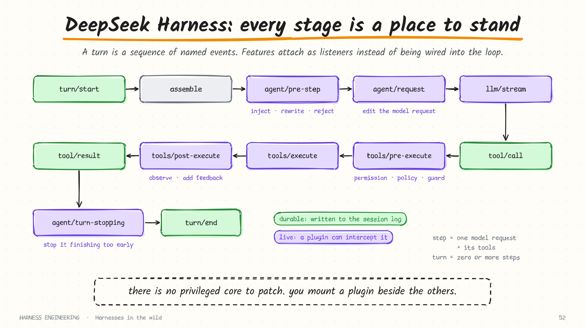
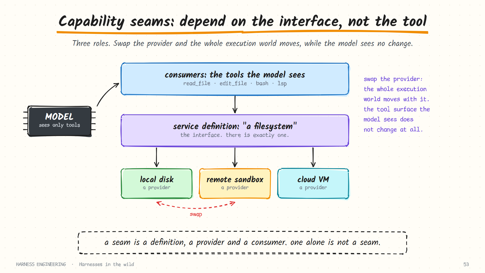

# DeepSeek Harness

> **The bet:** there should be no privileged core. Every part of the product is a plugin, including the model adapter, the tool registry, the session log and the agent loop itself.

**Maintainer:** DeepSeek · **Repository:** [deepseek-ai/deepseek-harness](https://github.com/deepseek-ai/deepseek-harness) · **Command:** `dsh` · **Language:** TypeScript · **Licence:** MIT

> Snapshot: October 2026. The project describes itself as a **developer preview** with compatibility-breaking changes expected. Read its safety notice before running it, and treat everything below as a description of the architecture at the time of writing, taken from the repository's `docs/` folder.

## In one paragraph

Pi minimises the core. DeepSeek Harness (`dsh`) removes it. The project is built on a plugin framework called Cordis, in which plugins contribute services, typed events and reversible effects to a shared context. The architecture document says, in effect, that there is no special core to patch: you extend the system by mounting another plugin beside the existing ones, and a plugin's registrations unwind when it is unloaded. If the other harnesses in this section are applications, this one is closer to an operating system for agents.

## Go deeper

This page is the overview. Five deep-dive pages go through the repository's own documentation subsystem by subsystem, each with its own diagrams:

| # | Page | Covers |
|---|------|--------|
| 1 | [Cordis, profiles and scope](deepseek-harness/plugins.md) | The plugin framework in five ideas, dispatch modes, how a running `dsh` is layered, per-agent scope |
| 2 | [Agents, the inbox and the turn](deepseek-harness/turn.md) | Creating and owning agents, follow-up versus steer, the turn step by step, cancellation |
| 3 | [Tools, approval and sandbox](deepseek-harness/tools-and-safety.md) | Tool definitions, the fixed pipeline, fail-closed approval, sandbox modes, read-before-write, code mode |
| 4 | [The event log, persistence and compaction](deepseek-harness/sessions.md) | Surface and log-only events, write-behind persistence, crash recovery, format versions, compaction as a lock |
| 5 | [Sub-agents, teams and automation](deepseek-harness/agents.md) | The sub-agent seam, agent teams, model-written workflows, goals, schedules, webhooks, skills, MCP |


## Three ideas to understand

### 1. The loop as an event pipeline

Instead of a fixed "call model, run tools" function, a turn is a sequence of named events.



Two vocabulary points from the docs are worth adopting anywhere: a **step** is one model request plus the tools it calls, and a **turn** is zero or more steps, opening before its first input is claimed and closing once nothing is owed.

The events fall into three groups:

| Group | Examples | Use it to |
|-------|----------|-----------|
| **Session events** (durable) | `turn/*`, `step/*`, `user/message`, `assistant/message`, `tool/call`, `tool/result` | Record a fact that must survive a reload |
| **Agent events** (live) | `agent/pre-step`, `agent/request`, `agent/turn-stopping` | Observe or intercept work in flight |
| **Capability events** | `tools/pre-execute`, `tools/execute`, `tools/post-execute`, `fs/*` | Attach policy to a capability without touching the loop |

The consequence is that most features need no change to the loop:

| You want to… | Attach to… |
|--------------|-----------|
| Add a permission check | `tools/pre-execute` |
| Inject memory or context | the pre-step stage, or an explicit inject call |
| Modify the request to the model | `agent/request` |
| Stop the agent finishing too early | `agent/turn-stopping` |
| Record behaviour | subscribe to session events |
| Add a model provider | register an adapter on the model service |

Compare this with [chapter 3](../guide/03-guardrails.md), where the gate is a function called before execution. Same idea, generalised: *every* stage is a place something can stand.

### 2. Capability seams

A **seam** is a swappable capability with three roles.



| Role | What it is | Filesystem example |
|------|-----------|--------------------|
| **Service definition** | Declares the interface | "A filesystem" |
| **Service provider** | Implements it | Local disk, a remote sandbox |
| **Consumer** | Uses it; usually a model-facing tool | `read_file`, `edit_file` |

The model sees the same file tools whether the provider is your local disk or a remote sandbox. Swap the provider and the whole execution environment moves, with no change to the tool surface. The documentation notes that filesystem and subprocess providers share one execution world, so pointing them at a remote sandbox moves the shell, terminals and language servers along with them.

This answers a question every harness designer eventually meets: should the agent depend on **concrete tools** or on **capability interfaces**? The seam design chooses interfaces, and gets a pluggable environment as a result. The docs are strict about it: one role on its own is not a seam, and adding a capability means designing all three.

### 3. "Model-visible means logged"

The session log is append-only, and the model's view of history is **derived from the log** rather than stored beside it. On top of that the project states an invariant, which paraphrased says: every model request must be reconstructable from the log, and any new input the model can see needs a session event.

This turns observability from a feature into a constraint. If something could reach the model without being logged, that is a bug by definition. Fork, resume, transcripts, telemetry and persistence all derive from the same record. It is the strongest form of the advice in [chapter 6](../guide/06-durability.md) and [chapter 9](../guide/09-evaluation.md).

## A closer look: one tool call, end to end

The repository documents its tool execution pipeline as a generated graph. Reduced to essentials, a single call passes through these stages:

```text
assistant message contains a tool call
  → session event  tool/call          logged BEFORE anything runs
  → tools/pre-execute                 hooks · permission · sandbox policy
        deny  → the tool body is skipped
        ask   → one-shot approval prompt
  → registered guards                 may only deny or abstain
  → tools/execute                     timeout · retry · metrics, wrapped around the tool body
        the tool body runs (file writes pass through their own intent checks)
  → tools/post-execute                accept · block · replace · add context
  → session event  tool/result        the single outcome the model sees
```

Three details map directly onto the guide:

- **The call is logged before execution.** That is the write-ahead rule from [chapter 6](../guide/06-durability.md).
- **A denied call still produces a result.** The tool body is skipped, and the model receives an outcome it can react to.
- **Exceptions are normalised into error results** instead of escaping the pipeline: errors as messages, again.

### Approval that fails closed

The approval subsystem defines a small, closed set of outcomes:

| Outcome | Meaning | Effect |
|---------|---------|--------|
| `allowed-once` | Granted for this specific action only | The call proceeds |
| `rejected` | A person or policy said no | Deny |
| `cancelled` | The request was withdrawn | Deny |
| `unavailable` | Nobody could answer | **Deny** |

The last row is the design decision. A missing, crashing or non-conforming approver becomes "unavailable", and unavailable means deny. A per-session policy of `ask` or `never` decides whether an approver is consulted at all. This is the "fail closed" property from [chapter 3](../guide/03-guardrails.md), encoded in a type.

### Compaction as a lock

Compaction is itself a seam (a definition, a backend, a `/compact` command). It records three log-only events:

```text
compaction/start      acquires a lock, recorded in the log
compaction/summary    the summary and exactly which earlier events it replaces
compaction/end        releases the lock
```

The lock brackets the *whole* operation and is released last. So a crash in the middle leaves a `start` with no matching `end`: an orphan that is detectable on the next load, instead of a fold that looks complete and is not. None of the three events is itself visible to the model; the summary reaches it as a separate message.

## The nine parts

| Part | In DeepSeek Harness |
|------|---------------------|
| **Loop** | A default driver plugin implementing an `Agent` interface; replaceable |
| **Tools** | A scoped registry with a guarded execution pipeline; tools are consumers of capability seams |
| **Guardrails** | Sandbox backends and approval policy ship in the base bundle and attach at the pre-execute stage; approval fails closed |
| **Context** | Prompt sections and tool schemas are assembled each step; history is projected from the log |
| **Memory & skills** | Not a fixed convention; supplied by plugins and injected through documented stages |
| **Durability** | Append-only, versioned session event log with explicit migrations and pluggable storage |
| **Delegation** | A sub-agent seam with declared capabilities (depth limit, tool filter, output schema, persona): a provider can be a fresh local child or a run in another product. Agent teams are experimental |
| **Orchestration** | Named **profiles** selected at launch: a web app, a one-shot headless runner, an SDK server, and an automation server |
| **Evaluation** | The logging invariant, plus a telemetry seam |

### Profiles and bundles

A running `dsh` is a plugin tree composed at boot from ordered layers. A **profile** is a named composition; a **bundle** is a distributable set of plugin configuration. You can print the tree your machine boots and replace any row with a patch of your own. Configuration, in other words, *is* the architecture.

## What to steal

1. **Name the stages of your loop.** Even if you never build a plugin system, giving each stage a name and a hook makes permissions, memory and logging additions instead of rewrites.
2. **Depend on capabilities, not tools.** Define "filesystem" once and let local and remote implementations compete.
3. **Derive the model's view from the log.** One source of truth; resume, fork and replay follow.
4. **State observability as an invariant** and assert it at runtime.
5. **Log the call before you run it**, and always produce a result, even for a denied call.
6. **Make "nobody answered" mean "no".**
7. **Bracket multi-step operations with start and end records**, so an interruption is detectable.
8. **Distinguish durable events from live ones.** Decide deliberately which facts must survive a restart.

## What it costs

- **Configuration is the price of flexibility.** With no fixed core, there is more to understand before you can change anything safely.
- **Fewer conventions out of the box.** There is no built-in equivalent of a layered instruction file; you choose or build one.
- **Preview status.** Interfaces are still moving.

## Compared with the others

Claude Code, Codex and Pi each optimise a harness around a particular agent. DeepSeek Harness treats the harness as a platform on which *an* agent is one replaceable application. It is the logical end of the idea this guide began with: if everything outside the model is the harness, the harness can be its own system.

## Sources

- [deepseek-ai/deepseek-harness](https://github.com/deepseek-ai/deepseek-harness): README (developer preview status, how to run)
- [Architecture document](https://github.com/deepseek-ai/deepseek-harness/blob/master/docs/architecture.md): Cordis, profiles and bundles, events, turn flow, session log, capability seams, and the table of where new behaviour goes
- In the same `docs/` folder: `tool-execution-pipeline.md`, `capability-seams.md`, and under `subsystems/`: `approval.md`, `compaction.md`, `subagent.md`, `session.md`
- [Breaking down DeepSeek Harness's design](https://github.com/walkinglabs/learn-harness-engineering), from the *Learn Harness Engineering* course
