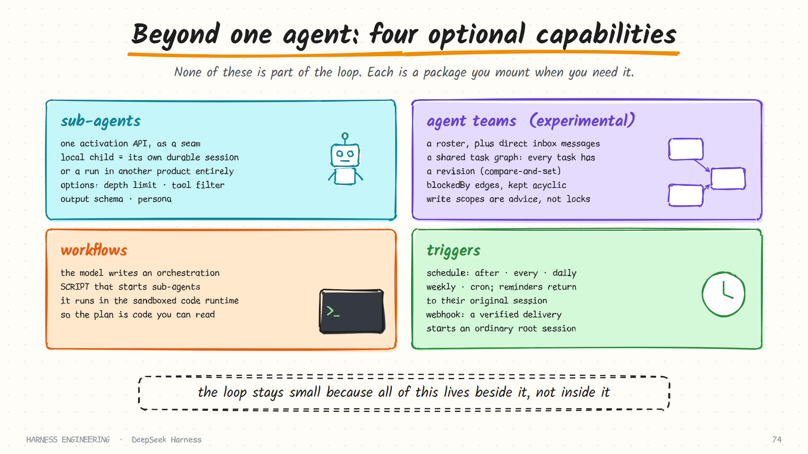

# DeepSeek Harness · Sub-agents, teams and automation

> **Part 5 of 5.** Everything beyond a single agent in a single session: sub-agents, experimental agent teams, model-written workflows, goals, schedules, webhooks, skills, MCP and the hook bridges.
>
> [Overview](../deepseek-harness.md) · [1. Plugins](plugins.md) · [2. The turn](turn.md) · [3. Tools and safety](tools-and-safety.md) · [4. Sessions](sessions.md) · **5. Many agents**

Sources: `docs/subsystems/subagent.md`, `agent-team.md`, `workflow.md`, `goal.md`, `schedule.md`, `webhook.md`, `skills.md`, `mcp.md`, `jobs.md`, `claude-code-mods.md` and the package list, as of October 2026. Items marked *experimental* live under `packages/experimental/` and are the least stable part of an already-moving project.

## The pattern on this page

Every capability here has the same status: **optional, and outside the loop**. The documentation repeats the phrase for each one. A composition that does not mount sub-agents has no sub-agent code path at all.

That is the payoff of the plugin design from [part 1](plugins.md). The loop stays small because none of this lives inside it.

## Sub-agents: one seam, two kinds of child

Delegation is a capability seam like the filesystem. There is one activation API, and a *provider* decides what a child actually is.

| Kind | What it is |
|------|------------|
| **Local child** | A fresh agent in the same process, with its own durable session |
| **External execution** | A run handed to another backend or product entirely |

The model-facing `subagent` tool is the same either way. Behind it, each backend declares which options it supports:

| Capability flag | Lets the caller… |
|-----------------|------------------|
| Depth limit | Cap how deep delegation may go |
| Tool filter | Restrict the child's tools |
| Output schema | Require a structured result |
| Persona | Give the child a different system prompt |
| Agent options | Choose model and other settings |

The manager validates every requested option against those flags *before* preparing a child. A request for something a backend cannot honour fails early rather than being silently ignored.

Properties of a local child worth noting:

- It has **a durable session of its own** and **at most one live activation**. The session outlives the activation, so a child can be resumed cold later.
- The manager owns identity, capacity, input admission and **child-first disposal**: children are torn down before their parent.
- A child's working directory can be set explicitly; otherwise it captures the parent's at the moment of admission.
- If cleanup fails, the failure is reported **separately**. A captured result is not replaced by a teardown error. This follows the repository's rule to report orthogonal outcomes independently.

Companion tools let a parent `list_agents`, `send_message` to one, and `interrupt_agent`. A separate tool lists the models available to sub-agents, so the parent can deliberately pick a cheaper one for a scout, which is the model-per-role advice from [chapter 7](../../guide/07-delegation.md).

Result delivery has two forms. The model-facing tool delivers to the parent as a message. Programmatic consumers, such as a workflow script, can await a child's result directly without injecting another message into anyone's context.

## Agent teams *(experimental)*

Teams go beyond a parent and its children: several long-lived teammates that message each other and share work.

| Piece | Design |
|-------|--------|
| **Roster** | Each member starts as *provisioning* and reaches exactly one terminal phase, *active* or *failed*. Names are immutable labels |
| **Messages** | Sent directly to a teammate's inbox, carrying the real sender's session id |
| **Shared tasks** | A task graph with dependencies |

The task graph is the interesting part, because it has to survive concurrent writers:

- Every task event stores a **complete snapshot**.
- Each task has a **revision** used for compare-and-set: an update names the revision it read, and loses if someone else got there first.
- `blockedBy` edges must point at existing tasks and keep the graph **acyclic**.
- Task states are *pending*, *in progress* (with an owner), *completed*, and *deleted* (kept as a tombstone).
- **Write scopes** are path prefixes a task declares it will touch. They are explicitly **advisory, not locks**: views warn about overlap, and nothing is prevented.

That last choice is honest engineering. Real file locks across agents are hard and brittle; a warning that two tasks claim the same directory catches most collisions for almost no complexity. Compare with [chapter 7](../../guide/07-delegation.md)'s "one writer" rule: this is a softer version, with the trade-off stated.

## Workflows: the model writes the orchestration

A workflow lets an agent run a **model-written script** that starts sub-agents.

Instead of the model making a dozen delegation calls one at a time and holding the plan in its context, it writes a program: fan out these five investigations, wait for them, pass results to a sixth. The script runs in the same sandboxed code runtime used for code-mode tool calling, under the calling session's file policy.

| Compared with… | A workflow… |
|----------------|-------------|
| Ad-hoc delegation | Puts the plan in code you can read, instead of in the model's head |
| A hand-written orchestrator ([chapter 8](../../guide/08-orchestration.md)) | Is written by the model for this task, not by you in advance |

Like the shell, the seam allows one engine per context. Failure discipline is explicit: a workflow error is marked fatal or not, so the caller knows whether the run can continue.

An experimental companion tool wraps the repeat-until-done pattern, running one prompt in a loop.

## Goals: a turn that will not stop early

A **goal** is a durable objective attached to a session.

- Every mutation is a `goal/change` event carrying a complete snapshot, with a revision number that increments on each accepted change.
- A goal can be **blocked**, with a stable machine-readable reason code and a free-form explanation.
- While a goal is active, a continuation consumer can start another round when a turn would otherwise end.

This connects to the `agent/turn-stopping` event from [part 2](turn.md). A goal is the durable state behind "you are not finished": the turn tries to stop, the goal is not met, another round begins. It is the maker loop from [loops and graphs](../../practice/loops-and-graphs.md), with the state stored as log events instead of a Markdown file.

## Triggers: schedules and webhooks

### Schedules

Reminders are stored **host-wide**, independently of whether a session is currently active, and are delivered back to their **original session**.

| Form | Example |
|------|---------|
| `after` | In 30 minutes |
| `every` | Every two hours |
| `daily`, `weekly` | At a wall-clock time, in an explicit time zone |
| `cron` | A standard five-field expression, in an explicit time zone |
| `at` | An absolute time, as a strict offset-bearing timestamp or an explicit local-calendar value |

The care around time is notable. Targets are normalised to UTC; wall-clock forms keep their time zone; a bare local time is not accepted without saying which zone it is in. Scheduling bugs are almost always time-zone bugs, and the type design rules them out.

### Webhooks

An authenticated external delivery can start an ordinary root session.

- **Provider adapters** own authentication and intake. A GitHub adapter ships as an experimental package.
- **Rules** are trusted, programmatic callbacks that decide what a delivery should do.
- The runtime is deliberately **fire-and-forget**: it keeps no delivery or completion state, and does not deduplicate by delivery id.

That last point is a real trade-off, stated openly. A simpler runtime, in exchange for you handling duplicates if your provider redelivers. It also echoes [chapter 8](../../guide/08-orchestration.md): the payload of an event-triggered run is untrusted input.

## Background jobs

Long-running work, such as a dev server or a watch process, is tracked by a job runtime. A job has a status (*running*, *stopping*, *completed*, *killed*, *failed*), an owning session, and an output ring the model can read with `job_output`. Access is by owner authorisation, not by knowing an id. This is the "start it in the background and return a handle" pattern [chapter 2](../../guide/02-tools.md) recommends for commands that never return.

## Skills

Skills are a seam too: a registry, providers, and one consumer tool.

Local discovery scans roots in a fixed priority order:

| Rank | Source |
|------|--------|
| 1 | The project's `.dsh/skills` |
| 2 | The project's `.agents/skills` |
| 3 | Custom directories from configuration |
| 4 | The user's own skills |
| 5 | The user's shared agents directory |
| 6 | Bundled skills, when configured |

How the catalogue reaches the model is carefully cache-aware:

- At the first step of a session, the consumer injects a **catalogue message** containing only each skill's name and description. Bodies, paths and sources are omitted. Descriptions are capped (500 characters by default).
- Before each later step it computes a **digest** of the catalogue. Only if the digest changed does it inject a replacement.
- If compaction hides every earlier catalogue message, the next complete snapshot re-establishes it.
- The `skill` tool loads a body on demand.

So the skills list is not part of the system prompt, and adding a skill mid-session costs one small message rather than invalidating the cached prefix. It is progressive disclosure from [chapter 5](../../guide/05-memory-and-skills.md), implemented with the cache in mind.

## MCP

MCP is opt-in: one client entry per server, in the scope where it should be visible. Each server's tools become **ordinary harness tools**, which means they inherit cancellation, permission checks and recorded results from the [tool pipeline](tools-and-safety.md) with no special path. Server instructions join the logged system prompt, and shared tools let the model list and read a server's resources.

## Bridges to other ecosystems

Two experimental packages show how far "everything is a plugin" stretches:

- **Hook bridges** map another product's hook format onto `dsh` events, with separate packages for Claude Code-style and Codex-style hooks. A hook's decision is translated into the typed pre-step or tool-pipeline decision described earlier.
- A **compatibility bridge for Claude Code mods** loads such a mod as a `dsh` plugin. Its documentation is a table of every behavioural difference between the two hosts.

And among the model adapters is a package named for Pi's multi-provider client library, alongside DeepSeek's own. The harness that removed its core can borrow another harness's provider layer as just one more plugin.

## What to take from this page

- **Keep every multi-agent feature outside the loop.** If it is not mounted, it should not exist.
- **Make delegation a seam** so "child" can mean a local agent or a different system.
- **Validate requested options against declared capabilities** before starting anything.
- **Use revisions and compare-and-set for shared task state**, and be honest when a safeguard is advisory.
- **Let the model write its orchestration as code** when the plan is too big to hold in context.
- **Be strict about time zones** in anything scheduled.
- **Keep the skills catalogue out of the system prompt** and re-inject only on a changed digest.

## Sources

- `docs/subsystems/subagent.md`, `agent-team.md`, `workflow.md`, `ptc-runtime.md`
- `docs/subsystems/goal.md`, `schedule.md`, `webhook.md`, `jobs.md`
- `docs/subsystems/skills.md`, `mcp.md`, `claude-code-mods.md`
- The package list under `packages/` and `packages/experimental/` in [deepseek-ai/deepseek-harness](https://github.com/deepseek-ai/deepseek-harness)

**Back to:** [DeepSeek Harness overview](../deepseek-harness.md) · **Next harness:** [OpenRouter →](../openrouter.md)
