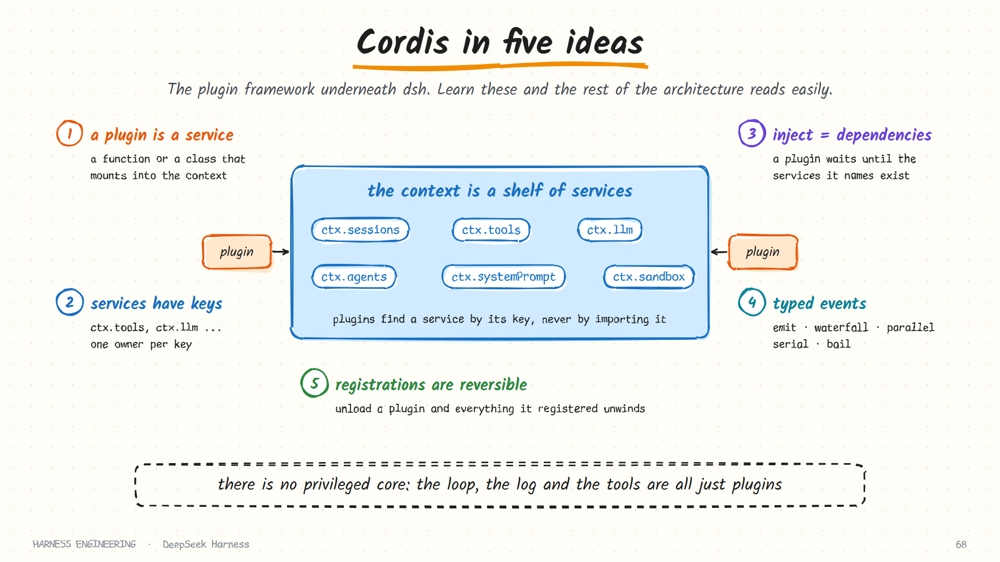
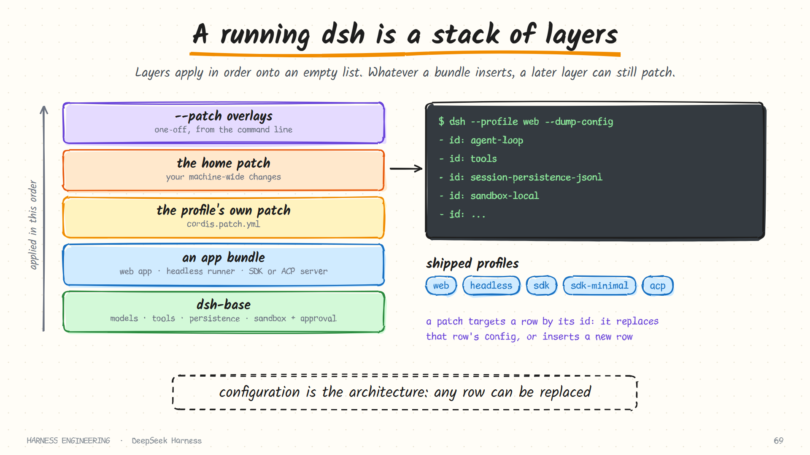

# DeepSeek Harness · Cordis, profiles and scope

> **Part 1 of 5.** How a product with no core is put together: the plugin framework, how a running `dsh` is composed from layers, and how one agent gets a different set of tools from another.
>
> [Overview](../deepseek-harness.md) · **1. Plugins** · [2. The turn](turn.md) · [3. Tools and safety](tools-and-safety.md) · [4. Sessions](sessions.md) · [5. Many agents](agents.md)

Everything on this page is taken from the repository's `docs/` folder as of October 2026, mainly `cordis-primer.md`, `architecture.md`, `glossary.md` and the package READMEs. The project is a developer preview; expect details to move.

## Why read about a plugin framework at all?

Most harnesses are an application with extension points. DeepSeek Harness inverts that: it is a set of extension points with an application assembled on top. The session log, the tool registry, the model adapter and the agent loop are each a plugin. To understand anything else in `dsh`, you first need the five ideas of the framework underneath it, Cordis.



## Cordis in five ideas

| # | Idea | What it means | Why a harness wants it |
|---|------|---------------|------------------------|
| 1 | **A plugin is a service** | A function or class that mounts into a context | Every capability has the same shape, so every capability is replaceable |
| 2 | **A context is a repository of services** | Each service claims a stable key such as `ctx.tools`, `ctx.llm`, `ctx.sessions` | Plugins find each other by key, never by importing a concrete implementation |
| 3 | **`inject` declares dependencies** | A plugin that names required services waits until they exist | Load order comes from requirements, not from a hand-written boot sequence |
| 4 | **Typed events** | Services declare event names and a dispatch mode | Interception and policy attach as listeners |
| 5 | **Registrations are reversible effects** | Prompt sections, tool schemas, adapters and listeners are installed so that unloading unwinds them | Hot reload and clean teardown, without leaks |

The second idea is the one that makes "no privileged core" possible. The loop does not import the tool registry; it asks the context for whatever is registered under `ctx.tools`. Replace the plugin behind that key and the loop never knows.

## Five ways to dispatch an event

An event's dispatch mode is part of its public contract. This table is worth learning, because the mode tells you what a listener is *allowed* to do.

| Mode | Awaited? | Order | Returns a value? | Use it when listeners… |
|------|----------|-------|------------------|------------------------|
| `emit` | No | Registration order | No | only observe |
| `waterfall` | No | Registration order | Yes | wrap or rewrite a decision |
| `parallel` | Yes | All at once | No | do independent side work |
| `serial` | Yes | Registration order | Yes | must run one after another |
| `bail` | No | Until one bails | Yes | compete to answer first |

### Waterfall is around-middleware

The pipeline stages you will meet on later pages (`agent/pre-step`, `tools/pre-execute`, `tools/execute`, `tools/post-execute`) are waterfalls. A waterfall listener receives the arguments plus a `next` function:

```text
listener(args, next):
    change the request            ← before
    result = next()               ← delegate to the listeners after me
    change the result             ← after
    return result
```

- Calling `next()` delegates. Returning *without* calling it **short-circuits**: the remaining listeners never run.
- That is how a policy listener says "denied" and stops the chain, and how a timeout listener wraps the actual tool call.
- A listener that only observes or annotates must delegate, or it silently breaks everyone after it.

If you have written web middleware, this is the same shape. The contribution here is applying it uniformly to every decision point of an agent loop.

### Two practical rules from the primer

- **Events for interception and policy; service methods for direct capability calls.** "May this run?" is an event. "Run this command" is a method on `ctx.shell`.
- **Every registration has a disposer.** If teardown order matters, keep related work in one effect so it unwinds in the right sequence.

## A running `dsh` is a stack of layers

There is no monolithic binary configuration. A running instance is a plugin tree composed at boot.



Two terms:

- A **bundle** is a distribution format: a set of plugin configuration rows together with the code they mount.
- A **profile** is a named composition stored in the Harness home. It lists the bundles it stacks, holds any out-of-tree plugins it installs, and keeps the user's own patch file.

Layers apply to an empty list, in this order:

```text
1. the profile's ordered bundles     (dsh-base first, then an application bundle)
2. the profile's cordis.patch.yml
3. the home patch                    (machine-wide)
4. --patch overlays                  (this run only)
```

A patch targets a row **by id**. It either replaces that row's whole configuration or inserts new rows. Because every layer works on the same list, whatever a bundle inserted remains patchable by a later layer.

### The shipped bundles and profiles

| Bundle | Adds |
|--------|------|
| `dsh-base` | The shared first layer: model adapters, tools, persistence, sandbox and approval policy, settings, credentials, telemetry |
| `dsh-web-app` | The browser application |
| `dsh-headless` | A one-shot runner with no server |
| `dsh-sdk-app` | An SDK server speaking JSON-RPC |
| `dsh-acp-app` | An automation-only server for the Agent Client Protocol |
| `dsh-sdk-minimal` | The deliberate exception: one bundle that owns a complete, explicit tree and does not use `dsh-base` |

| Profile | What you get |
|---------|--------------|
| `web` | The web UI, started with `npx @deepseek-ai/dsh web` |
| `headless` | Run one task and exit |
| `sdk` | A server for the TypeScript and Python SDKs |
| `sdk-minimal` | The smallest explicit composition, useful as a reference |
| `acp` | Editor and automation integration |

These are the "doors" from [chapter 8](../../guide/08-orchestration.md), expressed as configuration. A desktop application wraps the same runtime, and the Python SDK launches `dsh --profile sdk` under the hood rather than re-implementing anything.

### See exactly what will boot

```bash
dsh --profile web --dump-config
```

That prints the resolved plugin tree. Any row it prints can be replaced by a patch of your own. This is the most honest form of "configurable" a harness can offer: the configuration *is* the architecture, and you can read it.

## The core packages

Six packages form the spine every composition boots.

| Package | Owns | Key |
|---------|------|-----|
| `core/session` | The append-only event log and its in-memory store | `ctx.sessions` |
| `core/system-prompt` | Prompt-section and tool-schema assembly | `ctx.systemPrompt` |
| `core/tools` | The scoped tool registry and guarded execution pipeline | `ctx.tools` |
| `core/agent` | The `Agent` interface, the live registry, and the `agent/*` events | `ctx.agents` |
| `core/agent-loop` | The default driver that implements that interface | `ctx.agentLoop` |
| `core/scope` | A small library for per-agent registration | (no key) |
| `llm/llm` | Message and stream vocabulary, plus the adapter seam | `ctx.llm` |

Notice the split between `agent` and `agent-loop`. Extension plugins depend on the *interface*. The concrete loop is one implementation, and the docs say plainly to write a custom `Agent` only when the standard "call model, run tools, repeat" shape does not fit.

One turn touches them in order: the driver claims a queued prompt, opens a turn on the session log, assembles the request prefix through the system-prompt service, derives history from the log, streams the model reply through the LLM seam, dispatches tool calls through the tool registry, and appends every model-visible fact back onto the log.

The package tree beyond the spine is grouped by capability family: `llm`, `shell`, `fs`, `sandbox`, `subagent`, `skill`, `mcp`, `compaction`, `schedule`, `goal`, `plan`, `workflow`, and more. Each group has its own README that acts as the authoritative map for that family.

## Scope: giving one agent a different world

A real deployment runs several agents at once: a parent, its sub-agents, a reviewer. They should not all see the same tools or the same persona. `dsh` handles this with **scope**.

| Term | Meaning |
|------|---------|
| **Global registration** | Visible to every agent |
| **Scoped registration** | Owned by exactly one agent; visible only to it, and removed when it is torn down |
| **Shadowing** | A scoped tool or prompt section replaces its same-named global twin, for that agent alone |
| **Restriction** | A filter on the *global* tool set for one agent |
| **Setup window** | The moment during creation when a creator composes an agent's scoped world, before the agent is published |

Three properties are worth copying into any multi-agent design:

1. **Scope is flat.** Scoped registrations do *not* inherit down to sub-agents. A child gets what it is explicitly given. Subtree behaviour is expressed with lineage data, not with nested scopes.
2. **Visibility and lifetime are one fact.** Registering through an agent's own context makes something visible only to that agent *and* ties its lifetime to that agent. There is no way to leak a per-agent tool.
3. **A hidden tool is really gone.** A global tool filtered away by a restriction is absent from the prompt **and** refuses execution, indistinguishably from a tool that does not exist. The model cannot call what it cannot see, even if it guesses the name.

That third point closes a hole many harnesses leave open, where a tool is hidden from the schema list but still executes if the model names it.

## Documentation that is checked like code

A small detail that says a lot about the project's engineering habits: much of its reference documentation is **generated and verified**.

- The tool catalogue is produced by actually booting each tool plugin and reading the schemas the model would receive. A guard fails the build if a tool package is missing from it.
- The event and service catalogue is generated from source, and a check verifies it is fresh.
- The configuration catalogue lists every accepted field.

For a system whose behaviour is defined by composition, generated docs are the only kind that stay true. It is the [repo as system of record](../../practice/repo-as-system-of-record.md) idea applied by a harness to itself.

## What to take from this page

- **Services by key, not by import**, is what makes components replaceable.
- **Give every decision point a name and a dispatch mode.** The mode documents what listeners may do.
- **Compose from layers that all patch one list**, and provide a command that prints the result.
- **Tie visibility to lifetime** for per-agent registrations.
- **Make a hidden tool unexecutable**, not merely unlisted.

## Sources

- `docs/cordis-primer.md`, `docs/architecture.md`, `docs/glossary.md` in [deepseek-ai/deepseek-harness](https://github.com/deepseek-ai/deepseek-harness)
- `packages/README.md`, `packages/bundle/base/README.md`, `packages/core/agent-loop/README.md`
- `docs/subsystems/core.md`, `docs/subsystems/scope.md`, `docs/tool-catalog.md`

**Next:** [2. Agents, the inbox and the turn →](turn.md)
