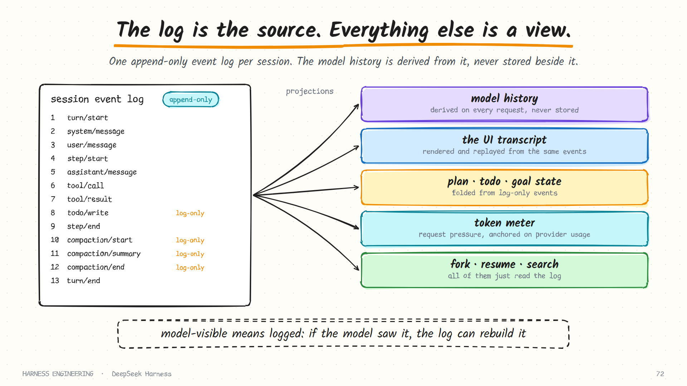

# DeepSeek Harness · The event log, persistence and compaction

> **Part 4 of 5.** One append-only log per session is the single source of truth. This page covers what is in it, how it reaches the disk, what happens after a crash, and how compaction works without rewriting history.
>
> [Overview](../deepseek-harness.md) · [1. Plugins](plugins.md) · [2. The turn](turn.md) · [3. Tools and safety](tools-and-safety.md) · **4. Sessions** · [5. Many agents](agents.md)

Sources: `docs/subsystems/session.md`, `persistence.md`, `compaction.md`, `token-meter.md`, `storage.md` and `packages/compaction/compaction-basic/README.md`, as of October 2026.

## The log is the source. Everything else is a view.

A session is an append-only log of typed events. The list of messages sent to the model is **derived** from that log on every request. It is never stored beside it.



That one decision removes a whole category of bug. In a harness that keeps a message list *and* a log, the two can disagree after a crash, a compaction or a fork. Here there is nothing to disagree with.

Three properties are stated as requirements of the log:

- Every event is **lossless JSON**.
- **Sequence numbers are contiguous.**
- An assistant message **embeds the exact compact stream** that produced it, so a durable record of what the provider actually sent exists for every settled reply.

## Two kinds of event

| Kind | Reaches the model? | Examples |
|------|--------------------|----------|
| **Surface events** | Yes: they project to messages | `system/message`, `user/message`, `assistant/message`, `tool/call`, `tool/result` |
| **Log-only events** | No: durable and replayable, never in the transcript | `turn/*` and `step/*` boundaries, `assistant/attempt`, `todo/write`, `plan/mode`, `goal/change`, `compaction/*`, approval and hook audit records |

Log-only events are how the harness keeps *state* without spending the model's context on it. The todo list, whether plan mode is on, the current goal, an approval decision: each is a fact in the log that the UI and other plugins can fold into a current value, and none of it costs a token unless something explicitly renders it into a message.

`assistant/attempt` is a good example of the care taken. A failed, retried, cancelled or stream-errored attempt is retained in the log for debugging and telemetry, **without** adding to model history. You can see every try; the model sees only the one that settled.

### The vocabulary is open

Plugins add their own event types. The compaction package adds three, the todo tool adds one, the goal service adds one. Each declares its events through the type system, and a generated catalogue lists every member, core and contributed.

This is what makes the next rule enforceable.

## "Model-visible means logged"

The architecture document states an invariant. Paraphrased: every model request must be reconstructable from the log, and any new input the model can see requires a session event.

A plugin that wants to change existing message content does not mutate anything. It registers a *pure projection*, a function from logged events to the view, and a reader replaying the log later applies the same function. So the transformation itself is reproducible.

The practical consequences:

| Because the request is rebuilt from the log… | …you get |
|----------------------------------------------|----------|
| Any past request can be reconstructed exactly | Real debugging, not guesswork |
| The UI and the model read the same record | No drift between what was shown and what was sent |
| A fork is "replay a prefix into a new session" | Cheap branching |
| Telemetry is a fold over events | No separate instrumentation path |

This is the strongest form of the advice in [chapter 6](../../guide/06-durability.md) and [chapter 9](../../guide/09-evaluation.md): observability as a constraint the code must satisfy, instead of a feature added afterwards.

## From memory to disk: the persistence seam

Durability is its own capability seam, with a small contract.

| Operation | Purpose |
|-----------|---------|
| `create` | Start a new stored session |
| `open` | Open an existing one, for reading or for writing |
| `stat`, `list` | Read headers without loading events |

`create` and `open` return a **handle** for one session, with `read`, `append`, `flush` and `close`. All access to a stored log goes through a handle, and the handle carries **single-writer ownership**: a second attempt to open the same session for writing is rejected with an "already owned" error instead of racing the first.

The shipped provider stores each session as:

- an append-only **logical JSONL** log,
- held on disk as **checksummed, concatenated Zstandard frames** by default (raw lines by configuration),
- with a **sync per batch**,
- **crash-safe atomic materialisation** when a file is first created, and
- **torn-tail truncation** before the first new append.

A metadata header travels beside the log, so listing sessions does not require reading their events.

### Write-behind, with a bounded window

Appending is not done one event at a time. The session's event notification is synchronous and must not block the loop, so the backend routes each event into a small write-behind window:

1. The first pending event starts a fixed batching window.
2. Later events join it without resetting the deadline.
3. When it expires, one durable append writes the batch.
4. Events that arrive during that write form the next batch.

An explicit *flush* cancels the wait and drains immediately. A checkpoint policy decides when a flush is required, for example before a model request, so that the log on disk is never behind something the model has already been told.

This is a refinement of the simple rule in [chapter 6](../../guide/06-durability.md). "Sync after every message" is correct and simple. Batching with a bounded window and explicit checkpoints keeps the guarantee where it matters and removes most of the cost.

## After a crash

This part differs from what most harnesses do, and the reasoning is worth following.

A log that crashed mid-turn ends with an open `turn/start` and no `turn/end`. Persistence does **not** truncate it and does **not** repair it. The documentation gives the reason: a single turn in a long task can be huge, with many steps and large tool outputs, and those events were durably written before the crash. Throwing them away to restore tidiness would destroy real work.

So the layers divide the job:

| Layer | Responsibility |
|-------|----------------|
| **Persistence** | Return the physically valid, contiguous log. Discard only the incomplete fragment of a torn final write. Complete records recovered from a partly written frame are kept |
| **The reader that owns the session** | Repair the *logical* state: close the interrupted turn, record the missing tool results |
| **Read-only observers** | Balance an interrupted log in memory only, and write nothing back |

Repair writes happen only under write ownership, so a tool inspecting old sessions can never race a live turn. And a failed step records its missing tool results, which is the "answer the orphan honestly" repair from [chapter 6](../../guide/06-durability.md), performed by the loop that owns the session.

## Format versions

Session formats change, and the project treats that as a first-class problem.

- Files are named by version: the original format is `session.jsonl`, and later ones are `session.vN.jsonl`, optionally compressed.
- Opening an old session composes a chain of adjacent migrations, once, and yields current events.
- A **read** uses the migrated result in memory without writing anything. A **write** first publishes a new version-named successor file beside the unchanged original.
- Committed files are never renamed, replaced or deleted.
- A log from a *future* version is refused, with diagnostics, rather than half-read.

The repository includes a cookbook page just for adding a session format version, and another for reviewing changes to persisted types. A team only writes those documents after being burned, and the lesson generalises: put a version in your session header on day one.

## Measuring pressure: the token meter

Compaction needs to know how full the window is. A dedicated service produces that number.

| Baseline | Meaning |
|----------|---------|
| `usage` | The most recent successful provider call had the same request envelope, so its reported total is a trustworthy anchor |
| `estimated` | No reusable anchor exists, so the service priced the whole request itself |

Preferring the provider's own count, and saying clearly when you are estimating, is the right order. Image inputs are priced using the route's declared pricing where one exists, since an image can cost thousands of tokens that a character count would miss.

## Compaction without rewriting history

Compaction is a seam of its own: a service definition, a backend, and a `/compact` command as a human-facing consumer.

### When it triggers

The shipped backend states its default trigger as a formula. With context window `W`, the effective output cap `O`, and a headroom `B` of 65,536 tokens:

```text
trigger = floor( min( W × 0.8 ,  W − O − B ) )
```

So it folds at 80% of the window, or earlier if the reply reservation plus a generous headroom requires it. One backend can serve models of different sizes, with a per-model override for the threshold and for how much recent history to keep.

It provides four behaviours:

1. **Automatic** condensation as pressure builds.
2. **Recovery** after a confirmed context-overflow error: condense, then retry the request.
3. **On demand** through `/compact`.
4. Optionally, a **pruner** that trims oversized tool outputs first.

That fourth item is the cheap, lossless-first stage from [chapter 4](../../guide/04-context.md). The docs are also candid about limits: condensation cannot shrink the system prompt, the tool schemas or the session prefix, and cannot split one indivisible unit such as a single enormous tool call.

### How it is recorded

```text
compaction/start      acquires a lock, recorded in the log
compaction/summary    the summary, exactly which earlier events it shadows, and the model call used
compaction/end        releases the lock
```

All three are **log-only**. The summary itself reaches the model as a separate message. Nothing earlier is deleted: the summary record names the range of events it *shadows*, and the projection that builds model history simply skips them.

The lock brackets the whole operation and is released last. A crash in the middle therefore leaves a `start` with no matching `end`, which is a detectable orphan on the next load. The alternative, an `end` written early, would falsely claim a fold had completed.

| Property | How it is achieved |
|----------|--------------------|
| History is never lost | The originals stay in the log; they are shadowed, not removed |
| A half-finished fold is detectable | Start and end records bracket it, with the end written last |
| The fold is auditable | The summary record stores the range, the model and the token usage |
| You can branch from before a fold | The log still contains everything |

## Other state: the storage seam

Not everything is a session event. Schedules, team rosters and plugin data need somewhere to live. A separate storage seam handles that, with JSON and SQLite backends that can be mounted side by side. Each consumer declares a *domain*, and a route table decides which backend serves it. The split keeps the event log pure: it holds the conversation, and nothing else.

## What to take from this page

- **Derive the model's view from the log.** Never store a second copy of the conversation.
- **Use log-only events for state.** Durable, replayable, and free of token cost.
- **Keep failed attempts in the log and out of the history.**
- **Make persistence return what is physically valid, and let the owner repair what is logically incomplete.** Do not truncate work to make a file tidy.
- **One writer per session**, enforced by the handle.
- **Version the format, never rewrite committed files, refuse the future.**
- **Bracket multi-step operations with a lock in the log**, released last.
- **State your compaction trigger as a formula.**

## Sources

- `docs/subsystems/session.md`, `persistence.md`, `session-projection.md`, `docs/persistence-catalog.md`
- `docs/subsystems/compaction.md`, `packages/compaction/compaction-basic/README.md`, `docs/subsystems/token-meter.md`
- `docs/subsystems/storage.md`, and the cookbook pages on session format versions
- `docs/architecture.md` (the session log section)

**Next:** [5. Sub-agents, teams and automation →](agents.md)
