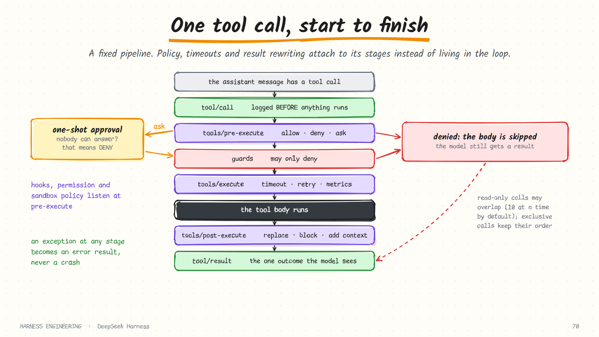
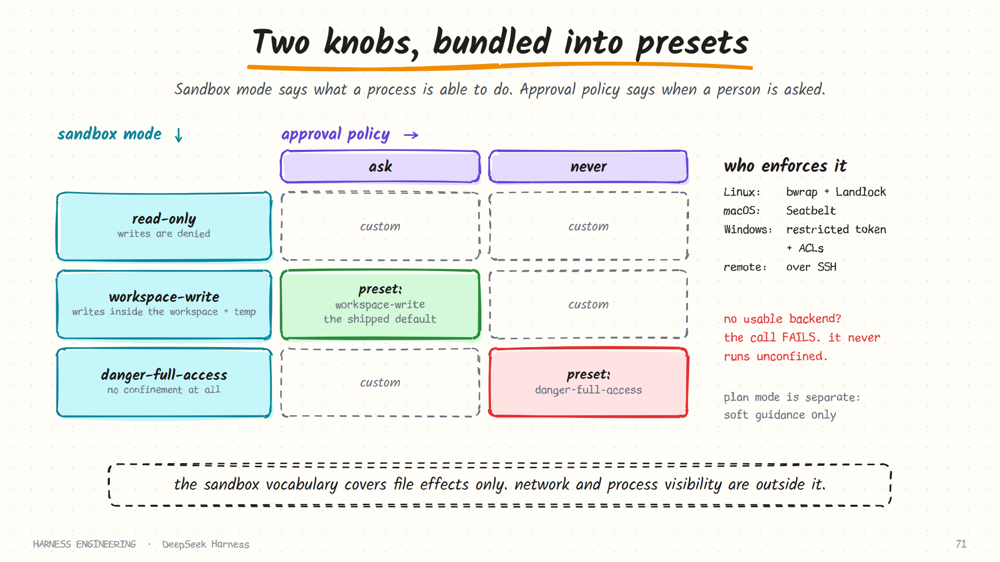
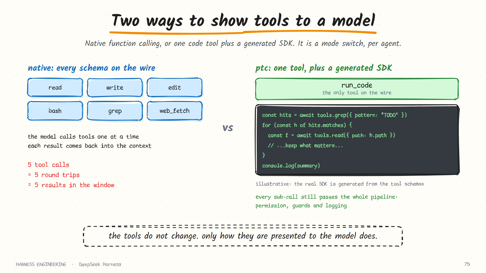

# DeepSeek Harness · Tools, approval and sandbox

> **Part 3 of 5.** What a tool definition contains, the fixed pipeline every call passes through, and the three independent safety mechanisms: approval, sandbox mode and file-observation policy.
>
> [Overview](../deepseek-harness.md) · [1. Plugins](plugins.md) · [2. The turn](turn.md) · **3. Tools and safety** · [4. Sessions](sessions.md) · [5. Many agents](agents.md)

Sources: `docs/subsystems/tools.md`, `approval.md`, `sandbox.md`, `permission-presets.md`, `filesystem.md`, `spill.md`, `docs/tool-catalog.md`, `packages/core/tools/README.md` and `SAFETY.md`, as of October 2026.

> **Read the project's safety notice first.** It describes the software as an experimental developer preview that has not had a security audit, says sandboxing and approval reduce risk without guaranteeing isolation, and recommends a disposable VM or container. Everything below describes mechanisms, not guarantees.

## What a tool definition contains

A tool is declared with a typed helper. The definition has more parts than the schema the model sees.

| Part | Seen by the model? | Purpose |
|------|--------------------|---------|
| Name, description, parameter schema | **Yes** | The interface from [chapter 2](../../guide/02-tools.md) |
| Output declaration: a schema plus a renderer | No | The tool body returns a plain JSON value; the renderer turns it into what the model reads |
| `execute` | No | The body |
| A timeout budget | No | A cooperative deadline |
| A concurrency-safety flag | No | Whether calls may overlap |
| Presenters | No | How the UI draws the pending and finished call |

Two details deserve attention.

**The wire schema is built by allowlist.** The registry constructs the model-facing schema from an explicit list of fields, so execution details, timeouts and presentation callbacks can never leak into a request. Forgetting to strip a field is impossible, because nothing is included by default.

**Output is declared, not improvised.** The body returns a canonical JSON value that is validated against a schema, and a separate pure function renders it for the model. That separation lets the same result be shown to a model, replayed in a UI, and consumed by a program, without three hand-written formats drifting apart.

Model arguments are validated before the body runs. Invalid input becomes an ordinary error result, and an ordinary tool failure does not end the turn.

## The pipeline

Every call, from every tool, passes through the same fixed stages.

| Stage | Kind | What may happen here |
|-------|------|----------------------|
| `tool/call` | Durable event | The call is **logged before anything runs** |
| `tools/pre-execute` | Waterfall | Allow, deny, or ask. Hooks, permission policy and sandbox policy listen here |
| Guards | Registered functions | **May only deny.** No later listener can turn a guard's denial back into permission |
| `tools/execute` | Waterfall, around the body | Timeout, retry, metrics |
| The tool body | | The actual work |
| `tools/post-execute` | Waterfall | Accept, block with feedback, replace content, attach extra context |
| `tool/result` | Durable event | The single outcome the model sees |

Why separate *pre-execute* from *guards*? Pre-execute is extensible and reorderable: plugins cooperate on a decision. A guard is **monotonic**: it can add a denial and nothing can remove it. An owner who must never be overridden registers a guard, and does not have to worry about what another plugin does earlier or later in the chain.

Three behaviours fall out of this shape, and each matches a principle from the guide:

- **A denied call still produces a result.** The body is skipped, and the model receives an outcome it can react to ([chapter 3](../../guide/03-guardrails.md): a blocked call is a message).
- **An exception at any stage is normalised into an error result.** It does not escape the pipeline ([chapter 1](../../guide/01-the-loop.md): errors are messages).
- **The call is logged before it executes** ([chapter 6](../../guide/06-durability.md): write the intent before the effect).

## The tools that ship

The generated catalogue lists every tool a shipped plugin contributes. Grouped by job:

| Family | Tools |
|--------|-------|
| Files | `read`, `write`, `edit`, `read_image`, `glob`, `grep`, and a `str_replace_editor` alternative |
| Shell | `bash` (and `pwsh` on Windows), each with a persistent-session variant |
| Terminals | `terminal_open`, `terminal_send`, `terminal_read`, `terminal_signal`, `terminal_list`, `terminal_close` |
| Background jobs | `job_list`, `job_output`, `job_kill` |
| Web | `web_fetch`, `web_search` |
| Code intelligence | `lsp` |
| Planning | `todo_write`, `exit_plan_mode`, `create_goal`, `get_goal`, `update_goal` |
| People | `ask_user_question`, `present` |
| Agents | `subagent`, `list_subagent_models`, `send_message`, `interrupt_agent`, `list_agents`, `workflow` |
| Time | `schedule_create`, `schedule_list`, `schedule_update`, `schedule_delete` |
| Knowledge | `skill`, plus tools to search and trace past sessions |
| Meta | `run_code`, `plugin_manager`, tools to inspect the plugin system itself, and MCP resource tools |

The catalogue also records, for each tool package, which services it requires and which session events it writes. That is unusually useful: you can see a tool's blast radius in a table.

## Approval: fail closed, by type

When a pre-execute listener answers "ask", the approval service runs a one-shot prompt. Its outcome is one of a small closed set.

| Outcome | Meaning | Effect |
|---------|---------|--------|
| `allowed-once` | Granted for this specific action only | The call proceeds |
| `rejected` | A person or policy said no | Deny |
| `cancelled` | The request was withdrawn | Deny |
| `unavailable` | Nobody could answer | **Deny** |

A missing, crashing, non-owning or non-conforming approver becomes `unavailable`, and callers deny on it. There is no path where the absence of an answer opens the gate.

Each request gets a fresh id that pairs an *asked* audit event with a *decided* one, so the log holds a complete record of every approval and its outcome. A per-session policy, `ask` or `never`, decides whether an approver is consulted at all; `never` deterministically returns a rejection without dispatching anyone.

## Sandbox mode: what a process is able to do

The sandbox is a separate seam. It wraps the command line of a subprocess in a file-effect policy, without the shell tool knowing which platform mechanism does the work.

| Mode | File effects |
|------|--------------|
| `read-only` | The backend denies writes |
| `workspace-write` | Writes are permitted under the workspace root and a temp area |
| `danger-full-access` | Confinement is bypassed entirely |

| Platform | Backend |
|----------|---------|
| Linux | bubblewrap and Landlock |
| macOS | Seatbelt |
| Windows | A restricted token with access-control lists |
| Remote | The same policy applied over SSH, paired with remote filesystem and subprocess providers |

Three points the documentation is careful about, and that are easy to get wrong when describing any sandbox:

1. **The vocabulary covers filesystem effects only.** Network access and process visibility are explicitly outside it. Do not read "sandboxed" as "cannot reach the network".
2. **It fails closed.** If no usable backend exists, confinement rejects with an explicit "sandbox unavailable" error. The docs state the rule directly: for a confined policy, silently running unconfined is never legal.
3. **Policy is resolved per call.** The workspace root comes from the calling session's working directory, and an approved one-off retry can carry a wider mode without mutating shared state. Concurrent sessions can ask the same backend for different boundaries.

## Presets: two knobs behind one selector

Sandbox mode and approval policy are independent. A thin preset layer bundles them so a user interface can offer one "Permissions" choice.

| Preset | Sandbox mode | Approval policy |
|--------|--------------|-----------------|
| `workspace-write` | workspace-write | ask |
| `danger-full-access` | danger-full-access | never |

The names `custom` and `auto` are reserved: *custom* is what you are in when your two knobs do not match a named preset, and *auto* belongs to an experimental auto-review integration. Misconfiguration fails when the plugin loads, not at the first tool call. For instance, composing presets over a shell executor that cannot confine is rejected at startup.

This is the same two-dial design [Codex](../codex.md) uses, arrived at independently, which is a good sign that the split is the right one.

### Plan mode is deliberately not a safety feature

Plan mode is logged per-agent state. While active, a guidance section is added to each request, and an `exit_plan_mode` tool and a `/plan` command are registered. The documentation calls it **soft guidance**: sandbox mode and approval policy enforce restrictions independently, and neither reads plan state. A deployment that wants planning to be read-only must also set the sandbox to read-only. Plan mode alone asks; it does not enforce.

That is [chapter 3](../../guide/03-guardrails.md)'s distinction between prompts that shape behaviour and code that enforces limits, stated in a product's own docs.

## Read before you write

A third mechanism guards files specifically. The filesystem tools are thin; a separate **observation policy** plugin decides whether a write or an edit may proceed, by remembering what the agent has actually seen.

| What the agent has observed | A `write` becomes | An `edit` becomes |
|-----------------------------|-------------------|-------------------|
| Nothing (unseen) | create only if absent | refused: *not observed* |
| That the file is absent | create only if absent | refused: *not found* |
| The file at a particular version | replace only if still that version | allowed, guarded by that version |

So an agent cannot blindly overwrite a file it never read, and cannot edit a file that changed on disk since it looked. The edit fails with a specific code, and the model's natural next move is to read the file again.

The design is instructive because of where the rule lives. The file tool does not know about it. It calls the filesystem service and dispatches events; the policy plugin decides those events. Remove the plugin and the tools still work, unconstrained. The docs note that any deployment loading the file tools is expected to load the policy too.

## Oversized results: spill, do not truncate blindly

For results too large to keep inline, a spill policy keeps the model's view within a token budget and saves the complete result to storage.

- The model receives the **head and the tail**, in their original order, plus a path to the full result.
- Text may be split; an image is kept or omitted whole.
- If saving fails, the original content stays visible. A recovery failure never silently loses the result.

This is the "say what was dropped and how to get the rest" rule from [chapter 2](../../guide/02-tools.md), with the "rest" stored somewhere the agent can actually read.

## A different way to present tools: code mode

The registry has a `mode` setting that changes what the model sees.

| Mode | The model sees | How it uses tools |
|------|----------------|-------------------|
| `native` | Every visible tool schema | Ordinary function calling, one call per request |
| `ptc` | Only `run_code`, plus an SDK generated from the tool schemas | It writes a program that calls tools as functions |

In code mode a program can call many tools, loop, filter, and return only what matters, so intermediate results never enter the context. Crucially, each sub-call still passes the whole pipeline: permission, guards, logging. The program runs in a sandboxed runtime with a default deadline of two minutes and a cap of ten minutes, and asking for wider sandbox permissions requires a written justification and approval before the program starts.

An agent preset can choose its own presentation, so one agent can use native calls while another uses code mode over the same tools. Hermes arrives at the same idea from another direction; see [its tools page](../hermes/tools-and-security.md).

## What to take from this page

- **Build the wire schema by allowlist.** Never by "everything except".
- **Separate cooperative policy from monotonic guards.** One can be negotiated; the other cannot be undone.
- **Encode "fail closed" in a type.** Give "nobody answered" its own outcome and make it deny.
- **Keep "able to" and "allowed to" as separate knobs**, then bundle them for people.
- **Say what your sandbox does not cover.**
- **Put the read-before-write rule in a policy, not in the tool.**
- **Spill, do not just clip.**

## Sources

- `docs/subsystems/tools.md`, `docs/tool-execution-pipeline.md`, `packages/core/tools/README.md`, `docs/tool-catalog.md`
- `docs/subsystems/approval.md`, `sandbox.md`, `permission-presets.md`, `plan.md`
- `docs/subsystems/filesystem.md`, `spill.md`, `packages/spill/spill-policy/README.md`, `ptc-runtime.md`
- `SAFETY.md`

**Next:** [4. The event log, persistence and compaction →](sessions.md)
