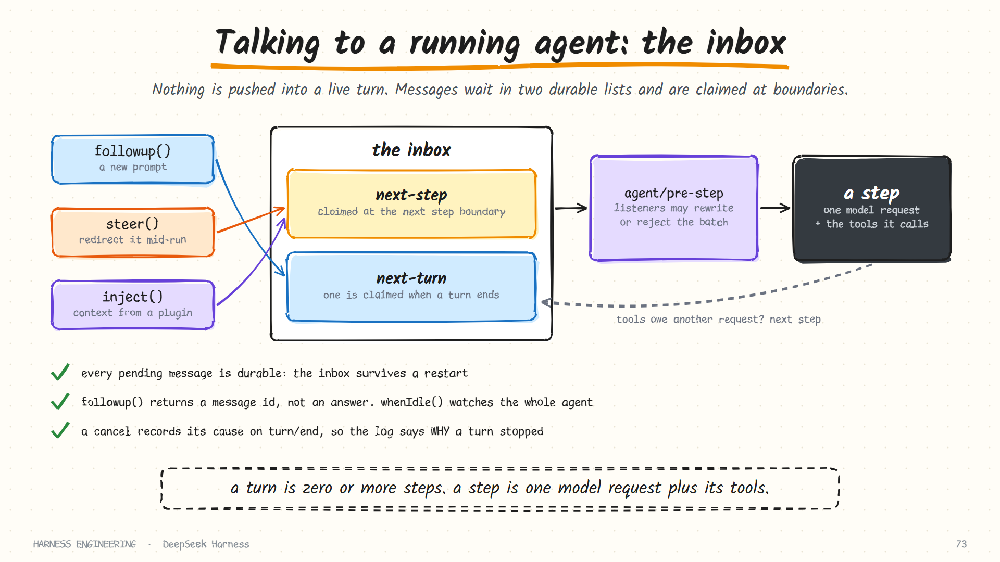

# DeepSeek Harness · Agents, the inbox and the turn

> **Part 2 of 5.** How an agent is created and owned, how you talk to one that is already running, and exactly what happens between "a message arrives" and "the turn ends".
>
> [Overview](../deepseek-harness.md) · [1. Plugins](plugins.md) · **2. The turn** · [3. Tools and safety](tools-and-safety.md) · [4. Sessions](sessions.md) · [5. Many agents](agents.md)

Sources: `docs/architecture.md`, `docs/subsystems/core.md` and `packages/core/agent-loop/README.md` in the repository, as of October 2026.

## Creating an agent

Agents are created through the `ctx.agents` registry, either declaratively (entries in the loop's configuration start at boot) or in code.

| Call | Does |
|------|------|
| `ctx.agents.create(...)` | Builds a fresh session and an agent under one caller-supplied session id |
| `ctx.agents.resume(...)` | Loads a persisted session first, then starts the agent on it |
| `ctx.agents.get(id)` | Returns the bare `Agent`, for anyone who wants to talk to it |

`create` and `resume` return a **handle**: the agent plus a `dispose()` function.

That small design choice encodes an ownership rule. The disposer is a *capability*: among consumers, only the holder can tear the agent down. Anyone can look an agent up and send it a message; only its creator can end it. Disposal stops the loop, waits for it to actually exit, unregisters the agent, removes its session from the in-memory store, and unwinds the agent's scoped registrations.

A declarative entry looks like this in outline:

| Field | Meaning |
|-------|---------|
| `id` | A stable label |
| `provider`, `model` | The model route; both are required before a request can be dispatched |
| `reasoningEffort` | An initial reasoning effort |
| `maxTokens` | A cap on output tokens per request |
| `cwd` | The workspace directory for a fresh session |
| `sessionId` | An exact identity: first use creates, a later mount resumes |
| `resumeSessionId` | Load this persisted session instead of creating one |

A loop-wide `maxParallelToolCalls` (10 by default) limits how many parallel-safe tool calls are in flight in one step; setting it to 1 makes execution strictly serial.

## The inbox: how you talk to a running agent

You never push a message *into* a live turn. You put it in the agent's inbox, and the loop claims it at a boundary.



The agent exposes one unified `send` method. Three convenience aliases cover the common cases:

| Call | Goes to | Meaning |
|------|---------|---------|
| `followup()` | The **next-turn** list | A new prompt, to be handled after the current work |
| `steer()` | The **next-step** list | A redirection, delivered as soon as the current step finishes |
| `inject()` | The **next-step** list | Synthetic context from a plugin: a file-change notice, a skill's content, a reminder |

At each **step boundary** the loop removes a batch from the inbox: all next-step input, plus, at a turn boundary, exactly one next-turn message.

Three details matter in practice:

- **The inbox is durable.** It is a projection of events in the session log. Pending messages survive a restart, and the log shows when each was inserted, claimed or discarded.
- **`followup()` returns a message id, not an answer.** It identifies the *insertion*. There is no per-message result, because several queued follow-ups, steering messages and injected context can share one stretch of work. If an automation wants "the output of my message", it must define that interval itself, for example from its message being claimed until the agent next goes idle.
- **`whenIdle()` watches the whole agent**, not one message.

The repository's list of defensive patterns turns this into a rule worth quoting in spirit: asynchronous state is not synchronous state. Treating "the agent is idle" as "my request finished" is a class of bug the project has met and documented.

## The turn, step by step

Two definitions first, because the whole design rests on them:

> A **step** is one model request plus the tools it calls. A **turn** is zero or more steps: it opens before its first input is claimed and closes once nothing is owed.

"Zero steps" is deliberate. A turn can open, find its input rejected or empty, and close without ever calling the model.


Reduced from the architecture document's turn-flow listing:

```text
turn/start                                  ← durable
  claim next-step input, plus one queued message
  assemble prompt sections and tool schemas
  agent/pre-step        accept · rewrite · reject the claimed batch
      rejected, or rewritten to empty → close the turn with no step
  step/start                                ← durable
  agent/request         resolve the actual model route; inspect or change the request
  append the entered messages as user/message          ← durable
  derive and freeze the model history FROM THE LOG
  stream the call → llm/stream
      assistant/message   (or assistant/attempt for a failed or retried try)   ← durable
  for each tool call:
      tool/call → tools/pre-execute → tools/execute → tools/post-execute → tool/result
  step/end                                  ← durable
  tools owe another request, or new next-step input arrived?  → next step
agent/turn-stopping     last chance to keep the turn going
turn/end                                    ← durable
```

### Which events are facts, and which are hooks

| Kind | Examples | Survives a restart? |
|------|----------|---------------------|
| **Durable session events** | `turn/*`, `step/*`, `system/message`, `user/message`, `assistant/message`, `assistant/attempt`, `tool/call`, `tool/result` | Yes: they are the log |
| **Live extension points** | `agent/pre-step`, `agent/request`, `llm/stream`, the three `tools/*` stages, `agent/turn-stopping` | No: they exist only while the work is in flight |

When you add behaviour, the first decision is which kind you need. If the fact must survive a reload, it needs a session event. If you only want to observe or intercept, a live event is enough.

### The three interception points worth knowing

**`agent/pre-step`** runs once before each step with the batch the loop just claimed. A listener can:

- **enter**, supplying the complete batch of messages that will be appended. Messages it drops stay removed; messages that arrived after the claim stay pending.
- **reject**, in which case no step opens.

This is where hook bridges, memory injection and input rewriting live. It is the only waterfall chain before the request is derived.

**`agent/request-error`** runs after a failed model step closes and before its turn closes. A listener can repair state, wait on a policy decision, and return a *retry* decision. Left unhandled, the failure is terminal. Context-overflow recovery is built on exactly this: compact, then retry.

**`agent/turn-stopping`** runs when a turn has no tool continuation and no steering left. It is the place for "you are not done yet": a goal that is not met, a check that has not passed. It is the event-pipeline form of the stop hook described in [chapter 9](../../guide/09-evaluation.md).

### Retries do not repeat assembly

A retried request does not re-run prompt assembly or `agent/pre-step`. Each attempt refreshes the registered runtime facts, reconciles the prompt, and freezes the request before streaming. The practical effect is that a retry cannot double-inject context or double-count input.

## Cancellation that leaves a record

Cancelling an agent is cooperative and it is logged.

- The cancellation **cause** travels as a typed value. The durable `turn/end` event records the outcome as *aborted* together with that cause.
- So the log does not merely show that a turn stopped. It shows **why**: a user interrupt, a timeout, a parent tearing down a child.
- Text that had already streamed to the user is preserved rather than discarded.
- Tools are expected to observe the cancellation signal and settle only after their own work has actually stopped.

That last expectation appears in the defensive-patterns document as a rule: *dispose must reach quiescence, not just request it.* A teardown that issues a kill and returns before the work stops leaves orphans. The harness awaits the exit.

Compare with [chapter 1](../../guide/01-the-loop.md)'s advice on interrupts. There, the harness appends a "cancelled" result for each pending call so the transcript stays legal. Here the same guarantee is structural: failed steps record their missing tool results, and the reason is part of the turn's closing event.

## Parallel tool calls

When one reply asks for several tools:

- Each tool definition declares whether it is **concurrency-safe**.
- Parallel-safe calls may overlap, up to the configured limit.
- Exclusive calls keep their order.

A file read is safe to overlap with another file read. A shell command is not. The tool author makes that declaration once, on the definition, and the loop schedules accordingly.

## Seeding, forking and identity

Because history is derived from the log ([part 4](sessions.md)), several operations fall out cheaply:

| Operation | How |
|-----------|-----|
| **Resume** | Open the persisted session and start an agent on it |
| **Fork** | Create a new agent with a *seed*: a replay prefix copied from the parent session up to an exact event count |
| **Remount** | A declarative entry with a fixed `sessionId` creates on first use and resumes on later ones |

Session metadata records fork lineage, delegation depth, the working directory and the agent preset, so any session can explain where it came from.

## What to take from this page

- **Make teardown a capability.** Whoever creates an agent holds the only handle that can end it.
- **Deliver through a durable inbox, at boundaries.** It removes a whole class of race conditions, and it makes steering survive a restart.
- **Separate "follow up" from "steer".** They are different intentions with different timing.
- **Define your units.** "Step" and "turn" mean precise things here, and that precision shows up everywhere else.
- **Record why a turn ended**, not only that it did.
- **Do not confuse idle with done.**

## Sources

- `docs/architecture.md` (events, turn flow) and `docs/subsystems/core.md` (creation, ownership, the agent handle, interception decisions)
- `packages/core/agent-loop/README.md`
- `docs/defensive-patterns.md`

**Next:** [3. Tools, approval and sandbox →](tools-and-safety.md)
