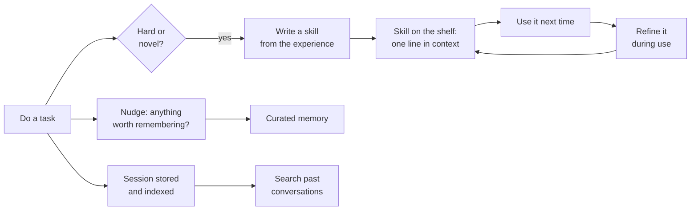

# Hermes Agent

> **The bet:** an agent should get better the longer you use it. Hermes builds a *learning loop* into the harness: it writes skills from experience, improves them in use, and remembers across sessions, while running somewhere other than your laptop.

**Maintainer:** Nous Research · **Repository:** [NousResearch/hermes-agent](https://github.com/NousResearch/hermes-agent) · **Language:** Python · **Licence:** MIT · **Docs:** [hermes-agent.nousresearch.com/docs](https://hermes-agent.nousresearch.com/docs/)

> Snapshot: October 2026. Details below come from the project's README, its `AGENTS.md`, and its developer and user guides. Check the repository for current behaviour.

## In one paragraph

Most harnesses in this guide are coding tools you open in a project. Hermes is closer to a personal agent that is always on: one agent core behind a terminal UI, a messaging gateway (Telegram, Discord, Slack and many more), a desktop app and a scheduler. You can message it from your phone while it works on a cloud machine. Its two signature ideas are the learning loop and a pair of strict design invariants that are worth studying even if you never run it.


## Go deeper

This page is the overview. Five deep-dive pages take Hermes apart subsystem by subsystem, each with its own diagrams:

| # | Page | Covers |
|---|------|--------|
| 1 | [Inside the agent loop](hermes/loop.md) | The architecture, one turn step by step, three wire formats, interrupts, budgets and fallback |
| 2 | [Prompt, cache and compression](hermes/context.md) | The three prompt tiers, cache breakpoints, two compressors and four phases, micro-compaction |
| 3 | [Memory, skills and the learning loop](hermes/learning.md) | Bounded memory files, session search, self-written skills, the curator |
| 4 | [Tools, backends and security](hermes/tools-and-security.md) | Self-registering tools, tool search, programmatic tool calling, the eight security layers |
| 5 | [Gateway, cron and delegation](hermes/automation.md) | Messaging platforms, authorisation and pairing, scheduled jobs, sub-agents, session storage |


## Two invariants

The project's contributor guide names two rules that shape almost every decision. They are some of the clearest statements of harness design principles in any open-source project.

**1. The per-conversation prompt cache must not be broken.** Changing past context, swapping the tool set, reloading memories or rebuilding the system prompt in the middle of a conversation invalidates the cached prefix and multiplies cost. The single permitted exception is context compression. Even commands that change system-prompt state take effect in the *next* session by default, with an explicit opt-in to apply them now.

**2. The core stays narrow; capability lives at the edges.** Every model-facing tool is sent on every API call, so the bar for adding a core tool is high. New capability should arrive, in order of preference, as:

```text
extend existing code
  → a CLI command plus a skill
    → a tool that only appears when its service is reachable
      → a plugin
        → an MCP server
          → a new core tool   (last resort: fundamental, broadly useful, unreachable otherwise)
```

The project calls this a footprint ladder: take the highest rung that solves the problem. Both invariants are direct consequences of ideas in [chapter 4](../guide/04-context.md) (a stable prefix) and [chapter 2](../guide/02-tools.md) (tool schemas are not free), promoted from advice to hard rules.

## The nine parts

### 1. Loop

One Python agent class shared by every surface. A message from Telegram and a line typed in the terminal reach the same loop. The developer guide describes the loop living in one module, with each phase of a turn in its own: preparing the iteration, the API call, API errors, overflow, truncation and recovery.

Its responsibilities, as the docs list them, are a tidy summary of this whole guide: assemble the system prompt and tool schemas; pick the provider mode; make interruptible model calls; execute tool calls, sequentially or concurrently through a thread pool; keep the conversation history; handle compression, retries and fallback models; track an iteration budget across parent and child agents; and flush persistent memory before context is lost.

**One internal format, three wire formats.** Hermes supports three API modes and converts at the edge:

| Mode | Used for |
|------|----------|
| Chat completions | OpenAI-compatible endpoints, including OpenRouter and most providers |
| Responses | OpenAI's Responses API |
| Anthropic messages | The native Anthropic API, through an adapter |

All three converge on the same OpenAI-style internal message shape before and after each call. That is the provider layer from the [OpenRouter page](openrouter.md), implemented as a harness component.

### 2. Tools

Dozens of tools organised into **toolsets** you enable and disable, plus MCP. A notable capability: the agent can write a Python script that calls tools over RPC, collapsing a multi-step pipeline into a single turn that costs almost no context.

### 3. Guardrails

Command approval, a pairing step for direct messages from chat platforms, and container isolation. The terminal tool can run on several **backends**: local, Docker, SSH, Singularity, and serverless sandboxes. Choosing a backend is choosing the box from [chapter 3](../guide/03-guardrails.md).

### 4. Context

See the closer look below.

### 5. Memory and skills

See the closer look below.

### 6. Durability

Session state lives in a local database with full-text search, which serves both resumption and recall. Because the agent can run on a remote or serverless backend, the *environment* is durable too: it can hibernate when idle and wake on demand.

### 7. Delegation

A `delegate_task` tool spawns child agents with an isolated context, inherited tool access and their own terminal sessions. Each child gets a fresh conversation, and only its final summary enters the parent's context. Top-level delegations run in the **background**: the tool returns a handle at once so the conversation can continue, and the result is posted back as a new message. Background processes belong to the agent that started them, and are cleaned up when that child is closed.

### 8. Orchestration

Two built-in triggers beyond "a human typed something":

- A **cron scheduler** for unattended jobs described in natural language, with results delivered to any connected platform.
- The **messaging gateway**, a single process that connects the agent to many chat platforms and carries a conversation across them.

### 9. Evaluation

Batch trajectory generation and trajectory compression are included, aimed at producing training data for future tool-calling models. Traces are treated as a dataset as well as a debugging aid.

## A closer look: a prompt built for caching

Hermes separates two things that most harnesses mix: the **cached system prompt** and **ephemeral additions** made at call time. The cached part is assembled in three ordered tiers.

| Tier | Contains | Changes |
|------|----------|---------|
| **Stable** | Identity (a `SOUL.md` file or a fallback), tool and model guidance | Almost never |
| **Context** | Project context files (`AGENTS.md`, `CLAUDE.md` and similar), then anything that depends on the current worktree | Per project |
| **Volatile** | The skills index, the memory and user-profile snapshots, the date and session line, runtime environment hints | Per session |

The final prompt is joined in that order. The docs explain a subtle choice inside the middle tier: shared project files come *before* anything naming the current worktree, so two sessions of the same project in different worktrees still share a long cached prefix. That is prefix caching ([chapter 4](../guide/04-context.md)) taken seriously enough to dictate paragraph order.

On the context side, a turn begins with a *preflight* check that compresses if the conversation is already past a threshold, and the context engine itself is an interface with two essential methods, "should we compress?" and "compress", so a plugin can replace the built-in summariser with a different strategy.

## A closer look: bounded memory

Hermes keeps two small files and is strict about their size.

| File | Purpose | Limit |
|------|---------|-------|
| `MEMORY.md` | The agent's notes: environment facts, conventions, lessons | About 2,200 characters |
| `USER.md` | A profile of you: preferences, style, expectations | About 1,375 characters |

Four design decisions are worth copying:

1. **A frozen snapshot.** Both are injected into the system prompt once, at session start. Writes during the session do not change the prompt, which protects the cache.
2. **The agent curates.** A `memory` tool lets it add, replace and remove entries.
3. **Full means an error, not a silent drop.** When a write would exceed the limit, the tool refuses. The agent must consolidate or delete something, in the same turn, and try again. The header shown to the agent includes the current usage, so it knows how much room is left.
4. **One agent per memory.** The docs warn against pointing two agent processes at the same home directory, because automatic writes would compound into state nobody authored.

The cap is the clever part. A 2,200-character budget forces memory to stay a short list of things that matter, and makes the agent do the editing.

## A closer look: the learning loop



- **Skills are documents on disk**, in a user-level skills directory, following the open [Agent Skills](https://agentskills.io) format with progressive disclosure. Bundled, hub-installed and agent-created skills all live in the same place.
- **The agent can create, modify and delete them.** After a complex task it can write the procedure down; when a skill proves incomplete, it edits the file rather than just re-reading it.
- **Past sessions are searchable**, so recall does not depend on what survived a summary.
- **An optional user-modelling component** builds a deepening picture of who you are and how you work.

Memory here is not a static file you maintain. It is a process the harness runs.

## What to steal

1. **Write your invariants down.** Two sentences that every design review can be checked against are worth more than a long style guide.
2. **Protect the cached prefix.** Order the prompt stable → context → volatile, and defer changes to the next session unless the user opts in.
3. **A ladder for new capability.** Make "add a core tool" the last resort, not the first reflex.
4. **Cap agent-written memory, and make overflow an error** the agent has to resolve.
5. **Close the learning loop.** Let the agent turn a hard-won procedure into a skill, then let it fix that skill.
6. **Search, not just summaries.** Indexing past sessions gives recall that summaries alone lose.
7. **Convert at the edge.** One internal message format, several wire formats.
8. **Separate the agent from the machine.** A terminal backend abstraction lets the same agent run locally, in a container, or on a server.

## What it costs

- **Self-written memory and skills need governance.** An agent that writes its own procedures can also write wrong ones. Review and version them ([memory hygiene](../guide/05-memory-and-skills.md)).
- **A wide surface.** Gateway, scheduler, backends and platforms are a lot to operate and secure.
- **Always-on raises the stakes.** An agent reachable from a chat app needs strict pairing and approval, because the "user" channel is now exposed to the internet.

## Sources

- [NousResearch/hermes-agent](https://github.com/NousResearch/hermes-agent): README (features, backends, gateway, learning loop) and `AGENTS.md` (the two invariants and the footprint ladder)
- Developer guide in the repository under `website/docs/developer-guide/`: `agent-loop.md`, `prompt-assembly.md`, `context-compression-and-caching.md`
- User guide under `website/docs/user-guide/features/`: `memory.md`, `skills.md`, `delegation.md`
- [Hermes Agent documentation site](https://hermes-agent.nousresearch.com/docs/)
