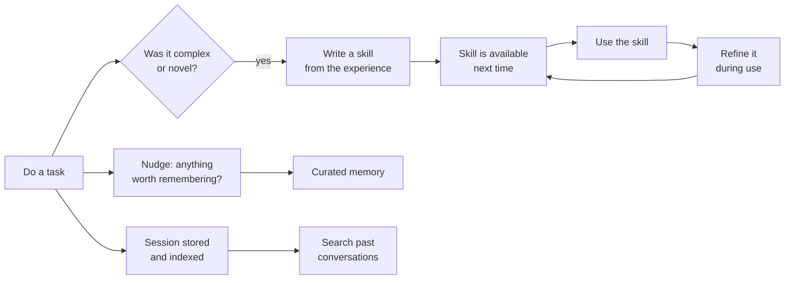

# Hermes Agent

> **The bet:** an agent should get better the longer you use it. Hermes builds a *learning loop* into the harness: it writes skills from experience, improves them in use, and remembers across sessions, while running somewhere other than your laptop.

**Maintainer:** Nous Research · **Repository:** [NousResearch/hermes-agent](https://github.com/NousResearch/hermes-agent) · **Language:** Python · **Licence:** MIT · **Docs:** [hermes-agent.nousresearch.com/docs](https://hermes-agent.nousresearch.com/docs/)

> Snapshot: October 2026. Check the repository for current behaviour.

## In one paragraph

Most harnesses in this guide are coding tools you open in a project. Hermes is closer to a personal agent that is always on: one agent core behind a terminal UI, a messaging gateway (Telegram, Discord, Slack and many more), a desktop app and a scheduler. You can message it from your phone while it works on a cloud machine. Its two signature ideas are the learning loop and a pair of strict design invariants that are worth studying even if you never run it.

## Two invariants

The project's contributor guide names two rules that shape almost every decision. They are some of the clearest statements of harness design principles in any open-source project.

**1. Per-conversation prompt caching is sacred.** Changing past context, swapping the tool set, reloading memories or rebuilding the system prompt in the middle of a conversation breaks the cached prefix and multiplies cost. The single permitted exception is context compression. Even commands that change system-prompt state take effect in the *next* session by default.

**2. The core is a narrow waist; capability lives at the edges.** Every model-facing tool is sent on every API call, so the bar for adding a core tool is high. New capability should arrive as a command plus a skill, a gated tool, a plugin or an MCP server, in roughly that order of preference.

Both are direct consequences of ideas in [chapter 4](../guide/04-context.md) (a stable prefix) and [chapter 2](../guide/02-tools.md) (tool schemas are not free), stated as hard rules.

## The nine parts

### 1. Loop

One Python agent core shared by every surface. A message from Telegram and a line typed in the terminal reach the same loop.

### 2. Tools

Dozens of tools organised into **toolsets** you enable and disable, plus MCP. The "footprint ladder" in the contributor guide explains how to decide where a new capability belongs: extend existing code first, then a command with a skill, then a tool that only appears when its service is reachable, then a plugin, then an MCP server, and only last a new core tool.

A notable capability: the agent can write a Python script that calls tools over RPC, collapsing a multi-step pipeline into a single turn that costs almost no context.

### 3. Guardrails

Command approval, a pairing step for direct messages from chat platforms, and container isolation. The terminal tool can run on several **backends**: local, Docker, SSH, Singularity, and serverless sandboxes. Choosing a backend is choosing the box from [chapter 3](../guide/03-guardrails.md).

### 4. Context

Compression of the conversation when it grows, with manual commands to compress and inspect usage. Under invariant 1, compression is the *only* operation allowed to rewrite the past.

### 5. Memory and skills: the learning loop

This is the heart of Hermes.

- **Agent-curated memory.** The agent maintains its own notes, with periodic nudges to persist what matters.
- **Autonomous skill creation.** After a complex task, it can write the procedure down as a skill.
- **Skills improve in use.** A skill that turns out to be incomplete gets edited, not just re-read.
- **Cross-session recall.** Past sessions are indexed with full-text search and summarised on retrieval.
- **User modelling.** An optional component builds a deepening picture of who you are and how you work.
- **Context files** give project-level instructions, and skills follow the open [Agent Skills](https://agentskills.io) format.

Memory here is not a static file you maintain. It is a process the harness runs.

### 6. Durability

Session state lives in a local database with full-text search, which serves both resumption and recall. Because the agent can run on a remote or serverless backend, the *environment* is durable too: it can hibernate when idle and wake on demand.

### 7. Delegation

Isolated sub-agents for parallel workstreams, plus the tool-calling scripts mentioned above for cases where a script is cheaper than a conversation.

### 8. Orchestration

Two built-in triggers beyond "a human typed something":

- A **cron scheduler** for unattended jobs described in natural language, with results delivered to any connected platform.
- The **messaging gateway**, a single process that connects the agent to many chat platforms and carries a conversation across them.

### 9. Evaluation

Batch trajectory generation and trajectory compression are included, aimed at producing training data for future tool-calling models. Traces are treated as a dataset as well as a debugging aid.

## What to steal

1. **Write your invariants down.** Two sentences that every design review can be checked against are worth more than a long style guide.
2. **Protect the cached prefix.** Defer changes to the next session unless the user explicitly opts in.
3. **A ladder for new capability.** Make "add a core tool" the last resort, not the first reflex.
4. **Close the learning loop.** Let the agent turn a hard-won procedure into a skill, then let it edit that skill when it proves wrong.
5. **Search, not just summaries.** Indexing past sessions gives recall that summaries alone lose.
6. **Separate the agent from the machine.** A terminal backend abstraction lets the same agent run locally, in a container, or on a server.

## What it costs

- **Self-written memory needs governance.** An agent that writes its own skills can also write wrong ones. Review and version them ([memory hygiene](../guide/05-memory-and-skills.md)).
- **A wide surface.** Gateway, scheduler, backends and platforms are a lot to operate and secure.
- **Always-on raises the stakes.** An agent reachable from a chat app needs strict pairing and approval, because the "user" channel is now exposed to the internet.

## Sources

- [NousResearch/hermes-agent](https://github.com/NousResearch/hermes-agent): README (features, backends, gateway, learning loop) and `AGENTS.md` (the two invariants and the footprint ladder)
- [Hermes Agent documentation](https://hermes-agent.nousresearch.com/docs/): architecture, tools and toolsets, skills, memory, security, cron, context files
