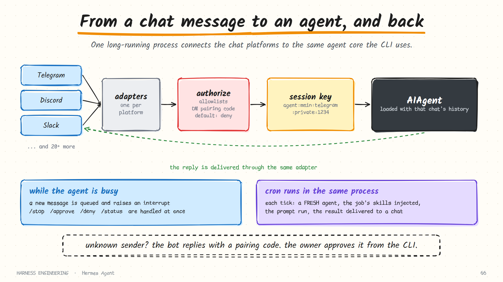

# Hermes Agent · Gateway, cron and delegation

> **Part 5 of 5.** What makes Hermes an always-on agent: the messaging gateway, who is allowed to talk to it, scheduled jobs, sub-agent delegation, and the session database underneath.
>
> [Overview](../hermes.md) · [1. The loop](loop.md) · [2. Prompt, cache and compression](context.md) · [3. Memory and skills](learning.md) · [4. Tools and security](tools-and-security.md) · **5. Gateway, cron and delegation**

Sources: `gateway-internals.md`, `cron-internals.md`, `session-storage.md` and `trajectory-format.md` in the developer guide; `delegation.md` and `security.md` in the user guide, as of October 2026.

## The gateway

The gateway is one long-running process that connects Hermes to more than twenty messaging platforms through a common design.



```text
platform event
  → the adapter turns it into a common message event
  → the runner authorises the user
  → resolves the session key
  → creates an agent loaded with that chat's history
  → runs the conversation
  → delivers the response back through the adapter
```

Each platform is an **adapter** that translates its own event and message formats to a shared one. Everything after that is platform-independent. Adding a platform means writing an adapter, not touching the agent.

### The session key

A conversation is identified by a key that encodes the full routing context:

```text
agent:{namespace}:{platform}:{chat_type}:{chat_id}
```

For example `agent:main:telegram:private:123456789`. The namespace is the profile, so one gateway can route different chats to different isolated profiles. Thread-aware platforms fold a thread id into the chat portion. The docs insist that keys are never built by hand, only through one function, which is the kind of rule that exists because someone once built one by hand.

### What happens when a message arrives mid-run

An agent may already be working when you send another message. Incoming messages pass two guards in sequence:

| Guard | Where | What it does |
|-------|-------|--------------|
| Level 1 | The base adapter | If the session is active, queue the message and set an interrupt event |
| Level 2 | The gateway runner | Intercept specific commands (stop, new, queue, status, approve, deny) and route them at once. Anything else interrupts the running agent |

Commands that must get through while the agent is blocked, such as approving a pending action, are dispatched inline instead of through the background task queue. Without that, an agent waiting for approval could never receive the approval.

This is the gateway's version of the steering and follow-up distinction from [chapter 1](../../guide/01-the-loop.md): some input is for the running turn, some is for the session, and some is for the agent's controller.

### When memory is flushed

Explicit conversation boundaries, such as starting a new session or resuming another, flush and finalise the outgoing session's memory. Idle time and the change of day never finalise it. If a cached agent is evicted to save resources, its transcript is committed first and the durable conversation stays open; the next message reloads the same history and identity.

## Who may talk to the agent

An agent on a chat platform is reachable from the internet. Authorisation is checked in a fixed order, and the last line is the important one.

```text
1. A per-platform "allow all" flag
2. The list of users approved through DM pairing
3. Platform-specific allowlists
4. A global allowlist
5. A global "allow all" flag
6. Default: DENY
```

### DM pairing

Collecting user ids in advance is awkward, so there is a pairing flow:

1. An unknown user sends the bot a direct message.
2. The bot replies with a short one-time pairing code.
3. The bot's **owner** approves that code from the command line.
4. The user is approved on that platform from then on.

The approval happens on a channel the stranger does not control. The behaviour for unauthorised messages is configurable per platform: reply with a pairing code, silently ignore, or send one polite refusal.

Remember what this protects. Whoever can message the agent is, in effect, the *user* in the transcript, with whatever tools are enabled. Authorisation here is not a nicety; it is the outermost guardrail.

## Cron

The scheduler provides anything from a one-shot delay to recurring jobs.

| Format | Example | Behaviour |
|--------|---------|-----------|
| Relative delay | `30m`, `2h`, `1d` | One-shot, after that duration |
| Interval | `every 2h` | Recurring |
| Cron expression | `0 9 * * *` | The standard five fields |
| Timestamp | An ISO date and time | One-shot, at that moment |

The model manages jobs through a single tool with action-style operations: create, list, update, pause, resume, run, remove. So you can say "every weekday at nine, summarise the open pull requests and send it to this chat" and the agent schedules itself.

A job record has this shape (the values here are illustrative):

```json
{
  "name": "Weekday PR digest",
  "prompt": "Summarise the pull requests opened since yesterday",
  "schedule": { "kind": "cron", "expr": "0 9 * * 1-5" },
  "skills": ["pr-digest"],
  "deliver": "telegram:<chat id>",
  "repeat": { "times": null, "completed": 12 },
  "state": "scheduled",
  "next_run_at": "2026-10-13T09:00:00Z",
  "last_status": "ok"
}
```

Jobs are stored in one file with atomic writes: write a temporary file, then rename it over the original. A crash mid-write cannot leave a half-written job list.

### What one tick does

```text
scheduler tick
  → load the jobs that are due
  → create a FRESH agent, with no history
  → inject the job's attached skills as context
  → run the job's prompt
  → deliver the response to the target platform
  → update the job's state and next run time
```

Three design points:

- **A fresh agent each time.** A scheduled job does not inherit a conversation, so it cannot be confused by one, and its cost is predictable.
- **Skills are the job's memory.** The procedure for "how to write the daily briefing" lives in a skill attached to the job. Improve the skill and every future run improves.
- **Delivery is part of the job.** The result goes to a chat. A scheduled run nobody reads is not worth scheduling.

As [part 4](tools-and-security.md) noted, a cron job that hits a dangerous command is denied by default, since nobody is present to approve it.

## Delegation

A `delegate_task` tool spawns child agents.

### Children know nothing

The documentation makes the point with a warning box, and it is the same point as [chapter 7](../../guide/07-delegation.md): a sub-agent starts with a **completely fresh conversation**. It has no knowledge of the parent's history or prior tool calls. Its only context is the goal and context fields the parent fills in.

One sensible exception: when the parent has a resolved workspace, each child's system prompt includes that workspace's **project context files**, found the same way as for the main agent (the identity file is excluded). A child working in a repository operates under that repository's conventions without rediscovering them.

### Shapes of delegation

| Shape | Use |
|-------|-----|
| Single task | One child, one job |
| Parallel batch | Several children at once, up to a concurrency limit |
| Structured output | The child must return data matching a schema |
| Orchestrator role | A child that may itself spawn leaves, when depth allows |

Configuration covers the things [chapter 7](../../guide/07-delegation.md) said to bound:

| Setting | Controls |
|---------|----------|
| A turn limit per child | The child's budget |
| Maximum concurrent children | Fan-out |
| Maximum spawn depth | Recursion. The default is 1: **flat**, no grandchildren |
| Worktree isolation | Give each child its own git worktree |
| Model and provider override | Run children on a different model |

Children inherit tool access, get their own terminal sessions, and own their background processes: closing a child terminates what it started without touching the parent's or its siblings' processes.

### Results arrive later

Top-level delegations run in the **background**. The tool returns a handle immediately so the conversation can continue, and the result is posted back as a new message when ready. An orchestrator child, by contrast, waits for its own workers so it can combine their results before reporting.

Background completion is engineered for an unreliable world: a completion is acknowledged only once it has actually been queued for the session, a missing route leaves it pending for retry, and delivery after a crash or restart is at-least-once.

### The cost strategy

The delegation docs make an argument about money that is worth repeating:

- Breaking a problem into well-specified sub-tasks takes frontier-level judgment.
- *Executing* a sub-task that arrives with a clear goal, full context and an output contract usually does not.
- And the children are where the tokens go: a parallel batch typically burns the large majority of a run's total.

So pin the parent to a strong model and the children to an inexpensive one. The worker model is where the cost actually lives, and a good brief is what makes a cheap worker sufficient.

## Session storage

Underneath all of this is one SQLite database per profile.

| Stored | Detail |
|--------|--------|
| Sessions | Source, model and its configuration, the system prompt, timestamps, end reason |
| Accounting | Message and tool-call counts; input, output, cache-read, cache-write and reasoning tokens; estimated and actual cost |
| Lineage | A parent session id, so compression-triggered splits form a chain |
| Messages | The full history, indexed for full-text search |

Recording the *system prompt* with the session means a past conversation can be reproduced exactly. Recording cache-read and cache-write tokens separately means you can see whether the caching strategy from [part 2](context.md) is working.

### Many writers, one file

A gateway, several CLI sessions and worktree agents may all share one database. The storage layer handles contention deliberately:

- a short database timeout, instead of the long default;
- **application-level retry with random jitter**, on a time budget that depends on the write: generous for transcript writes, whose failure aborts the turn, and very short for observation-only writes;
- transactions that take the write lock at the start, so contention surfaces immediately;
- periodic checkpoints of the write-ahead log.

The jitter is there for a specific reason given in the docs: a deterministic backoff makes all competing writers retry at the same instants, a convoy. Randomising breaks it up. It is the same reasoning as jittered retries against a model provider in [chapter 6](../../guide/06-durability.md).

### Profiles

Each named profile is an isolated directory with its own database, configuration, memory, logs and gateway process. Several run concurrently. A subprocess that drops the profile's environment variable silently falls back to the default profile, so spawners are told to pass it explicitly. Tests are guarded from ever opening a live database.

## Trajectories

Finally, conversations can be saved as **trajectories**: one JSON object per line, in a widely used conversation format, with completed and failed runs written to separate files. A batch runner generates them at scale.

The purpose is training data for future tool-calling models, and it changes how you should think about traces. In [chapter 9](../../guide/09-evaluation.md) a trace is a debugging aid. Here it is also a dataset: the record of what a good run looks like is itself an asset.

## What to take from this page

- **Adapters at the edge, one core behind them.**
- **Encode routing in the session key**, and build keys in one place.
- **Let control commands bypass the queue**, or a blocked agent can never be unblocked.
- **Default deny, and approve on a channel the stranger does not control.**
- **Scheduled jobs get a fresh agent and a skill**, and deliver their result somewhere a person will see it.
- **Children know nothing**, except the project's own instruction files.
- **Strong model for the plan, cheap model for the work.**
- **Record the system prompt and the cache counters** with each session.
- **Jitter every retry**, including database writes.
- **Traces are data.**

## Sources

- `website/docs/developer-guide/gateway-internals.md`, `cron-internals.md`, `session-storage.md`, `trajectory-format.md` in [NousResearch/hermes-agent](https://github.com/NousResearch/hermes-agent)
- `website/docs/user-guide/features/delegation.md`, `cron.md`, and `user-guide/security.md`

**Back to:** [Hermes Agent overview](../hermes.md) · **Next harness:** [DeepSeek Harness →](../deepseek-harness.md)
