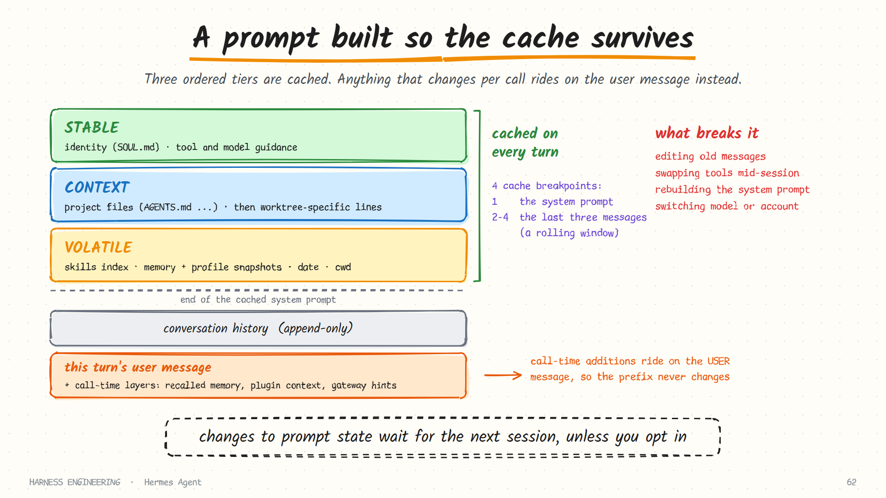
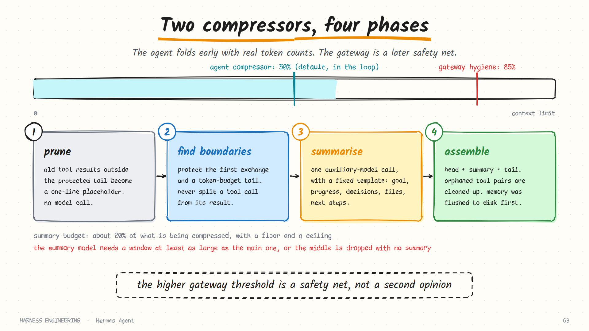

# Hermes Agent · Prompt, cache and compression

> **Part 2 of 5.** How the system prompt is assembled in tiers so the provider cache survives, how cache breakpoints are placed, and the two-layer, four-phase compression system.
>
> [Overview](../hermes.md) · [1. The loop](loop.md) · **2. Prompt, cache and compression** · [3. Memory and skills](learning.md) · [4. Tools and security](tools-and-security.md) · [5. Gateway, cron and delegation](automation.md)

Sources: `prompt-assembly.md`, `context-compression-and-caching.md` and `micro-compaction.md` in the developer guide, and `context-files.md` in the user guide, as of October 2026.

## The rule everything else follows

Hermes's contributor guide states an invariant: the per-conversation prompt cache must not be broken. This page is the machinery that makes that true.

Recall from [chapter 4](../../guide/04-context.md) why it matters. Providers cache the unchanged *prefix* of a request and charge far less to read it again. An agent re-sends its whole transcript on every turn, so an intact cache is the difference between paying full price for a 100,000-token conversation thirty times and paying a fraction of that.

## The prompt in three tiers



Hermes separates two things that most harnesses mix together: **cached system-prompt state**, and **additions made at call time**.

The cached system prompt is assembled as three ordered tiers.

| Tier | Contents | How often it changes |
|------|----------|----------------------|
| **Stable** | Identity (a `SOUL.md` file, or a built-in fallback), tool and model guidance | Almost never |
| **Context** | A caller-supplied system message, project context files, then anything naming the current worktree | Per project |
| **Volatile** | The skills index, the memory snapshot, the user-profile snapshot, an external memory block, the date and session line, runtime environment hints | Per session |

The final prompt is joined in that order: stable, then context, then volatile.

### A detail worth copying

Inside the middle tier, the shared project files come *before* anything that names the current worktree. The docs explain why: two sessions of the same project, running in different git worktrees, then share a prompt prefix that covers the whole project block. A longest-prefix cache can reuse it for both. Had the working directory been mentioned one line earlier, the shared prefix would have ended there.

That is paragraph ordering chosen by cache arithmetic. It costs nothing and saves real money for anyone running parallel agents on one repository.

### What does *not* go in the system prompt

Some context is useful for one call only. These are deliberately kept out of the cached prompt:

- an ephemeral system prompt supplied for a single call;
- prefill messages;
- session-context overlays derived by the gateway;
- memory recalled for this turn by an external provider;
- context returned by plugin hooks that run before the model call.

Where do they go instead? They are appended to the **current turn's user message**. The newest message is by definition not part of any cached prefix, so adding to it breaks nothing.

The documentation gives four reasons for the split, and they are the right four: preserve provider-side caching; avoid mutating history unnecessarily; keep memory semantics understandable; and let the gateway, the editor adapter and the CLI add context without poisoning persistent prompt state.

## Context files

| File | Purpose | Found by |
|------|---------|----------|
| `.hermes.md` / `HERMES.md` | Project instructions, highest priority | Walking up to the git root |
| `AGENTS.override.md` | A personal override of `AGENTS.md`, usually untracked | The working directory, then subdirectories progressively |
| `AGENTS.md` | Project instructions and conventions | The same |
| `CLAUDE.md` | Also recognised | The same |
| `.cursorrules` | Also recognised | The working directory only |
| `SOUL.md` | The agent's identity | The Hermes home directory only |

Two rules:

- **Only one project context type is loaded per session**, first match wins, in the order above. A repository with both `AGENTS.md` and `CLAUDE.md` does not pay for both.
- **`SOUL.md` is always loaded, independently**, as the first thing in the prompt. It defines who the agent is; project files define how to work here.

Separating *identity* from *project instructions* is a distinction few harnesses make, and it matters for a personal agent that follows you across projects. Context files are also scanned for prompt-injection patterns before use, since they are loaded into the most trusted part of the prompt.

## Cache breakpoints

On Anthropic routes, Hermes places explicit cache markers using a strategy it calls *system and three*.

```text
Breakpoint 1   the system prompt                      stable across every turn
Breakpoint 2   the 3rd-to-last non-system message  ┐
Breakpoint 3   the 2nd-to-last non-system message  ├  a rolling window
Breakpoint 4   the last non-system message         ┘
```

The provider allows at most four breakpoints per request. One anchors the system prompt; three slide along the tail of the conversation so that each new turn extends a cached prefix instead of starting a fresh one. The docs put the saving at roughly three-quarters of input cost on multi-turn conversations.

Four design notes from the documentation generalise to any provider:

| Note | Consequence |
|------|-------------|
| Cache hits require an identical prefix | Adding or removing a message in the middle invalidates everything after it |
| Compression invalidates the compressed region | The system-prompt cache survives; the rolling window re-establishes itself within a turn or two |
| The cache has a time-to-live | A short default, with a longer option for sessions where the user steps away |
| **Model identity is part of the cache key** | A model switch, a fallback to another provider, or a credential rotation onto a different account means the next request gets no cache hits at all |

The last row is the one that surprises people. Failing over to a backup model is correct, and it is also the most expensive single request of the session.

## Two compressors

Hermes has two compression layers that operate independently.



| Layer | Where | Threshold | Token source | Role |
|-------|-------|-----------|--------------|------|
| **Agent compressor** | Inside the loop | 50% of the window by default | Real, provider-reported counts | The normal mechanism |
| **Gateway hygiene** | Before the agent runs, on an incoming chat message | A fixed 85% | Reported counts if available, else a rough estimate | A safety net |

Why two? A chat session can sit idle overnight and accumulate messages. The gateway check stops an oversized session from ever reaching the model. The docs note that its threshold is deliberately *higher* than the agent's: setting both at 50% caused compression on every turn in long chat sessions.

The engine is replaceable. Context management sits behind an interface whose two essential questions are "should we compress?" and "compress". A plugin can supply a different engine, and it is never activated automatically: you opt in by name.

### Counting tokens honestly

Every compression decision first asks for a **usage anchor**: the provider's own count from the last response, plus a rough estimate of *only* the messages added since. That keeps estimation error small, because only the newest sliver is estimated.

When there is no anchor (the very first request, or after a rewind), a rough whole-conversation estimate that looks over the threshold does not trigger compression on its own. Hermes waits one request for the provider's real number. The reasoning: an estimate's size does not prove a request will fail, and compressing on a bad estimate destroys context for nothing.

Images are priced from what the provider actually charged for earlier images, learned per model, instead of a vendor formula. Opaque encrypted blobs count as zero in any local estimate, since only real usage can price them.

## The four phases

### Phase 1: prune old tool results

Old tool results longer than a couple of hundred characters, outside the protected tail, are replaced with a one-line placeholder. No model call. This is the free, lossless-first stage from [chapter 4](../../guide/04-context.md), and it removes most of the bulk.

One exception shows care: a tool round the model has **not yet answered** keeps its results verbatim, so compaction never deletes output the model just asked for.

### Phase 2: determine boundaries

```text
[ head ]    the system prompt and the first exchange      protected
[ middle ]  everything between                             summarised
[ tail ]    the most recent messages, by token budget      protected
```

The tail is chosen by walking backwards and adding up tokens, capped at a fifth of the context window, so a "keep the last N messages" setting can never force a tail too large to leave room. Boundaries are then aligned so that a tool call is never separated from its results.

### Phase 3: generate a structured summary

The middle is summarised by an auxiliary model, using a fixed template:

| Section | Holds |
|---------|-------|
| Goal | What the user is trying to accomplish |
| Constraints and preferences | Style, constraints, important decisions |
| Progress | Done, in progress, blocked |
| Key decisions | Technical choices and why |
| Relevant files | Files read, changed or created, with a note on each |
| Next steps | What needs to happen next |
| Critical context | Specific values, error messages, configuration details |

The summary's size scales with what is being compressed: about 20% of the content, with a floor of a couple of thousand tokens and a ceiling tied to the window size.

**A documented trap.** The summary model must have a context window at least as large as the main model's, because the whole middle section is sent to it in one call. If it is smaller, the call fails, the failure is caught, and the middle turns are dropped *without a summary*. The docs call this the most common cause of degraded quality after compression. If you route summarisation to a cheap model, check its window first.

### Phase 4: assemble

Head, then the summary, then the tail. Orphaned tool-call and tool-result pairs are cleaned up. On a later compression the previous summary is carried forward and updated, which loses less than summarising a summary from scratch.

Before any of this, **memory is flushed to disk**, so nothing the agent meant to remember is lost in the fold. A failed or stalled summary attempt arms a cooldown that escalates, so a broken summariser cannot be retried in a tight loop.

## Micro-compaction: the same bill, in instalments

Batch compression has one visible cost: when the threshold is crossed the session pauses for one large summarisation call. An opt-in alternative folds the single oldest un-absorbed exchange into a running summary after *each* turn.

| | Batch | Micro |
|---|-------|-------|
| When the cost is paid | All at once, at the threshold | A little after every turn |
| Window size | A sawtooth | Steadier and smaller |
| Detail from early in the session | Verbatim until the fold | Becomes second-hand sooner |
| Prompt cache | Broken occasionally | **Broken every turn** |

The documentation is refreshingly direct that this is not free and is off by default: every pass rewrites already-sent history, so the cache prefix is invalidated each turn, and for some setups that costs more than it saves.

One design choice inside it deserves to be stolen. An "exchange" is defined to start at the *assistant* message, so the walk skips straight past user messages. **What the user typed is never summarised.** The assistant's output is mostly an account of what it did, which survives summarising well; the user's words are the requirements, which do not.

## What to take from this page

- **Order the prompt stable → context → volatile.** Then check the order within each tier.
- **Put per-call context on the user message**, never in the system prompt.
- **Separate identity from project instructions.**
- **Anchor token counts on the provider's numbers** and estimate only the delta.
- **Do not compress on an unanchored estimate alone.**
- **Prune before you summarise**, and never prune a result the model has not answered.
- **Check the summary model's window.**
- **Never summarise the user's own messages.**
- **Know that failover costs a full cache miss.**

## Sources

- `website/docs/developer-guide/prompt-assembly.md`, `context-compression-and-caching.md`, `micro-compaction.md`
- `website/docs/user-guide/features/context-files.md`, `personality.md`
- The project's `AGENTS.md`

**Next:** [3. Memory, skills and the learning loop →](learning.md)
