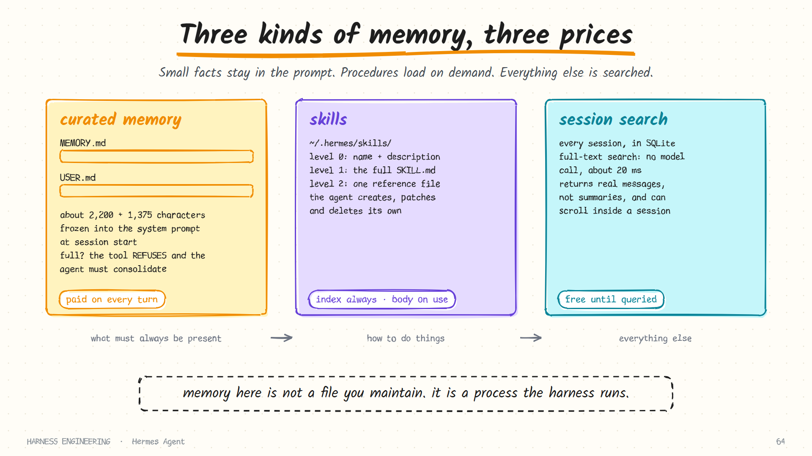

# Hermes Agent · Memory, skills and the learning loop

> **Part 3 of 5.** The part Hermes is known for: two small bounded memory files, skills the agent writes and repairs for itself, search over every past session, and a background curator that keeps it all from piling up.
>
> [Overview](../hermes.md) · [1. The loop](loop.md) · [2. Prompt, cache and compression](context.md) · **3. Memory and skills** · [4. Tools and security](tools-and-security.md) · [5. Gateway, cron and delegation](automation.md)

Sources: `memory.md`, `skills.md` and `curator.md` in the user guide under `website/docs/user-guide/features/`, as of October 2026.

## Three stores, three prices

Hermes does not have "a memory". It has three, and each is paid for differently.



| Store | Holds | Loaded | Cost |
|-------|-------|--------|------|
| **Curated memory** | Small facts that must always be present | Into the system prompt, at session start | A fixed number of tokens on every turn |
| **Skills** | Procedures: how to do a class of task | An index always; a body on demand | A line per skill, plus the body when used |
| **Session search** | Everything ever said | Only when queried | Nothing until used |

The whole design is an answer to one question from [chapter 5](../../guide/05-memory-and-skills.md): *where should this piece of knowledge live?* A preference goes in memory. A ten-step procedure goes in a skill. "What did we decide about the retry policy last month?" is a search.

## Curated memory

Two files, both deliberately tiny.

| File | Purpose | Limit |
|------|---------|-------|
| `MEMORY.md` | The agent's own notes: environment facts, conventions, lessons learned | About 2,200 characters |
| `USER.md` | A profile of you: preferences, communication style, expectations | About 1,375 characters |

Together that is on the order of 1,300 tokens. They are rendered into the system prompt as a **frozen snapshot** when a session starts, with a header showing how full each one is:

```text
MEMORY (your personal notes) [67% — 1,474/2,200 chars]
Orders service lives in ~/code/orders; tests run with uv run pytest
§
This laptop has Docker but no GPU; use the CPU test profile
§
Prefers short answers with the command first, explanation after
```

Showing the agent its own usage is a small touch with a large effect: it knows how much room is left before it tries to write.

### The memory tool

The agent manages memory itself, through one tool with three actions.

| Action | Does |
|--------|------|
| `add` | Appends an entry |
| `replace` | Swaps an existing entry, found by a substring match, for new text |
| `remove` | Deletes an entry, found the same way |

Two targets: the agent's notes, and the user profile.

### Four decisions worth copying

**1. A frozen snapshot.** Writes during a session do not change the system prompt. They land on disk and take effect next session. That protects the cache ([part 2](context.md)), and it is why the docs have a troubleshooting entry for "I told it to remember, and it did not seem to": the write succeeded, and the *prompt* will show it next time.

**2. Full means an error, not a silent drop.** When a write would exceed the limit, the tool refuses. The agent must consolidate or remove entries, in the same turn, and try again. `replace` is bound by the limit too. Nothing is ever truncated behind the agent's back.

**3. The cap is the feature.** A 2,200-character budget cannot hold a diary. It forces memory to remain a short list of things that matter, and it makes the agent the editor.

**4. One agent per memory.** The docs warn against pointing two agent processes at the same home directory: both write automatically and both reload at session start, so they would compound each other's entries into state that neither authored. Memory is scoped per *profile* by design.

### What it is told to save

| Save | Skip |
|------|------|
| User preferences | Trivial or obvious information |
| Environment facts | Facts that are easy to look up again |
| Corrections ("do not use sudo for Docker here") | Raw data: large code blocks, logs, tables |
| Project conventions | Session-specific ephemera, such as temporary paths |
| Completed work worth knowing about | Anything already in a context file |
| Explicit "remember that…" requests | |

The right-hand column is the hygiene rule from [chapter 5](../../guide/05-memory-and-skills.md): do not store what can be derived or re-discovered.

### Memory is an attack surface

Because memory entries are injected into the system prompt, they are scanned before being accepted. Content that matches prompt-injection or credential-exfiltration patterns, or that contains invisible Unicode characters, is blocked.

That closes the *memory poisoning* route: hostile text in a web page persuades the agent to "remember" an instruction, which then sits in the most trusted part of every future prompt. An optional write-approval setting goes further and requires a person to confirm memory writes. A background review of the session can also run on a cheaper auxiliary model, proposing what should be saved.

## Session search

Every CLI and messaging session is stored in a local database with full-text search. The agent has a tool to query it.

| | Curated memory | Session search |
|---|----------------|----------------|
| Capacity | About 1,300 tokens in total | Unlimited: every session |
| Speed | Instant: already in the prompt | Around 20 ms per query |
| Cost | Tokens on every turn | None; no model call |
| Returns | Curated facts | The **actual messages**, untruncated |
| Maintained by | The agent, deliberately | Nothing: it is automatic |

Two details matter. Search returns real messages, not model-written summaries, so it cannot hallucinate a past conversation. And the agent can scroll forward and backward inside any session it finds, so a hit becomes a doorway to the surrounding context.

This is the cheap, "pulled" kind of memory. It complements the small "pushed" files instead of replacing them.

## Skills: procedural memory

Skills live in one directory under the Hermes home. Bundled skills, skills installed from a hub, and skills the agent wrote for itself all end up there, and the agent can modify or delete any of them. They follow the open [Agent Skills](https://agentskills.io) format.

### Progressive disclosure, three levels

```text
Level 0   list the skills        → name, description, category for each
Level 1   view one skill         → the full content and metadata
Level 2   view one file in it    → a specific reference file
```

The model sees level 0 always, and descends only when a task calls for it.

### A skill file

```markdown
---
name: my-skill
version: 1.0.0
platforms: [macos, linux]          # optional: restrict by operating system
metadata:
  hermes:
    tags: [python, automation]
    category: devops
    requires_toolsets: [terminal]  # optional: only offer it when these tools exist
    fallback_for_toolsets: [web]   # optional: offer it when a toolset is MISSING
---
# Skill title

## When to Use
## Procedure
## Pitfalls
## Verification
```

Two pieces of this are unusual and useful.

**Conditional activation.** A skill can declare that it needs certain toolsets, or that it is a *fallback* for when a toolset is unavailable. A "search the web by hand" skill appears only when the web toolset is missing. The catalogue adapts to what the agent can actually do.

**A fixed body shape.** *When to use*, *procedure*, *pitfalls*, *verification*. The last section is the one most skills lack: it tells the agent how to know the procedure worked.

### Skills added mid-conversation

The skills index is part of the system prompt, which must stay fixed for the cache. So what happens when a skill is installed, created or removed while a conversation is open?

Your next message carries a short note naming the new skills with their descriptions, and the removed ones. The note is sent once per change. The system prompt itself picks up the change at the next compaction, when the prefix is being rebuilt anyway.

That is the same trick as putting per-call context on the user message. Something new needs to reach the model; the cached prefix must not move; so it rides on the newest message.

## The learning loop


The agent has a tool to create, update and delete its own skills. The docs call skills its **procedural memory**.

It is prompted to record a non-trivial workflow when:

- it worked out a multi-step procedure worth repeating;
- it hit errors or dead ends and found the path that works;
- the user corrected its approach.

### "Lessons, not logs"

The guidance on what a skill should contain is one of the clearest short statements of the idea in any project. Paraphrased:

- A skill is the instructions for doing a class of task the most efficient and correct way: the procedure in order, the commands that work, what the result should look like, and the pitfalls that cost time.
- A pitfall is a **general rule plus one clause of why**, attached to the step it affects, stated once.
- Incident narration, issue numbers, dates and quoted chat are **not** skill content. The rule has to stand without the story behind it.

Compare a log entry with a lesson:

| A log | A lesson |
|-------|----------|
| "On Tuesday the deploy failed because the migration ran before the build finished; we fixed it in PR 4412." | "Run the build to completion *before* migrating: the migration imports generated code that does not exist until the build has finished." |

The first is true and useless next time. The second changes behaviour.

### Keeping people in the loop

A write-approval gate can require human review before an agent-proposed skill change lands. A background review after a session can suggest or stage changes without applying them. Project-local skills must be trusted before they load, and a scan can quarantine a suspicious skill at load time.

## The curator

An agent that writes a skill every time it solves something new will, after a few months, own dozens of narrow near-duplicates. They crowd the catalogue and cost tokens on every turn. The **curator** is the maintenance pass that prevents that.

| What it does | Detail |
|--------------|--------|
| Tracks usage | How often each skill is viewed, used and patched |
| Ages skills | `active → stale → archived`, based on non-use |
| Reviews | Periodically runs a short auxiliary-model review that proposes consolidations and patches drift |
| **Never auto-deletes** | The worst outcome is an archive, which can be undone |

Its scope is conservative: agent-created skills only by default; hub-installed skills are always off-limits; archiving unused built-in skills is opt-in, because a shipped skill quietly vanishing is easy to mistake for a broken install.

Its trigger is also thoughtful. It is not a cron job. It runs on an **inactivity check**: enough time since the last run (a week by default) *and* the agent idle for long enough (a couple of hours). Maintenance happens when nobody is waiting.

A learning loop without a curator is a hoarding loop. Any system that lets an agent write its own procedures needs the second half: usage tracking, ageing, consolidation, and no irreversible deletion.

## What to take from this page

- **Three stores, chosen by price.** Always-present facts, on-demand procedures, searchable history.
- **Cap agent-written memory hard**, and make overflow an error the agent must resolve.
- **Show the agent how full its memory is.**
- **Freeze memory into the prompt at session start.**
- **Scan what goes into the prompt**, including memory the agent wrote itself.
- **Search returns real messages.**
- **Give skills a verification section** and conditional activation.
- **Announce catalogue changes on the next message**, not by rebuilding the prompt.
- **Lessons, not logs.**
- **Pair every "write" capability with a curator.**

## Sources

- `website/docs/user-guide/features/memory.md`, `skills.md`, `curator.md` in [NousResearch/hermes-agent](https://github.com/NousResearch/hermes-agent)
- `website/docs/developer-guide/prompt-assembly.md`, `session-storage.md`

**Next:** [4. Tools, backends and security →](tools-and-security.md)
