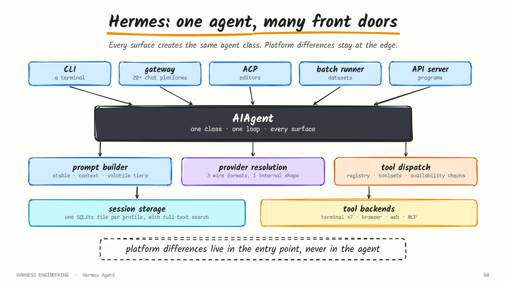
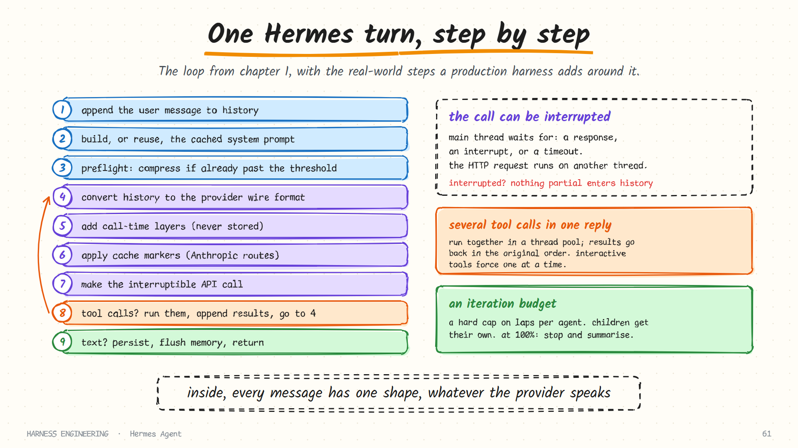

# Hermes Agent · Inside the agent loop

> **Part 1 of 5.** The architecture in one picture, what happens on every turn, how one internal message format serves three provider APIs, and how the loop is interrupted, budgeted and failed over.
>
> [Overview](../hermes.md) · **1. The loop** · [2. Prompt, cache and compression](context.md) · [3. Memory and skills](learning.md) · [4. Tools and security](tools-and-security.md) · [5. Gateway, cron and delegation](automation.md)

Sources: the developer guide in the repository under `website/docs/developer-guide/` (`architecture.md`, `agent-loop.md`), as of October 2026.

## The architecture in one picture



Every way of reaching Hermes creates the same agent class.

| Entry point | Who is on the other end |
|-------------|-------------------------|
| CLI | A person at a terminal |
| Gateway | A person in Telegram, Discord, Slack, or one of twenty-odd other platforms |
| ACP adapter | An editor |
| Batch runner | A dataset of prompts |
| API server, Python library | Another program |

The project lists its design principles in a short table. They read like a summary of this guide:

| Principle | In practice |
|-----------|-------------|
| **Prompt stability** | The system prompt does not change mid-conversation. No cache-breaking mutations except explicit user actions |
| **Observable execution** | Every tool call is visible to the user through callbacks |
| **Interruptible** | API calls and tool execution can be cancelled mid-flight |
| **Platform-agnostic core** | One agent class serves every surface; platform differences live in the entry point |
| **Loose coupling** | Optional subsystems use registries and availability checks, not hard dependencies |
| **Profile isolation** | Each profile has its own home directory, config, memory, sessions and gateway process |

The fourth principle is the one that makes Hermes possible at all. A harness that mixes "how Telegram formats a message" into the loop cannot also run in a terminal. Keeping the loop ignorant of its surface is what lets one core serve all of them.

## What the agent class is responsible for

The developer guide lists the responsibilities of the central class. Each line is a chapter of this guide:

- Assemble the effective system prompt and tool schemas
- Select the right provider and API mode
- Make interruptible model calls
- Execute tool calls, sequentially or concurrently
- Maintain conversation history in one message format
- Handle compression, retries and fallback model switching
- Track iteration budgets across parent and child agents
- Flush persistent memory before context is lost

The code is organised to match. The public class is a thin facade; the loop lives in its own module; and each phase of a turn (iteration preparation, the API call, API errors, overflow, truncation, recovery) has its own file. If you ever build a loop that has grown past a few hundred lines, that is the split to copy.

## One turn



```text
1. Generate a task id if none was given
2. Append the user message to conversation history
3. Build, or reuse, the cached system prompt
4. Preflight: compress if the conversation is already past the threshold
5. Build API messages from history, in the provider's wire format
6. Inject ephemeral prompt layers (budget warnings, context pressure)
7. Apply prompt-caching markers, on Anthropic routes
8. Make the interruptible API call
9. Parse the response:
     tool calls → execute them, append the results, go back to step 5
     text       → persist the session, flush memory if needed, return
```

Steps 3, 6 and 7 are where this differs from the ten-line loop in [chapter 1](../../guide/01-the-loop.md), and all three exist for one reason: keeping the prompt prefix stable so the provider's cache keeps working. [Part 2](context.md) covers that in detail.

### The message rules it enforces

History is kept in the OpenAI-compatible shape (`system`, `user`, `assistant` with optional `tool_calls`, and `tool` with a `tool_call_id`). The loop enforces strict alternation, because providers reject histories that break it:

| Rule | |
|------|---|
| After the system message | user → assistant → user → assistant … |
| During tool calling | assistant (with tool calls) → tool → tool → … → assistant |
| Never | two assistant messages in a row |
| Never | two user messages in a row |
| Only the `tool` role | may repeat consecutively, for parallel results |

Any harness that edits history (compaction, injection, repair) has to keep satisfying these. It is why Hermes's compressor picks the *role* of its summary message to avoid creating two same-role messages back to back.

## One internal shape, three wire formats

| API mode | Used for |
|----------|----------|
| Chat completions | OpenAI-compatible endpoints: OpenRouter, custom servers, most providers |
| Responses | OpenAI's Responses API |
| Anthropic messages | The native Anthropic API, through an adapter |

The mode is resolved in a fixed order: an explicit argument wins, then provider-specific detection, then heuristics on the base URL, then the default of chat completions.

Whatever the mode, messages are converted at the edge and the loop only ever sees the one internal shape. That is the provider layer from the [OpenRouter page](../openrouter.md) as a real component: translate at one door, normalise the reply, and nothing inside needs to know which vendor answered.

## Interruptible calls

A model call can take a minute. A user who has changed their mind should not have to wait.

The request runs on a background thread while the main thread waits on three things: the response arriving, an interrupt event, or a timeout. On an interrupt (a new message, a stop command, a signal):

- the API thread is abandoned and its response discarded;
- the agent can process the new input or shut down cleanly;
- **no partial response is injected into history.**

That last guarantee matters more than it looks. A half-finished assistant message, especially one with half a tool call, is exactly the malformed transcript [chapter 6](../../guide/06-durability.md) warns about. Discarding it whole keeps the history legal.

## Running the tools

| The reply contains | Execution |
|--------------------|-----------|
| One tool call | Directly, on the main thread |
| Several | Concurrently, through a thread pool |
| An interactive tool (asking the user to clarify) | Forces sequential execution |

Results are re-inserted in the **original call order**, whatever order they finished in. For each call:

```text
1. Resolve the handler from the registry
2. Fire the pre-tool-call plugin hook
3. Check for a dangerous command; if so, wait for approval
4. Execute the handler
5. Fire the post-tool-call plugin hook
6. Append the tool result to history
```

### Four tools the loop handles itself

Most tools go through the registry. Four are intercepted first, because they change the agent's own state:

| Tool | Why the loop handles it |
|------|-------------------------|
| `todo` | Reads and writes the agent's task list |
| `memory` | Writes the bounded memory files, enforcing their limits |
| `session_search` | Queries the agent's own session database |
| `delegate_task` | Spawns child agents |

That is a useful classification for any harness: *world* tools, which act on files and services, versus *agent* tools, which act on the harness itself. The second kind needs access to internals the first should never have.

### Callbacks make the work visible

The loop exposes callbacks for tool progress, thinking, reasoning content, clarification requests, each completed step, streaming tokens and status changes. The CLI turns them into a spinner; the gateway turns them into progress messages in a chat. The loop emits events; the surface decides how to draw them. That is the "observable execution" principle, and it is also what keeps platform code out of the core.

## Budgets and fallback

### The iteration budget

Each agent has a hard cap on loop iterations, configurable, with a generous default in the hundreds. Sub-agents get their own, lower cap. At 100% the agent stops and returns a summary of the work done, which is the "never end without a report" rule from [chapter 1](../../guide/01-the-loop.md).

One consequence to be aware of: because children have independent budgets, the total across a parent and its children can exceed the parent's own cap. If you need a global ceiling, enforce it at a higher level.

### Fallback models

When the primary model fails with a rate limit, a server error or an auth error:

1. Check the configured list of fallback providers.
2. Try each in order.
3. On success, continue the conversation with the new provider.
4. On an auth error, try refreshing credentials before failing over.

Auxiliary tasks (vision, compression, web extraction) each have their own fallback chain, so a summarisation outage does not take down the main conversation.

Fallback has a cost that [part 2](context.md) explains: a provider-side cache is tied to the model and account, so the first request after a failover re-reads the entire conversation at full price. It is the right trade for an unattended run, and worth knowing about.

## After the turn

- Messages are saved to the session store.
- Memory changes are flushed to disk.
- The session can be resumed later.

## What to take from this page

- **Keep the loop ignorant of its surface.** Platform code belongs at the entry point.
- **Split a large loop by turn phase**, one module each.
- **Convert at the edge**, and keep one message shape inside.
- **On interrupt, discard the partial reply whole.**
- **Separate world tools from agent tools.**
- **Emit events; let the surface draw them.**
- **Give auxiliary model calls their own fallback chain.**

## Sources

- `website/docs/developer-guide/architecture.md` and `agent-loop.md` in [NousResearch/hermes-agent](https://github.com/NousResearch/hermes-agent)
- The project's `AGENTS.md`

**Next:** [2. Prompt, cache and compression →](context.md)
