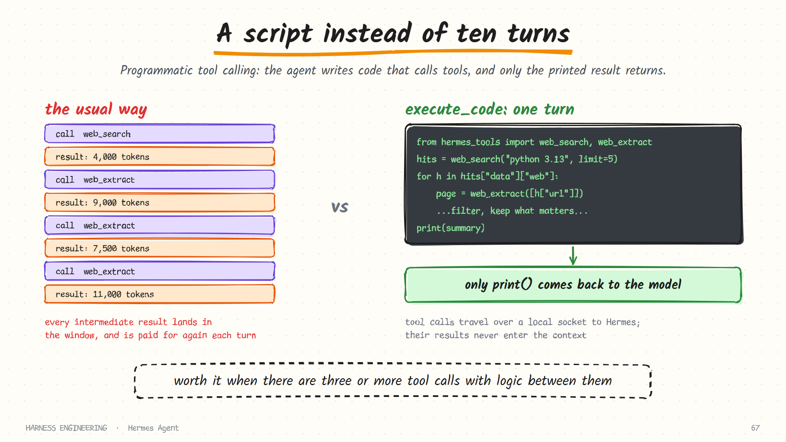
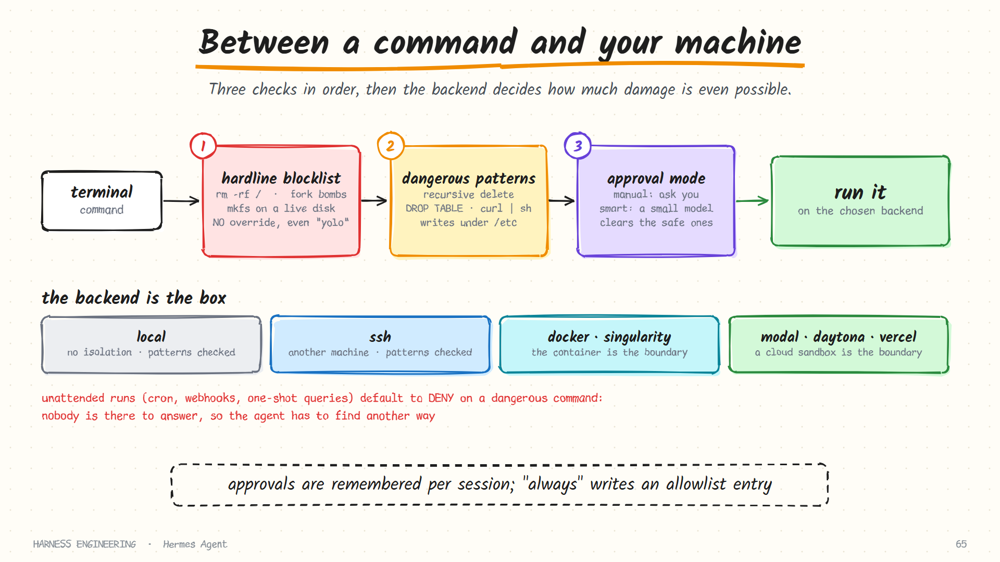

# Hermes Agent · Tools, backends and security

> **Part 4 of 5.** How tools register themselves and are gated by availability, two ways of keeping tool schemas out of the context, programmatic tool calling, and the layered security model.
>
> [Overview](../hermes.md) · [1. The loop](loop.md) · [2. Prompt, cache and compression](context.md) · [3. Memory and skills](learning.md) · **4. Tools and security** · [5. Gateway, cron and delegation](automation.md)

Sources: `tools-runtime.md` in the developer guide; `security.md`, `tool-search.md`, `code-execution.md` and `hooks.md` in the user guide, as of October 2026.

## Tools register themselves

Each tool is a module that registers itself when imported.

```python
registry.register(
    name="terminal",              # unique name, used in the model-facing schema
    toolset="terminal",           # the bundle it belongs to
    schema={...},                 # what the model sees
    handler=handle_terminal,      # what runs
    check_fn=check_terminal,      # optional: is this tool available right now?
    requires_env=["SOME_VAR"],    # optional: shown in the setup UI
    is_async=False,
)
```

Discovery is automatic. At startup the tools directory is scanned, and any module with a top-level registration call is imported. There is no hand-maintained list. The scan parses each file's syntax tree and only matches *top-level* calls, so helper modules are not imported by accident. An optional tool whose dependency is missing logs an error and is skipped, without stopping the others from loading.

Two safeguards are built into registration:

- A tool that would shadow an existing one from a **different** toolset is rejected, unless explicitly overridden.
- A *plugin* overriding a built-in tool additionally needs an operator opt-in in configuration.

That second rule matters for security: a third-party plugin cannot quietly replace the file-writing tool with its own.

## Availability checks

The `check_fn` is the idea to remember. It answers one question: *can this tool work right now?* Is the API key present, is the service reachable, is the binary installed?

A tool whose check fails is simply not offered to the model. The agent never sees a web-search tool it cannot use, so it never wastes a turn calling one. The contributor guide draws a line here: a check should answer reachability or opt-in, never be used to vary the tool surface from one session to the next, because that would change the cached prompt.

## Toolsets

Tools are grouped into named **toolsets**, resolved from:

- explicit enabled and disabled lists;
- platform presets, since a Telegram session and a terminal session want different tools;
- dynamically created sets for MCP servers.

After filtering, one more pass runs: schemas that *mention other tools* are patched so they only name tools that survived. The code-execution tool's description, for instance, lists the tools a script may call. If web search was filtered out, it is removed from that list too, so the model is never told about a tool that does not exist. Small, and it prevents a specific kind of hallucinated call.

## Two ways to keep schemas out of the context

Recall the cost from [chapter 2](../../guide/02-tools.md): every tool schema is sent on every request. Hermes attacks that from two directions.

### Tool search

With many MCP servers attached, schemas can eat a large share of the window. An opt-in layer replaces the deferred tools with three bridge tools:

| Bridge tool | Does |
|-------------|------|
| `tool_search` | Searches the catalogue of deferred tools |
| `tool_describe` | Loads the full schema for named tools |
| `tool_call` | Calls a deferred tool |

The working-set core tools (terminal, file operations, memory, delegation and so on) stay loaded directly. MCP and non-core plugin tools are deferred. It is progressive disclosure applied to tools instead of skills.

### Programmatic tool calling



The second approach removes the *results* instead of the schemas. A code-execution tool lets the agent write a Python script that calls tools as functions.

1. The agent writes a script that imports tool functions from a generated module.
2. Hermes generates that stub module, opens a local socket, and starts a listener.
3. The script runs in a child process. Each tool call travels over the socket back to Hermes.
4. **Only what the script prints is returned to the model.**

Intermediate results, such as five search results and five fetched pages, never enter the context window. The agent is guided to use this when there are three or more tool calls with processing logic between them: bulk filtering, conditional branching, loops over results.

A defined subset of tools is available inside scripts: web search and extraction, file read, write, search and patch, and foreground terminal commands.

This is the same idea DeepSeek Harness calls [code mode](../deepseek-harness/tools-and-safety.md), arrived at independently. When two unrelated projects converge on a design, pay attention to it.

## Security: eight layers

The documentation describes the model as defence in depth, with eight layers.

| # | Layer | Protects against |
|---|-------|------------------|
| 1 | User authorisation | Strangers talking to your agent |
| 2 | Dangerous-command approval | Destructive shell commands |
| 3 | File-write safety | Writes to credential stores and other protected paths |
| 4 | Container isolation | A bad command reaching the host |
| 5 | MCP credential filtering | Tool servers inheriting your environment variables |
| 6 | Context-file scanning | Prompt injection in project files |
| 7 | Cross-session isolation | One session reading another's data |
| 8 | Input sanitisation | Shell injection through working-directory parameters |

Layers 1 and 4 to 8 are covered where they arise. Layers 2 and 3 deserve a closer look.

### Three checks on every command



**Check 1: the hardline blocklist.** A short list of commands so catastrophic that Hermes refuses to run them *regardless* of any setting: wiping the filesystem root, a fork bomb, formatting a mounted root device, zeroing a disk. It is described as the floor below "yolo" mode. It trips before the approval layer even sees the command, and there is no override flag.

This is a deny rule in the sense of [chapter 3](../../guide/03-guardrails.md): checked first, and unreachable by any mode.

**Check 2: dangerous patterns.** A curated list of patterns for destructive operations: recursive deletes, filesystem formatting, destructive SQL, overwriting system configuration, stopping services, piping a download into a shell.

**Check 3: the approval mode.**

| Mode | Behaviour |
|------|-----------|
| `manual` | Ask the user for every match |
| `smart` | An auxiliary model reviews the match and auto-approves the low-risk ones. The shipped default |
| `off` | Never ask (the hardline blocklist still applies) |

*Smart* mode addresses a real weakness of pattern matching: `rm -rf node_modules/` matches "recursive delete" and is harmless. A small model clears the obvious false positives, so a prompt means something when it appears. That is a direct attack on approval fatigue.

Approvals are tracked per session: approve "recursive delete" once and later matches in that session do not re-prompt. An "allow permanently" choice writes the pattern to an allowlist in configuration. You can also define your own deny rules.

### Unattended runs default to deny

What should happen when a dangerous command comes up and **nobody is there**?

| Context | Default |
|---------|---------|
| Cron jobs | Deny |
| One-shot query sessions | Deny |
| Webhook and API sessions | Deny |

The alternative would be to block for the full approval timeout waiting for a person who is not coming. Instead the command is blocked instantly and the agent must find another path. Each setting can be flipped to auto-approve, deliberately. *Fail closed when nobody can answer* is the right default, and it matches the approval design in [DeepSeek Harness](../deepseek-harness/tools-and-safety.md).

### Protected paths

Some locations are always denied to the file-writing tools: operating-system credential stores (SSH keys, cloud credentials, the sudoers file) and Hermes's own secret stores (its environment file, OAuth tokens, vault and pairing data). An optional setting confines writes to one root directory.

## The backend is the box

The terminal tool runs on a selectable backend, and the choice determines how much damage is possible at all.

| Backend | Isolation | Dangerous-command check | Good for |
|---------|-----------|-------------------------|----------|
| `local` | None; runs on the host | Yes | Development, trusted users |
| `ssh` | A separate machine | Yes | Keeping work off your laptop |
| `docker` | A container | Skipped: the container is the boundary | A production gateway |
| `singularity` | A container | Skipped | HPC environments |
| `modal`, `daytona` | A cloud sandbox | Skipped | Scalable or persistent cloud isolation |
| `vercel_sandbox` | A cloud micro-VM | Skipped | Cloud execution with snapshots |

The "skipped" column encodes a principle. Inside a real boundary, pattern-matching commands adds friction without adding safety, so it is turned off. Pattern checks are a seatbelt for when there is no box; the box is the actual protection. That is the gate-versus-sandbox distinction from [chapter 3](../../guide/03-guardrails.md), expressed as a configuration table.

Container backends are run with hardened flags and resource limits. Environment variables and credential files are passed through only explicitly, which is how layer 5 keeps a tool server from inheriting your secrets.

## Four hook systems

| System | Registered through | Runs in | Typical use |
|--------|--------------------|---------|-------------|
| Gateway hooks | A hook file and handler in the Hermes home | The gateway only | Logging, alerts |
| Plugin hooks | A registration call in a plugin | CLI and gateway | Tool interception, metrics, guardrails |
| Shell hooks | A block in the profile configuration, pointing at scripts | CLI, gateway and desktop | Blocking, auto-formatting, context injection |
| Outbound webhooks | A list in configuration | CLI and gateway | Pushing signed lifecycle events to other systems |

Hook errors are isolated and logged instead of crashing the agent. Hooks are not all passive: some can change control flow or replace content, and a shell hook that runs before a tool call can block it, and fails closed. Context a hook returns before a model call is appended to the current user message, in keeping with the cache rule from [part 2](context.md).

The contributor guide adds a discipline worth borrowing: a hook with no concrete consumer is rejected. Extension points are added when something needs them, not in anticipation.

## What to take from this page

- **Self-registering tools with an availability check**, so the model only sees what works.
- **Patch cross-references** when a tool is filtered out.
- **Defer schemas** behind a search tool when there are many.
- **Offer a code path** so intermediate results stay out of the context.
- **A hardline floor no setting can lower.**
- **Use a small model to clear false positives**, so prompts stay meaningful.
- **Unattended means deny by default.**
- **Skip pattern checks inside a real boundary.** Know which layer is doing the protecting.
- **No hook without a consumer.**

## Sources

- `website/docs/developer-guide/tools-runtime.md` in [NousResearch/hermes-agent](https://github.com/NousResearch/hermes-agent)
- `website/docs/user-guide/security.md`, and under `features/`: `tool-search.md`, `code-execution.md`, `hooks.md`
- The project's `AGENTS.md`

**Next:** [5. Gateway, cron and delegation →](automation.md)
