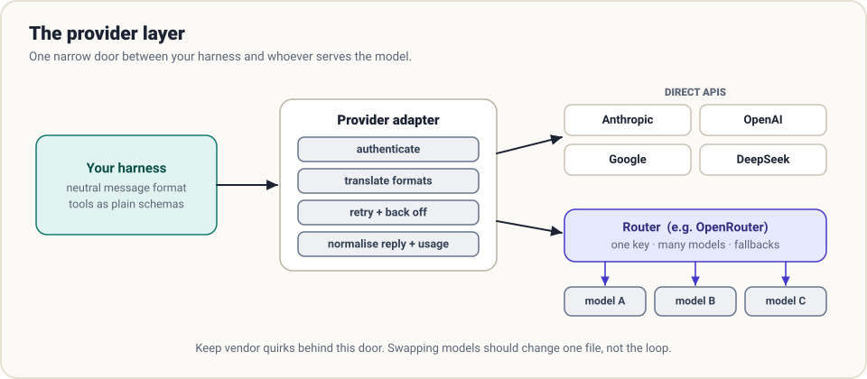

# OpenRouter

> **Not a harness.** OpenRouter is a model-access layer: one API and one key in front of hundreds of models from many providers. It belongs in this guide because every harness has to talk to *some* provider, and how you do that is a harness design decision.

**Site:** [openrouter.ai](https://openrouter.ai) · **Docs:** [openrouter.ai/docs](https://openrouter.ai/docs)

> Snapshot: October 2026. Routing features and model lists change often; the docs are the authority.

## Where it sits

Recall the definition from [chapter 0](../guide/00-what-is-a-harness.md): the harness decides what the model sees and acts on what it says. Between the harness and the model there is one more component, the **provider layer**.



The provider layer has four jobs:

| Job | What it means |
|-----|---------------|
| **Authenticate** | Hold the key; nothing else in the harness should |
| **Translate** | Convert your internal message format to the vendor's wire format and back |
| **Retry** | Back off on rate limits and transient errors |
| **Normalise** | Return one shape every time: text, tool calls, token usage |

A router such as OpenRouter takes over part of that work for many models at once.

## What a router gives a harness

**One wire format.** OpenRouter exposes an OpenAI-compatible chat completions endpoint. A harness that speaks that format can reach models from Anthropic, OpenAI, Google, DeepSeek, Meta, Mistral and others by changing a string.

```python
import json, os, urllib.request

def call_model(messages, tools=None, model="deepseek/deepseek-chat"):
    body = {"model": model, "messages": messages}
    if tools:
        body["tools"] = tools
    req = urllib.request.Request(
        "https://openrouter.ai/api/v1/chat/completions",
        data=json.dumps(body).encode(),
        headers={"Authorization": f"Bearer {os.environ['OPENROUTER_API_KEY']}",
                 "Content-Type": "application/json"})
    with urllib.request.urlopen(req, timeout=600) as r:
        data = json.load(r)
    return data["choices"][0]["message"], data.get("usage", {})
```

That is the entire provider module for the [mini harness](../examples/README.md).

**Model choice as configuration.** Models are addressed by slugs such as `vendor/model-name`. Switching models for an experiment, or using a cheap model for sub-agents and a strong one for the parent, becomes a one-line change.

**Fallbacks.** You can name a list of models to try in order, so a provider outage or rate limit does not kill a long unattended run. This is the retry job from [chapter 6](../guide/06-durability.md), handled one level down.

**Provider routing.** Many open-weight models are served by several hosts at different prices, speeds and quantisation levels. Routing preferences let you sort by price or throughput, pin or exclude specific hosts, and require that the chosen host supports every parameter you sent.

**One bill, one usage report.** Token counts and cost come back with each response, which makes per-task cost accounting ([chapter 9](../guide/09-evaluation.md)) straightforward.

## What a harness still has to handle

A router makes the wire format uniform. It does not make models uniform.

**Tool calling varies.** Not every model supports tools, and those that do differ in reliability: some emit malformed JSON arguments, some never call tools in parallel, some need firmer instructions. Your loop needs to validate arguments and treat a malformed call as an error message for the model to correct ([chapter 1](../guide/01-the-loop.md)). Restrict routing to hosts that support the features you rely on.

**Context windows and limits vary.** A compaction budget tuned for a 200k-token model will overflow a 32k one. Keep window size and output limits as per-model configuration, not constants.

**Prompt caching varies.** Some providers cache automatically, some need explicit markers, some do not cache at all. The advice about a stable prefix in [chapter 4](../guide/04-context.md) is always worth following, but the savings depend on the route.

**Reasoning fields vary.** Some models return reasoning content or opaque signatures that must be passed back on the next turn. Store assistant messages exactly as received.

**The same open model can behave differently on different hosts.** Quantisation and serving configuration change quality. For anything you are measuring, pin the host.

## Design advice

1. **Keep your own neutral message format** and convert at one door. Whether that door leads to a router or a vendor should be invisible to the loop.
2. **Describe models with capability flags.** For example: supports tools, supports parallel tool calls, context size, supports caching. Let the harness adapt instead of assuming.
3. **Pin for evaluation, float for resilience.** When you measure, fix the model and the host so results are comparable. In production, allow fallbacks so runs survive outages.
4. **Mix models on purpose.** A strong model for planning and judgment; a fast, cheap one for sub-agents that read and summarise; perhaps a third for compaction. A router makes this trivial to try, and [evaluation](../guide/09-evaluation.md) tells you whether it helped.
5. **Budget at the harness, not only at the account.** A spending limit on the key is a backstop. A per-run cost cap in your loop is the control.
6. **Know your data path.** A router adds a party that sees your prompts. Check the data-retention and training policies of both the router and the hosts it may select, and restrict routing if your code is sensitive.

## Direct API or router?

| | Direct to a vendor | Through a router |
|---|--------------------|------------------|
| Models available | That vendor's | Many vendors' |
| Newest vendor-specific features | Immediately | Sometimes later, or not exposed |
| Latency | One hop | One extra hop |
| Resilience | You build fallbacks | Fallbacks built in |
| Billing | Per vendor | Consolidated |
| Reproducibility | High | High only if you pin model and host |

A common arrangement: develop and experiment through a router, where trying a new model costs nothing; run production either way, behind the same adapter.

## How this connects to the harnesses

- **Hermes** lists OpenRouter among its supported providers and lets you switch models with a command.
- **Pi**'s `pi-ai` package is a unified multi-provider client, the same idea implemented as a library inside the harness.
- **DeepSeek Harness** makes the model adapter a plugin: a new provider is a registration, not a fork.
- The **mini harness** in this repository targets any OpenAI-compatible endpoint, so it runs against OpenRouter, DeepSeek's API, OpenAI, or a local server by changing two environment variables.

The pattern is universal: *one narrow door between the harness and the model.* A router is one thing you can put behind it.

## Sources

- [OpenRouter documentation](https://openrouter.ai/docs): quickstart, model routing, provider routing, tool calling, usage accounting
- [OpenRouter model list](https://openrouter.ai/models)
- [DeepSeek API documentation](https://api-docs.deepseek.com), for the direct OpenAI-compatible route
