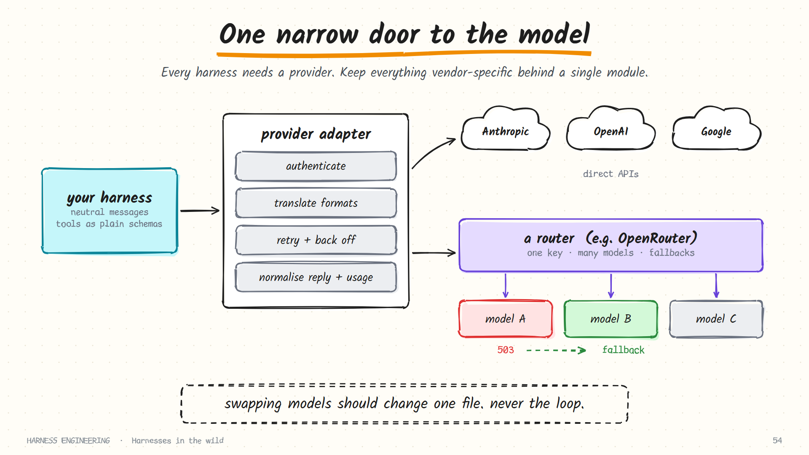

# OpenRouter

> **Not a harness.** OpenRouter is a model-access layer: one API and one key in front of hundreds of models from many providers. It belongs in this guide because every harness has to talk to *some* provider, and how you do that is a harness design decision.

**Site:** [openrouter.ai](https://openrouter.ai) · **Docs:** [openrouter.ai/docs](https://openrouter.ai/docs)

> Snapshot: October 2026. Routing features, parameter names and model lists change often; the docs are the authority. Request fields shown below are the ones documented at the time of writing: check before relying on them.

## Where it sits

Recall the definition from [chapter 0](../guide/00-what-is-a-harness.md): the harness decides what the model sees and acts on what it says. Between the harness and the model there is one more component, the **provider layer**.



The provider layer has four jobs:

| Job | What it means | What goes wrong if it leaks |
|-----|---------------|------------------------------|
| **Authenticate** | Hold the key; nothing else in the harness should | Keys end up in logs and tool environments |
| **Translate** | Convert your internal message format to the vendor's wire format and back | Vendor shapes spread through the codebase; switching becomes a rewrite |
| **Retry** | Back off on rate limits and transient errors | The loop fills with error handling |
| **Normalise** | Return one shape every time: text, tool calls, token usage | Every caller handles every vendor's quirks |

A router such as OpenRouter takes over part of that work for many models at once.

## What a router gives a harness

### One wire format

OpenRouter exposes an OpenAI-compatible chat completions endpoint. A harness that speaks that format can reach models from Anthropic, OpenAI, Google, DeepSeek, Meta, Mistral and others by changing a string.

```python
import json, os, urllib.request

def call_model(messages, tools=None, model="deepseek/deepseek-chat"):
    body = {"model": model, "messages": messages}
    if tools:
        body["tools"] = tools
    req = urllib.request.Request(
        "https://openrouter.ai/api/v1/chat/completions",
        data=json.dumps(body).encode(),
        headers={"Authorization": f"Bearer {os.environ['OPENROUTER_API_KEY']}",
                 "Content-Type": "application/json"})
    with urllib.request.urlopen(req, timeout=600) as r:
        data = json.load(r)
    return data["choices"][0]["message"], data.get("usage", {})
```

That is the entire provider module for the [mini harness](../examples/README.md), minus retries.

### Model choice as configuration

Models are addressed by slugs of the form `vendor/model-name`. Switching models for an experiment, or using a cheap model for sub-agents and a strong one for the parent, becomes a one-line change.

### Fallbacks

You can name a list of models to try in order, so a provider outage or a rate limit does not kill a long unattended run:

```json
{
  "models": ["vendor-a/primary-model", "vendor-b/backup-model", "vendor-c/last-resort"],
  "messages": [ ... ]
}
```

The slugs above are placeholders; use real ones from the model list. This is the retry job from [chapter 6](../guide/06-durability.md), handled one level down. Your own retry loop is still needed for the case where every option fails.

### Provider routing

Many open-weight models are served by several hosts at different prices, speeds and quantisation levels. Routing preferences let you steer between them:

```json
{
  "model": "vendor/open-weights-model",
  "provider": {
    "order": ["host-a", "host-b"],
    "allow_fallbacks": false,
    "require_parameters": true,
    "data_collection": "deny"
  },
  "messages": [ ... ]
}
```

| Preference | What it does | When a harness wants it |
|------------|--------------|-------------------------|
| Order / pin specific hosts | Try these hosts, in this order | Evaluation runs that must be comparable |
| Disallow fallbacks | Fail instead of silently switching host | Reproducibility |
| Require parameter support | Only use hosts that support everything you sent, such as tools | Agents: a host that ignores `tools` breaks the loop |
| Data-collection policy | Exclude hosts that retain or train on prompts | Proprietary code |
| Sort by price or throughput | Prefer the cheapest or the fastest host | Batch jobs; latency-sensitive use |

### One bill, one usage report

Token counts and cost come back with each response, which makes per-task cost accounting ([chapter 9](../guide/09-evaluation.md)) straightforward.

## What a harness still has to handle

A router makes the wire format uniform. It does not make models uniform.

| Difference | What you see | What the harness should do |
|------------|--------------|----------------------------|
| **Tool calling** | Some models do not support tools; some emit malformed JSON arguments; some never call tools in parallel | Validate arguments; return malformed calls as error results; restrict routing to hosts that support tools |
| **Context window** | 32k on one model, 1M on another | Keep window size and output limit as per-model configuration; compute the compaction budget from them |
| **Prompt caching** | Automatic on some providers, explicit markers on others, absent on some | Keep a stable prefix regardless; read cached-token counts from usage to see whether it is working |
| **Reasoning fields** | Some models return reasoning content or opaque signatures that must be passed back | Store assistant messages exactly as received |
| **Stop behaviour** | Some models narrate instead of calling a tool | The stop-rule guards from [chapter 1](../guide/01-the-loop.md) |
| **Host variance** | The same open model behaves differently on different hosts (quantisation, serving settings) | Pin the host for anything you measure |

A practical way to hold all this is a small capability table in your own code:

```python
MODELS = {
    "vendor-a/large-model":        {"window": 200_000, "max_out": 16_000, "tools": True,  "parallel_tools": True,  "cache": "explicit"},
    "vendor-b/mid-model":          {"window": 128_000, "max_out": 8_000,  "tools": True,  "parallel_tools": False, "cache": "auto"},
    "local/small-model":           {"window": 32_000,  "max_out": 4_000,  "tools": False, "parallel_tools": False, "cache": None},
}
```

The names and numbers above are placeholders to show the shape; fill them from the provider's model list. The harness reads the table and adapts: no tools means a different agent design altogether; a small window means an earlier compaction trigger.

## Design advice

1. **Keep your own neutral message format** and convert at one door. Whether that door leads to a router or a vendor should be invisible to the loop.
2. **Describe models with capability flags**, as above. Let the harness adapt instead of assuming.
3. **Pin for evaluation, float for resilience.** When you measure, fix the model and the host so results are comparable. In production, allow fallbacks so runs survive outages.
4. **Mix models on purpose.** A strong model for planning and judgment; a fast, cheap one for sub-agents that read and summarise; perhaps a third for compaction. A router makes this trivial to try, and [evaluation](../guide/09-evaluation.md) tells you whether it helped.
5. **Budget at the harness, not only at the account.** A spending limit on the key is a backstop. A per-run cost cap in your loop is the control.
6. **Know your data path.** A router adds a party that sees your prompts. Check the data-retention and training policies of both the router and the hosts it may select, and restrict routing if your code is sensitive.
7. **Test tool calling on every model you plan to use.** Run your smallest evaluation suite against each. "Supports tools" on a model card does not tell you how reliably it produces valid arguments on turn 40.

## Direct API or router?

| | Direct to a vendor | Through a router |
|---|--------------------|------------------|
| Models available | That vendor's | Many vendors' |
| Newest vendor-specific features | Immediately | Sometimes later, or not exposed |
| Latency | One hop | One extra hop |
| Resilience | You build fallbacks | Fallbacks built in |
| Billing | Per vendor | Consolidated |
| Reproducibility | High | High only if you pin model and host |
| Parties that see your prompts | One | Two or more |

A common arrangement: develop and experiment through a router, where trying a new model costs nothing; run production either way, behind the same adapter.

## A note on DeepSeek's own API

You do not need a router to use DeepSeek models. DeepSeek's API is itself OpenAI-compatible: point the same client at its base URL with a DeepSeek key. The [mini harness](../examples/README.md) does exactly this by changing two environment variables. The lesson generalises: because so many providers accept the same chat format, an adapter written for that format reaches most of the ecosystem, and a router is a convenience on top, not a requirement.

## How this connects to the harnesses

- **Hermes** lists OpenRouter among its supported providers, lets you switch models with a command, and converts between three wire formats at the edge.
- **Pi**'s `pi-ai` package is a unified multi-provider client, the same idea implemented as a library inside the harness.
- **DeepSeek Harness** makes the model adapter a plugin: a new provider is a registration, not a fork.
- The **mini harness** in this repository targets any OpenAI-compatible endpoint, so it runs against OpenRouter, DeepSeek's API, OpenAI, or a local server.

The pattern is universal: *one narrow door between the harness and the model.* A router is one thing you can put behind it.

## Sources

- [OpenRouter documentation](https://openrouter.ai/docs): quickstart, model routing and fallbacks, provider routing, tool calling, usage accounting
- [OpenRouter model list](https://openrouter.ai/models)
- [DeepSeek API documentation](https://api-docs.deepseek.com), for the direct OpenAI-compatible route
