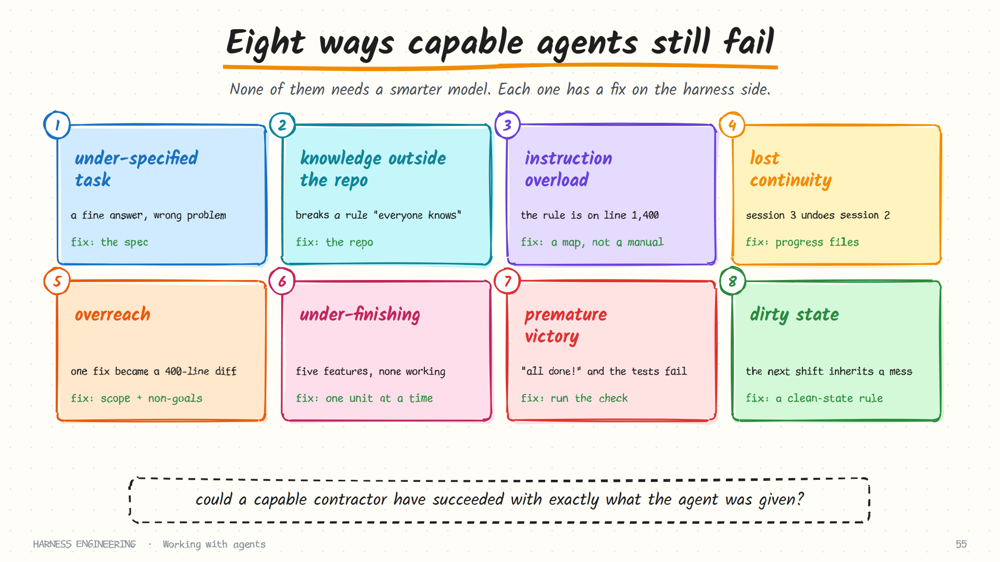

# Why capable agents still fail

A strong model in a good harness can still produce bad outcomes. When that happens, the instinct is to blame the model and wait for the next release. Most of the time the cause is closer to home: the *work* was not set up in a way an agent could succeed at.

This page catalogues eight failure patterns that show up again and again, with the symptom to look for, a concrete example, and the harness-side fix. None requires a smarter model.



## The eight patterns at a glance

| # | Pattern | What you see | Root cause | Fix lives in |
|---|---------|--------------|------------|--------------|
| 1 | Under-specified task | A plausible solution to the wrong problem | The agent had to guess what "done" means | The task spec |
| 2 | Knowledge outside the repo | It breaks a convention "everyone knows" | The convention lives in heads and chat threads | [Repo as system of record](repo-as-system-of-record.md) |
| 3 | Instruction overload | It ignores a rule that is written down | The rule is line 1,400 of a giant file | [Memory](../guide/05-memory-and-skills.md) |
| 4 | Lost continuity | Session 3 redoes or undoes session 2 | Nothing durable carried state across | [Long-running work](long-running-work.md) |
| 5 | Overreach | Asked for one fix, it refactored the module | No stated scope, no boundary | Task spec; [guardrails](../guide/03-guardrails.md) |
| 6 | Under-finishing | Half of five features, none working | It tried everything at once | One unit of work at a time |
| 7 | Premature victory | "All done!" and the tests fail | "Done" was an opinion, not a check | [Evaluation](../guide/09-evaluation.md) |
| 8 | Dirty state | The next session starts in a broken tree | Sessions end wherever they happen to stop | Clean-state rule |

## 1. The under-specified task

> "Add search to the app."

Search over what? Full-text or prefix? Is there a results page? What about empty queries? A person would ask. An agent, especially an unattended one, picks the most likely reading and builds it competently.

**What it looks like in a transcript:** no confusion at all. The agent proceeds confidently. That is the tell: a hard problem should produce some investigation, and an ambiguous one produces none, because the agent resolved the ambiguity silently on turn one.

**Fix: write the spec a contractor would need.**

```markdown
## Goal
Users can search products by name from the header.

## Behaviour
- Case-insensitive substring match on `product.name`.
- Results page at `/search?q=`, 20 per page, newest first.
- Empty query redirects to `/products`.

## Out of scope
- Fuzzy matching, search over descriptions, autocomplete.

## Done when
- `pytest tests/test_search.py` passes (write these tests first).
- `/search?q=lamp` shows only products whose name contains "lamp".
```

| Section | The question it answers | Most often missing? |
|---------|-------------------------|---------------------|
| Goal | What outcome, for whom? | Rarely |
| Behaviour | What exactly should happen, including the edge cases? | Often |
| Out of scope | What should it *not* do? | **Almost always** |
| Done when | How will anyone know? | Often |

Five minutes of writing replaces an hour of rework. A useful trick when you are unsure what is missing: ask the agent, in a read-only mode, to list the questions it would need answered before starting. Its questions are your missing spec.

## 2. Knowledge that lives outside the repository

"We never call the billing service directly; go through the gateway." Every engineer on the team knows it. It was decided in a meeting. It is written nowhere the agent can read.

An agent's world is its context window, and the only durable way into that window is the repository. If a rule is not in the repo, then for the agent it does not exist.

**What it looks like:** correct, clean code that a reviewer rejects in ten seconds for a reason the agent had no way to know.

**Fix:** treat the repository as the single source of truth. Every time a reviewer rejects agent work for an unwritten rule, the fix is two things: correct the code, *and write the rule down* where the next run will find it. The [next page](repo-as-system-of-record.md) covers how.

## 3. Instruction overload

The opposite failure. The team writes everything down, in one file, and keeps adding. The file passes a thousand lines. Now the agent pays to read all of it on every turn, important rules compete with trivia, and nobody can tell what is stale.

A rule that is technically "in the context" can still be functionally invisible.

**What it looks like:** the agent follows the rules near the top of the file and misses one in the middle; rules contradict each other because they were added a year apart; someone adds the same rule a second time in capitals.

**Fix:** a short entry file that works as a map, with detail in separate documents loaded on demand. Rules that must *always* hold move out of prose and into checks. See [memory and skills](../guide/05-memory-and-skills.md).

## 4. Lost continuity

Real work outlasts a context window. Each new session starts with no memory of the last. Without help, the agent spends the first twenty minutes rediscovering the project, then makes decisions that contradict yesterday's.

**What it looks like:** a second session that re-implements something that exists under a different name; a third that "fixes" a deliberate decision; a compaction after which the agent repeats work it finished an hour ago.

**Fix:** durable state in files that every session reads first and updates last: a progress log, a feature list, and git history. See [long-running work](long-running-work.md).

## 5. Overreach

Asked to fix a typo in an error message, the agent notices the function is messy and rewrites it, updates three callers, and "modernises" the imports. The diff is 400 lines. The reviewer cannot tell which change mattered.

This is not malice or stupidity. A model trained to be helpful treats visible problems as invitations.

**What it looks like:** a diff much larger than the task; files touched that the task never mentioned; a commit message with "also" in it.

**Fix:**

- State the scope and the non-goals explicitly.
- Add a standing rule: *make the smallest change that satisfies the task; report other problems instead of fixing them.*
- Give it somewhere to put what it noticed. An agent told "note unrelated issues in `NOTES.md`" stops fixing them, because the helpful impulse has an outlet.
- Enforce where you can: a read-only mode for investigation, path-scoped write permissions, a diff-size check in review.

## 6. Under-finishing

The mirror image, and it often appears together with overreach. Given a large goal, the agent starts on everything. It runs out of context or turns with five features half-built and nothing that runs.

**What it looks like:** many files created, few tests passing; scaffolding for features that were never filled in; a final message that lists what "remains to be done" at length.

**Fix: one unit of work at a time.** Pick a single feature, finish it, verify it, commit it, then pick the next. This is so effective that Anthropic's write-up on long-running agents makes it a core rule of their harness. A feature list ([long-running work](long-running-work.md)) turns the rule into a mechanism.

## 7. Premature victory

The agent writes the code, feels finished, and says so. It may even say "all tests pass" without having run them, or after running them and misreading the output.

Agents are prone to grading their own work generously. The harness must not take their word.

**What it looks like:** a confident summary with no test command in the last ten turns; a claim that contradicts the last tool result; "should work" in the final message.

**Fix:**

- Put the verification command in the project instructions and require it before any "done" claim.
- Verify **end to end**, the way a user would: start the app, hit the endpoint, drive the browser. Unit tests passing is not the feature working.
- Have the harness run the check, through a hook or an orchestrator, instead of asking whether it passed.
- Track completion as data that only a real test run may change.

| The agent says | What you actually know |
|----------------|------------------------|
| "I've implemented the feature." | Code was written |
| "The tests should pass now." | Nothing; they were not run |
| "All tests pass." | Only what the last test command's output shows |
| *(the check command exits 0)* | The check passed |

Only the last row is evidence.

## 8. Dirty state

The session ends mid-refactor: half the callers updated, tests red, a debug print left in. The next session, with no memory, inherits a mess it does not understand and has to guess what was intended.

**What it looks like:** the next session spends its first turns "fixing" failures that are really unfinished work; stray files nobody recognises; a server still holding a port.

**Fix: every session ends in a state someone else could pick up.**

```markdown
Before you stop:
- [ ] The build passes and the test suite is green (or failures are listed in PROGRESS.md)
- [ ] No half-applied changes; either finish the unit or revert it
- [ ] Work is committed with a message that says what and why
- [ ] PROGRESS.md says what was done, what is next, and anything surprising
- [ ] Temporary files, debug output and stray servers are cleaned up
```

Think of it as leaving the workshop tidy for the next shift, when the next shift has amnesia.

## The patterns interact

They rarely arrive alone. A typical bad run:

```text
vague task (1)  →  the agent guesses big  →  overreach (5)
                →  too much started        →  under-finishing (6)
                →  runs out of budget      →  dirty state (8)
                →  "mostly done!"          →  premature victory (7)
next session    →  no notes                →  lost continuity (4)
```

That chain is why fixing the *first* link, the spec, pays off out of proportion to its cost.

## A diagnostic habit

When a run goes wrong, ask these in order before blaming the model:

1. **Could a capable human contractor, given exactly what the agent was given, have succeeded?** If not, the spec or the repository is the problem.
2. **Was the needed information in the window at the moment of the mistake?** If not, it is a context or memory problem.
3. **Was there a check that would have caught it?** If not, it is a verification problem.
4. **Did the mistake cause damage, or just a bad diff?** If damage, it is a guardrail problem.

Only when all four come back clean is "the model was not good enough" a reasonable conclusion.

## Sources and further reading

- Anthropic, [Effective harnesses for long-running agents](https://www.anthropic.com/engineering/effective-harnesses-for-long-running-agents)
- OpenAI, [Harness engineering](https://openai.com/index/harness-engineering/)
- [Learn Harness Engineering](https://github.com/walkinglabs/learn-harness-engineering), whose lecture series explores many of these patterns in depth
