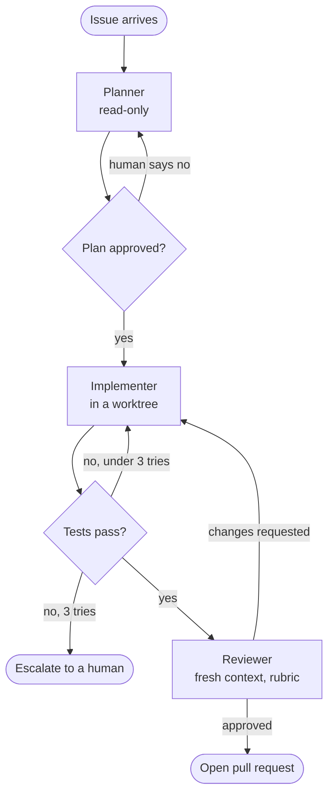

# Loops and graphs

Most people meet agents as a conversation: you type, it works, you correct it, it works some more. You are the outer loop. This page is about taking yourself out of that position without losing control.

There are three levels, and you should climb them one at a time.

| Level | Who drives | Structure | You are… |
|-------|-----------|-----------|----------|
| **1. Supervised** | You, turn by turn | One agent, one session | In the loop |
| **2. Loop** | A script, repeating one agent | Maker, checker, state file | On the loop |
| **3. Graph** | A script, routing between several agents | Nodes and edges | Designing the loop |

## Level 1: supervised

One agent, one human, one session. Everything in the [guide](../guide/00-what-is-a-harness.md) applies, and for a great deal of work this is the right level. Do not leave it until you can describe, precisely, what you keep typing.

**The signal to move up:** you notice your own contribution has become mechanical. "Run the tests." "Fix that." "Now the next one." If you could write your side of the conversation in advance, a script can say it.

## Level 2: loop engineering

A loop is an agent run inside a `while`, with a check deciding whether to go around again.


It has five parts. Leave any one out and the loop misbehaves in a predictable way.

### 1. A goal that can be checked

```markdown
# Goal
All functions in `src/billing/` have type hints and `mypy --strict src/billing` reports zero errors.

# Not in scope
Changing behaviour. Renaming public functions. Files outside `src/billing/`.
```

"Improve the code" cannot terminate. "Zero mypy errors in this directory" can.

*Missing it:* the loop runs until the budget is gone, producing changes nobody asked for.

### 2. A state file

Each iteration is a fresh agent with an empty context. The state file is what it reads first and updates last:

```markdown
# Loop state
Iteration: 4 of 15
Remaining: 23 mypy errors (was 61)

## Done
- invoices.py, tax.py: fully typed

## In progress
- ledger.py: the `Entry` union is tricky; see note below

## Notes for the next iteration
- `Decimal | None` is the right type for `discount`; do not default it to 0
- Checker feedback from iteration 3: do not add `# type: ignore`; fix the type
```

*Missing it:* every iteration starts from zero and repeats the same mistakes.

### 3. A maker

The agent that does the work. Its prompt is the same every iteration:

```text
Read GOAL.md and LOOP_STATE.md. Do the next small piece of work toward the goal.
Stay in scope. Update LOOP_STATE.md with what you did and what you learned. Then stop.
```

Small pieces matter. An iteration that tries to finish everything behaves like the [under-finishing](failure-modes.md) failure.

### 4. A checker

Something independent decides whether the goal is met. In order of preference:

1. **A command.** `mypy --strict` exits 0 or it does not. Unarguable, free, instant.
2. **A second agent with a rubric**, for things no command can judge. It gets the artifact and the criteria, not the maker's reasoning, and must give specific, actionable feedback.
3. **A human**, sampled, for the highest-stakes judgments.

*Missing it:* the maker declares success on iteration one. A maker reviewing itself is the [premature victory](failure-modes.md) failure with extra steps.

### 5. Stop conditions

```python
for i in range(MAX_ITERATIONS):                 # hard cap
    run_agent(MAKER_PROMPT)
    ok, feedback = check()
    if ok:
        break                                   # goal met
    if spent() > BUDGET:
        break                                   # out of money
    if no_progress_for(3):
        break                                   # stuck: same errors three times running
    append_to_state(feedback)
```

Four exits: success, iteration cap, budget cap, and *no progress*. The last one is the one people forget. A loop that makes the same failed attempt fifteen times is burning money to tell you something it could have said on the third.

*Missing it:* an expensive overnight surprise.

### What loops are good at

- **Mechanical, checkable transformations.** Migrating a codebase, raising coverage, fixing a lint class.
- **Work with a natural queue.** Process the next ticket, the next file, the next failing test.
- **Iterating toward a measurable target.** A benchmark number, a bundle size.

They are poor at work where "better" cannot be measured. There, keep a human on the checker's seat.

## Level 3: graph engineering

When one loop is not enough, several agents with different jobs are connected by code.



### The rules that keep a graph maintainable

**Nodes are agent runs. Edges are code.** A node has a narrow job, its own prompt, its own tools and a fresh context. An edge is an `if` on something mechanical: an exit code, a test result, a field in a JSON file. If you find a model deciding where control goes next, ask whether a test could decide instead.

**Every node has a contract.**

| Field | Example |
|-------|---------|
| Input | `plan.md`, the issue text |
| Output | A branch with commits; `result.json` with `{ "status": "...", "summary": "..." }` |
| Tools | Read, edit, shell. No network |
| Done when | `make check` exits 0 |
| On failure | Write what blocked you to `result.json` and exit non-zero |

**State lives in files.** What passes between nodes is a plan document, a diff, a results file. Never one agent's memory of a conversation. That makes every hand-off inspectable and every node re-runnable.

**Every cycle has a cap.** Each backward edge needs a counter and an escape route to a human. An uncapped cycle between an implementer and a reviewer can run for hours.

**Different context is the point.** A reviewer is useful because it has *not* seen the implementer's reasoning. Giving every node the full history defeats the purpose and multiplies the cost.

### Common graph shapes

| Shape | When to use it |
|-------|----------------|
| **Pipeline** (plan → build → test → review) | Stages are distinct and ordered |
| **Fan-out and gather** | Many independent items; see [orchestration](../guide/08-orchestration.md) |
| **Maker-checker cycle** | Quality needs iteration against a rubric |
| **Router** (classify, then send to a specialist) | Inputs fall into a few clearly different kinds |
| **Escalation ladder** (cheap model first, stronger on failure) | Most cases are easy and cost matters |

## Before you add a node

Graphs are seductive. A diagram with eight boxes looks like progress. Each box, though, adds cost, latency, a hand-off where detail is lost, and a new place for things to go wrong. Before adding one, answer:

1. **What specific failure does this node prevent?** Name a real run where it happened.
2. **Could a command do it instead of an agent?** A linter is cheaper than a reviewer.
3. **Could the existing node do it with a better prompt or tool?**
4. **How will I know if this node is helping?** If you cannot measure it with the methods in [evaluation](../guide/09-evaluation.md), you cannot justify it.

A reasonable path for most teams: one good supervised agent; then a maker loop with a mechanical checker; then a reviewer; and only then anything more elaborate.

## Sources and further reading

- Anthropic, [Building effective agents](https://www.anthropic.com/engineering/building-effective-agents): workflows versus agents, and the common composition patterns
- Anthropic, [Effective harnesses for long-running agents](https://www.anthropic.com/engineering/effective-harnesses-for-long-running-agents)
- [Learn Harness Engineering](https://github.com/walkinglabs/learn-harness-engineering): its lectures on loop engineering and graph engineering cover these topics at length, with templates
