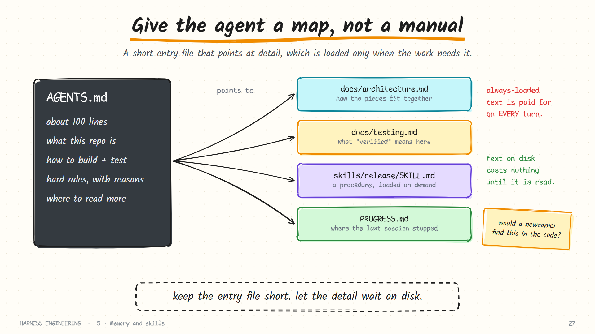
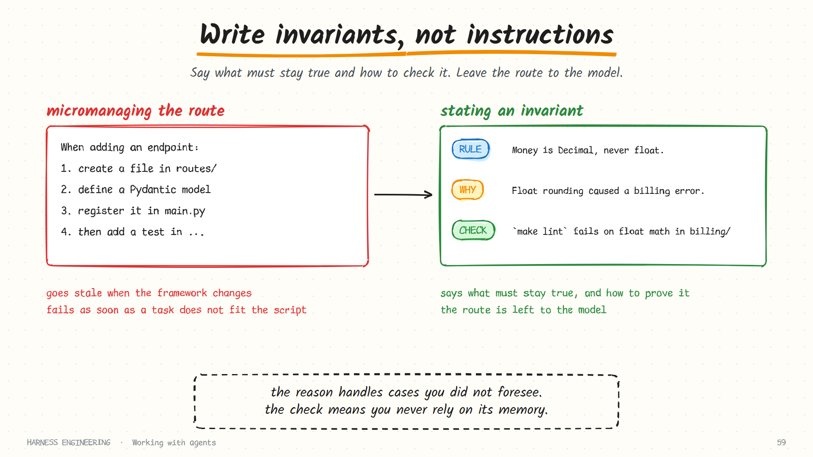

# The repo as system of record

> If the agent cannot read it in the repository, it does not exist.

An agent starts every session knowing nothing about your project. The only reliable way to change that is to put the knowledge where it will be found: in versioned files, next to the code.

This page describes how to organise a repository so that an agent (and a new human teammate) can become productive from the files alone.

## Why the repository, and not somewhere else

| Knowledge lives in… | Can the agent read it? | Versioned with the code? | Goes stale silently? |
|---------------------|------------------------|--------------------------|----------------------|
| People's heads | No | No | Yes |
| Chat threads | No | No | Yes |
| A wiki | Only with a connector | No | Yes |
| A long system prompt | Yes, at a cost every turn | Rarely | Yes |
| **Files in the repo** | **Yes** | **Yes** | **Less: it changes in the same commit as the code** |

The last row has one more advantage: it is checkable. A script can verify that links resolve, that documented commands still run, and that every module has an owner.

## The entry file is a map

Almost every harness loads one Markdown file from the repository root at startup: `AGENTS.md` (the cross-tool convention) or a tool-specific equivalent.

The mistake is to treat that file as the manual. It becomes long, it costs tokens on every turn, and nobody can keep it current. Treat it as a **table of contents** instead.



A good entry file has five short sections:

| Section | Contains | Why it earns its place |
|---------|----------|------------------------|
| **What this is** | One paragraph: purpose, stack, entry points | Orientation in ten seconds |
| **How to run and verify** | The exact commands | The single most valuable section |
| **Hard rules** | A handful of invariants, each with a reason | What must never break |
| **Where things are** | A sketch of the directory layout | Saves a dozen exploratory tool calls |
| **Where to read more** | Pointers to deeper documents, with *when* each is relevant | The map itself |

Aim for about a hundred lines. When it grows past that, move detail into `docs/` and leave a pointer. A starter is in [`templates/AGENTS.md`](https://github.com/AkbarSheikh-debug/harness-engineering/blob/main/templates/AGENTS.md).

### Pointers need a "when"

A bare list of links is not much of a map. Compare:

```markdown
## Docs                              ## Read more, when relevant
- docs/architecture.md               - Changing how services talk to each other → docs/architecture.md
- docs/testing.md                    - Writing or fixing a test → docs/testing.md
- docs/payments.md                   - Touching anything under billing/ → docs/payments.md (read it first)
```

The right-hand version tells the agent *which situation* each document is for, so it opens the right one at the right moment and none of the others.

## A layout that works

```text
AGENTS.md                 the map (about 100 lines)
ARCHITECTURE.md           how the system fits together, and why
docs/
  testing.md              what "verified" means here; how to run each kind of test
  conventions.md          naming, error handling, logging
  decisions/              short records of significant choices and their reasons
  plans/
    active/               work in progress, one file per effort
    completed/            finished plans, kept for context
skills/                   procedures loaded on demand
PROGRESS.md               where the last session stopped
feature_list.json         what is done and what is not, verified by tests
```

You do not need all of it on day one. Start with `AGENTS.md` and `docs/testing.md`, and add a file the first time an agent gets something wrong for lack of it.

| File | Add it when… |
|------|--------------|
| `docs/testing.md` | An agent says "done" without running the right thing |
| `ARCHITECTURE.md` | An agent puts code in the wrong layer |
| `docs/decisions/` | An agent "fixes" a deliberate choice |
| `docs/plans/active/` | Work spans more than one session |
| A skill | You explain the same procedure a second time |

### Decision records

One of the highest-value small habits. When you make a choice that an outsider would question, write five lines:

```markdown
# 0007: Stay on payments SDK v3

Date: 2026-01-09
Decision: Do not upgrade to v4.
Why: v4 changes the webhook signature scheme; our verifier and three partners depend on v3.
Revisit when: all partners have migrated (tracked in issue 412).
```

Without it, a helpful agent will upgrade the dependency, because upgrading dependencies looks like an improvement. With it, a pointer in `AGENTS.md` ("before changing a dependency, check `docs/decisions/`") prevents the incident.

## Write invariants, not instructions

There are two ways to tell an agent how to work.



**Micromanaging the implementation:**

> When adding an endpoint, first create a file in `routes/`, then define a Pydantic model, then register the router in `main.py`, then…

**Stating an invariant:**

> Every HTTP endpoint validates its input with a schema and has at least one test in `tests/api/`. `make check` enforces both.

The first is brittle: it goes stale when the framework changes, and it fails the moment a task does not fit the script. The second says what must remain true and how to check it, and leaves the route to the model. OpenAI's Codex team described this shift as focusing on invariants rather than micromanaging implementation.

A useful format for each rule:

```markdown
- **Rule.** Money is always `Decimal`, never `float`.
  **Why.** Float rounding produced a billing discrepancy in March.
  **Check.** `make lint` fails on float arithmetic in `billing/`.
```

| Part | What it buys you |
|------|------------------|
| **Rule** | The thing that must stay true |
| **Why** | Lets the model handle a case you did not foresee, because it knows what is being protected |
| **Check** | You no longer depend on the model remembering |

A rule with no check is a hope. A check with no stated rule is a mystery failure. You want both.

## Make verification a first-class citizen

The single highest-value thing you can write down is how to tell whether work is correct.

```markdown
## Verify
- Fast check (run after every change):   `make check`      # lint + types + unit tests, ~20s
- Full check (run before saying done):   `make test-all`   # adds integration tests, ~3 min
- Run the app locally:                   `make dev`        # http://localhost:8000
- A change is not done until `make test-all` passes.
```

With this in place, "done" stops being a feeling. Every agent and every human runs the same command. Go further where you can:

**Speed matters.** A check that takes twenty seconds gets run after every edit; one that takes twenty minutes gets run once, at the end, when the mistakes have compounded. Invest in a fast tier.

**Error messages are instructions.** A lint that says `layer violation` teaches nothing. One that says `ui/ may not import from db/; move this query into services/orders.py` tells the agent exactly what to do. Since you write custom lints, you can write the remediation into the message.

**Architectural rules as lints.** "The UI layer may not import from the database layer" is a rule a script can enforce and an agent can read the error from. Taste, once encoded, applies to every line an agent ever writes.

**Feedback the agent can query.** Logs, metrics and traces from a locally running instance let it check behaviour, not just compilation. An agent that can start the app, call the endpoint and read the log is working from evidence.

**Turn review comments into rules.** When a reviewer corrects the same thing twice, encode it as a lint or a line in the docs. The correction then applies to every future run.

```text
reviewer corrects it once     →  fix the code
reviewer corrects it twice    →  write it in docs/conventions.md
reviewer corrects it a third  →  make it a lint that fails the build
```

## Keep it honest

Documentation an agent trusts and that is wrong is worse than none. Some maintenance habits:

- **Change docs in the same commit as code.** Add it to the definition of done.
- **Lint the docs.** Check for dead links, commands that no longer exist, and files nobody owns.
- **Prefer pointing to restating.** "See the schema in `db/models.py`" cannot drift; a copied table can.
- **Generate what can be generated.** A database schema document produced by a script is always current.
- **Garbage-collect.** Periodically have an agent audit the docs against the code and open a small pull request with corrections.
- **Delete boldly.** A short accurate file beats a long doubtful one.

## A test for your repository

Hand the repo to a capable engineer who has never seen it, with no access to you or your chat history. Could they:

1. Understand what it does within five minutes?
2. Build it and run the tests from the instructions alone?
3. Tell which rules are hard constraints and why?
4. Find where a given feature lives?
5. Know when their change is finished?

Every "no" is a gap an agent will fall into. You can run this test cheaply: start a fresh agent session in a read-only mode and ask it those five questions. Where it guesses or gets it wrong, your documentation has a hole.

## Sources and further reading

- OpenAI, [Harness engineering](https://openai.com/index/harness-engineering/): the account of replacing a large instruction file with a short directory page and structured docs
- [AGENTS.md](https://agents.md): the open convention
- Claude Code, [How Claude remembers your project](https://code.claude.com/docs/en/memory)
- [Learn Harness Engineering](https://github.com/walkinglabs/learn-harness-engineering): includes a sample repository template along these lines
